# Color Block Jam Clone by Furkan Tokkan


Color Block Jam Clone is a portrait mobile puzzle game built in Unity around three goals:

- a responsive drag-and-exit block puzzle with boosters, Ice blocks and Arrow blocks
- a Level Editor that a designer can use without writing code: a 2D canvas, a live 3D preview and a solvability check that plays its solutions back
- a runtime that stays readable and fast: Unity-free rules, dependency injection, one gameplay tick, pooled visuals and no per-frame allocation

---

## Watch Full Demo

<p align="center">
  <a href="https://youtu.be/XG8T7TcIz2s">
    
  </a>
</p>

Gameplay and Level Editor walkthrough: [YouTube](https://youtu.be/XG8T7TcIz2s) ·
Android build: [latest release](https://github.com/furkantokkan/Color-Block-Jam-Clone/releases/latest)

---

## In Game View

| Clearing a level | Rocket, Vacuum and Hammer | Time Freeze | Menus and pre-level boosters |
| :---: | :---: | :---: | :---: |
| 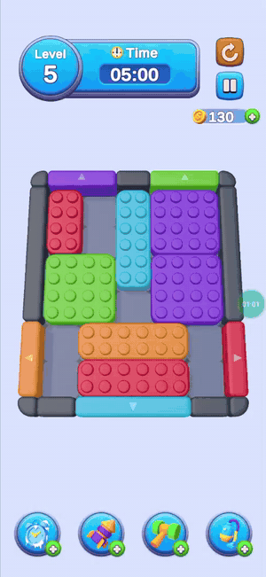 | 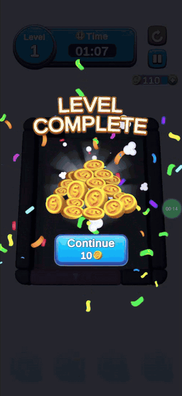 | 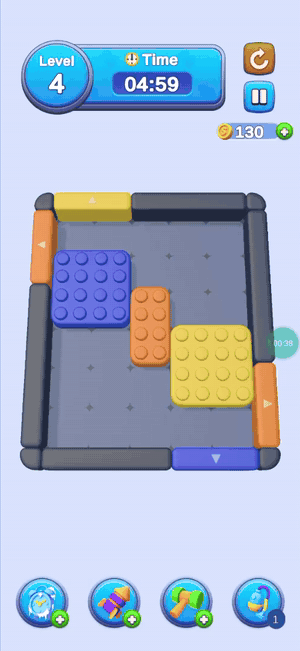 | 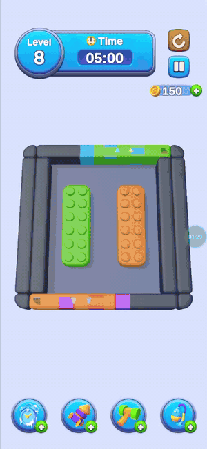 |

Recorded on a Samsung Galaxy A16.

---

## Project Summary

The player drags colored blocks across a grid and pushes each one through a gate of the same color before
the timer runs out. Blocks move on whole cells behind a validated preview, slide along walls, and leave the board
the moment they touch a gate that fits their width. Boosters remove a single cell, a whole block or a whole
color, or stop the clock. Ice blocks stay frozen until enough other blocks have left, and Arrow blocks move on
one axis only.

Around that loop sits the full mobile shell: a loading screen, Home with a level route and tab bar, Settings,
a pre-level booster selection, a HUD with pause and retry, win and fail popups, coins, lives with a timed
refill, and an encrypted local save. Every level comes from the custom Level Editor and is stored as JSON level
packs that the game loads through Addressables.

### Highlights

- **6 handcrafted levels that loop endlessly.** Level 7 replays Level 1 with a new number, so progress never dead-ends.
- **One booster system, six placements.** Time Freeze, Rocket, Hammer and Vacuum in game; Extra Time and a
  starting Rocket before a level. Boosters cost coins, keep their own stock and save before they apply.
- **Pluggable block effects.** Ice and Arrow are effect modules; a data-driven restriction matrix decides which
  booster may target which effect (Rocket cannot hit an Ice block).
- **Economy with transactional saves.** +10 coins per win, 10 coins per booster charge, 5 lives that refill one
  every 30 minutes. A failed save changes nothing, and nothing is charged twice.
- **Designer-first Level Editor.** Paint pieces, gates, holes and effects; watch the board rebuild in 3D;
  validate that the level can be solved and play the solutions back; test the level in the real game scene.
- **Measured on a device.** Profiled on a Galaxy A16: turning SSAO off alone took level 5 from 38 fps to a
  vsync-locked 60 fps, and the gameplay tick is built to allocate nothing per frame.
- **Tested.** About 2,100 EditMode and 250 PlayMode test cases across 26 assemblies.

---

## Level Editor

| Building a level | Painting holes with the Void brush |
| :---: | :---: |
| 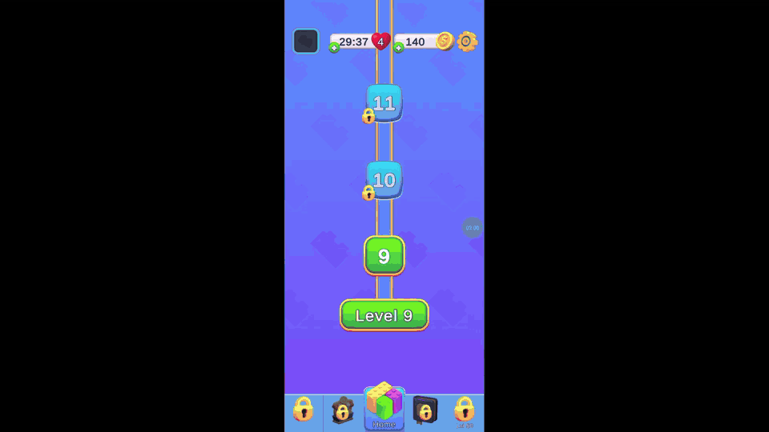 | 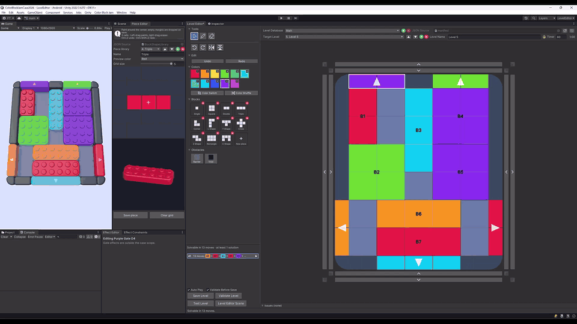 |

Open **Color Block Jam → Level Editor**. It loads a saved window layout with the Level, Piece and Effect
Editor windows next to a live 3D preview of the board.

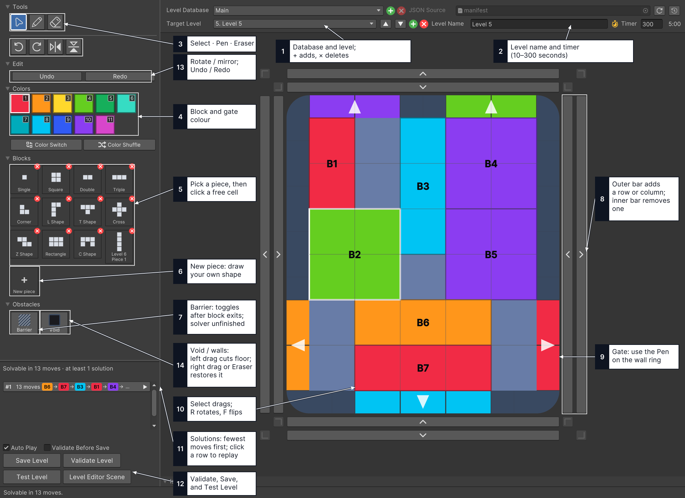

1. Select a **Level Database** and **Target Level**, or create one with **+**. The selected database is also the
   one the game plays.
2. Set the level name and timer; use the edge arrows to resize the board and the corner buttons to cut its
   corners.
3. Pick a color and a piece, then click the board to place it. **Pen** edits cells and paints gates on the wall
   ring, **Eraser** removes them, and rotate and mirror work on the selected piece.
4. Paint permanent holes and notches with **Void**. Select a block and use **Add Effect** for Arrow or Ice.
5. **Validate Level** checks that the level can be solved and lists the solutions; click one to play it back on
   the canvas and in the 3D preview.
6. **Save Level** writes the database. **Test Level** saves pending edits and plays the level in the real
   Game scene; **Stop Test** returns to the same level in the editor. Undo and Redo cover every edit.

### Solvability check

The validator runs a breadth-first search over whole board states on a worker thread, using the same Domain
`MoveRules` and `ExitRules` as the game, together with the Arrow and Ice rules. It answers **Solvable**,
**Cannot be solved** (and names the blocks that can never leave), **Not confirmed** (the search budget ran out)
or **Not checked** (an unsupported rule). With **Validate Before Save** on, Save Level asks before it writes an
unsolvable level. A found solution plays back frame by frame with Pause, Step and the arrow keys, and stopping
it restores the draft exactly.

<details>
<summary>Animation: how breadth-first search finds a path</summary>

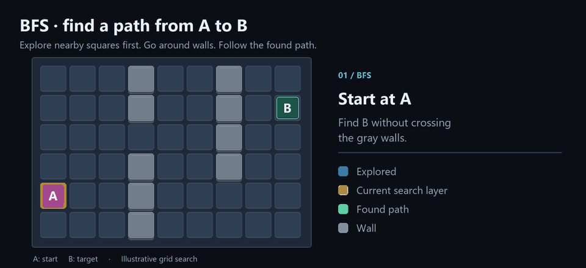

The validator does the same over whole board states and legal puzzle moves instead of grid cells.

</details>

### Piece Editor and effects

- **Piece Editor:** paint occupied cells on a grid of up to 5 × 5 and inspect the composed 3D piece. **Save piece**
  writes a library template; a piece drawn for one level stays in that level unless it is saved as a template.
  [Screenshot](docs/images/level-editor/piece-editor.png)
- **Effect Editor and Effect Constraints:** add Arrow or Ice to the selected block, and choose which effects may
  share a block. [Effect Editor](docs/images/level-editor/effect-editor.png) ·
  [Effect Constraints](docs/images/level-editor/effect-constraints.png)
- **Data:** a database is a folder under `Assets/ColorBlockJam/Data/Json/Levels/` with a `manifest.json` and
  `pack-NNN.json` files of up to 100 levels each. Saving rewrites only the packs that changed and keeps one
  backup of the whole database for **Restore**.

---

## Runtime Architecture

Authored levels, a running attempt and the player's saved data have separate owners. A restart replaces the
attempt and keeps purchases and progress; editing a level never touches a running attempt.

### Layers and assemblies

```text
Assets/ColorBlockJam/
├── Data/          # Authored content: level JSON, piece templates, booster and currency assets
├── UI/            # UXML layouts, USS styles and themes
├── Runtime/       # C# code, one assembly per area
│   ├── Domain/        # Board rules, commands and session rules (no Unity, no Onity)
│   ├── Core/          # Shared contracts, data types and app services
│   ├── Gameplay/      # Session, input, HUD, board presenter and effect modules
│   ├── Player/        # Economy rules and the encrypted save
│   ├── Hub/           # Home, tabs and menus
│   ├── UI/            # Popups shared by Hub and Game
│   ├── Presentation/  # Reusable board visuals and effects
│   └── Environment/   # Wall and gate layout rules and their visuals
├── Editor/        # Level, Piece and Effect editors, the solver and the scene preview
└── Tests/         # EditMode and PlayMode tests by area
```

`Domain` has **no Unity or Onity dependencies**, so movement, exits, boosters and the session state machine run
in plain C# tests. Views forward input and display state; rules and services own every change. Separate
`.asmdef` assemblies make the dependency direction explicit and keep Editor and test code out of the player.

### Dependency injection and reactive state with Onity

The project uses [Onity](https://github.com/furkantokkan/Onity), my own DI, reactive and event framework.
Project and scene installers bind services with explicit lifetimes, presenters receive interfaces in their
constructors, and services expose state as reactive properties:

```csharp
// PlayerDataInstaller: one app-owned save service behind several small ports.
container.BindInterfacesAndSelfTo<PlayerSaveService>().AsSingle();

// HomePresenter: the coin label follows committed balance changes, with no polling.
m_subscriptions.Add(m_wallet.GetBalance(definition).Subscribe(binding.OnBalanceChanged));
```

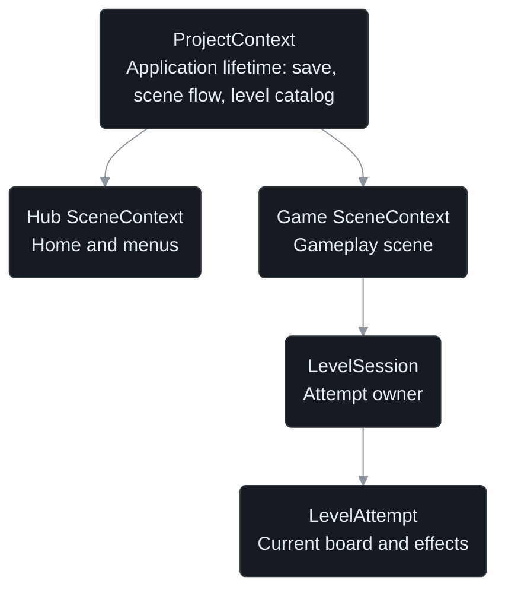

**Nothing runs unattended.** Every subscription, timer, tween and async operation has one owner and a stop
point. Leaving `Playing` either suspends the attempt (input off, clocks and tweens paused) or tears it down
(tokens cancelled, subscriptions disposed, pooled visuals returned). Generation checks stop a late save or a
late animation from touching a newer attempt.

### Commands, replay and editor parity

Input never changes the board directly. Dragging updates a validated preview; releasing submits a command:

```csharp
GameCommand move = GameCommand.Move(blockId, from, to);
GameCommand exit = GameCommand.MoveAndExit(blockId, from, flushOrigin, Side.Right);
CommandOutcome outcome = simulation.Commands.Execute(move);
```

The executor routes each command to its handler, which checks the whole move before it changes anything, and
logs only applied commands. Board boosters are commands too (`RemoveCell`, `RemoveBlock`, `RemoveColor`). The same
rules power three consumers: live play, a replay source that feeds recorded commands back through the executor,
and the Level Editor's solver. A parity test keeps the solver and the game in agreement.

### One gameplay tick

Gameplay systems have no `Update` methods. One
[tick owner](Assets/ColorBlockJam/Runtime/Gameplay/Session/GameplayTickOwner.cs) advances them in a fixed
order, and only while the session is `Playing`:

```text
if state != Playing: return
apply pending commands and boosters
read input, run queued commands
if the board is clear: enter Won
advance the countdown; if it expired: enter Failed
sync board and HUD
```

A [state machine](Assets/ColorBlockJam/Runtime/Domain/Session/SessionStateMachine.cs) owns `Home`, `Playing`,
`Paused`, `Won` and `Failed`; the first terminal state wins, so an exit in the frame the timer hits zero
still counts as a win.

### Data ownership and Addressable level packs

JSON holds level order, layouts and piece templates; ScriptableObjects hold Inspector configuration such as
prices, palettes and prefab bindings; each attempt copies validated level data into plain C# state; the
player save is a separate snapshot. Level databases are a manifest plus 100-level packs. The game reads the
manifest at startup and loads only the pack it needs, so the format scales to thousands of levels and leaves
room for remote level updates without a store release.

### Transactional, encrypted saves

[PlayerSaveService](Assets/ColorBlockJam/Runtime/Player/PlayerSaveService.cs) is the only writer. It writes one
complete snapshot at a time to a temporary file and atomically replaces the old one, keeping a backup.
Using a booster pauses the game while its stock debit saves; success applies the effect to the still-current
attempt, failure keeps the stock and applies nothing. Files use **AES-256-CBC** with an **HMAC-SHA256** check
before decryption. Life refills compare saved UTC timestamps instead of running a timer.

<details>
<summary>Animation: the save flow</summary>

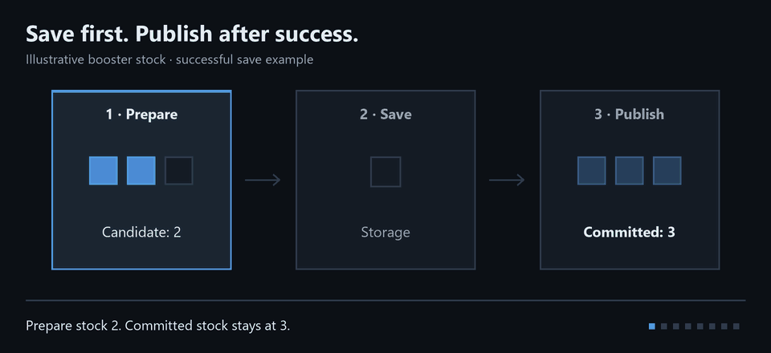

</details>

### Boosters and block-effect modules

Block effects implement `IBlockEffectModule`: read typed level data, add rule hooks to the attempt and create
an optional view. Arrow, for example, adds a movement constraint and an exit gate, so it needs no special case
in input or in the board presenter:

```csharp
public IBlockEffectState AddHooks(IBlockEffectLevel level, AttemptHooksBuilder hooks)
{
    ArrowEffectLevel arrow = level as ArrowEffectLevel
        ?? throw new ArgumentException("Arrow needs its own typed level metadata.", nameof(level));
    if (!arrow.HasArrow)
    {
        return new ArrowEffectState(null);
    }
    AxisMask[] axes = arrow.CreateAxisMasks();
    hooks.Add(new ArrowAxisConstraint(axes));
    hooks.Add(new ArrowExitGate(axes));
    return new ArrowEffectState(new ArrowEffectPresence(axes));
}
```

Booster definitions are assets with price, stock, targeting and presentation. A new booster adds an ID, a
definition, its command routing and its visuals; purchasing and save-before-use are shared.

### Board construction

- **Modular blocks.** A [composer](Assets/ColorBlockJam/Runtime/Core/Board/BlockPieceComposer.cs) builds every
  block from four modular meshes (center, edge, inner and outer corner), so any footprint and every Rocket
  fragment needs no dedicated prefab.
- **Rule-based environment.** A RuleTile-style matcher picks wall and corner pieces on a half-cell grid from the
  board's shape. Rules have Floor/Void/Any neighbor patterns and optional rotation, edited in a custom Inspector.
  The editor canvas, the 3D preview and the game all use the same rules, so holes and notches never need
  hand-placed walls.

### UI Toolkit, scene flow and preloading

Every screen is UI Toolkit: UXML/USS templates that open in UI Builder at the 1080 × 1920 reference
resolution, thin views, and presenters that bind to reactive state. A catalog asset decides which Home tabs are
available, locked or level gated. One persistent Input System EventSystem lives in the project scope, so
additive scene changes never lose touch input. Home and the win popup build the next level in a hidden Game
scene, so Play and Continue swap scenes in one frame; other transitions use a short black fade.

<details>
<summary>Screenshot: the Game scene prepared while Home is visible</summary>

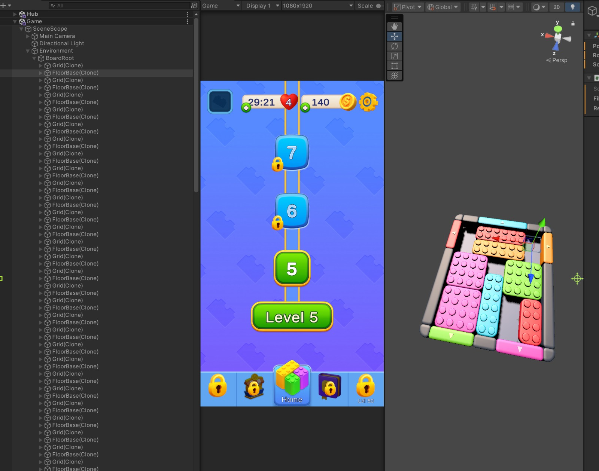

</details>

---

## Optimization Techniques

- **Pooling.** Block roots, block mesh pieces, environment pieces, arrow markers, booster casts and exit
  fragments come from Onity pools warmed during level preparation; nothing is instantiated during routine play.
- **One gameplay tick, no per-frame garbage.** The `Playing` path is written to allocate nothing in steady
  state: plain loops instead of LINQ, [ZString](https://github.com/Cysharp/ZString) and prebuilt strings for HUD
  text, and labels that update only when the shown value changes.
- **One shared material.** Blocks, walls, gates, arrows and the Hammer and Rocket models share one material and
  a 128 × 32 palette atlas; cached `MaterialPropertyBlock`s select colors and gate clipping without material
  instances.
- **Sprite atlases.** UI sprites are packed per screen group with ASTC 6×6 on mobile; large backgrounds stay out
  of the atlases.
- **Lighter meshes.** Blender-authored LODs cut the Hammer from 1,900 to 940 triangles and the Rocket from
  2,972 to 1,228; the Vacuum's hose animation is baked into a 32-frame sprite sheet instead of a skinned mesh.
- **Device-driven settings.** SSAO was turned off after Galaxy A16 profiling showed it cost 9.4 ms of GPU time;
  the held-block outline blurs at half resolution; the game targets 60 fps.

<details>
<summary>Visual examples: shared material, Rocket LODs and the baked Vacuum animation</summary>

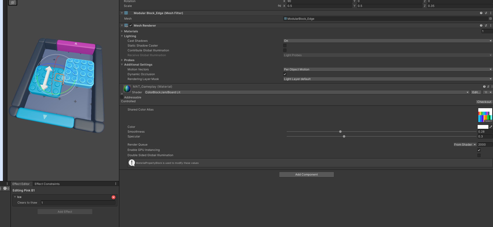

| LOD0: 2,972 triangles | LOD1: 1,228 triangles |
| :---: | :---: |
| 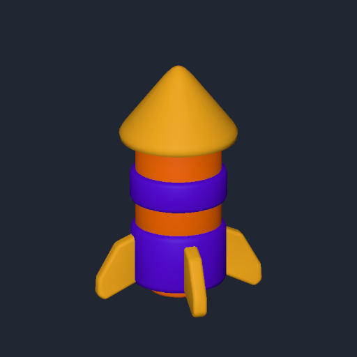 | 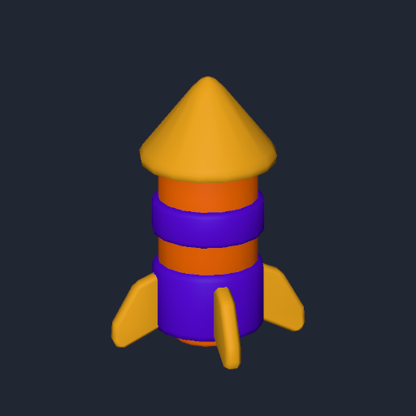 |

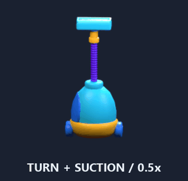

</details>

---

## Tools, Packages and Libraries

| Tool | Why it is here |
| --- | --- |
| **Unity 2022.3.62f2, URP 14** | Engine and render pipeline; Android IL2CPP ARM64 builds. |
| **[Onity](https://github.com/furkantokkan/Onity) 0.4.0** | My own framework for dependency injection, reactive properties, events, pooling and the single tick owner. One disposal model keeps the lifecycle rules enforceable. |
| **UI Toolkit** | Every runtime screen and every editor window; layouts stay in UXML/USS and are editable in UI Builder. |
| **Input System** | Touch input for gameplay and UI; the legacy Input Manager is off. |
| **Addressables** | Level manifests and packs load asynchronously and can be updated as content. |
| **PrimeTween** | Allocation-free tweens for gates, casts and UI, owned and stopped by their session or view. |
| **ZString, Newtonsoft Json.NET** | Allocation-light text formatting; typed JSON for levels and saves with no type-name handling. |
| **Highlight Plus 2, Epic Toon FX** | The held-block outline and the Level Complete confetti (Unity Asset Store). |
| **Blender** | Booster models and LODs, the baked Vacuum animation and the rounded wall and gate pieces. |
| **MCP for Unity** | Editor automation during development; stripped from player builds. |
| **Unity Version Control (Plastic SCM)** | Day-to-day version control; this GitHub repository is the portfolio mirror. |

Development was AI-assisted: Claude Code and OpenAI Codex agents worked under shared `AGENTS.md` / `PROJECT.md`
rules with task contracts and focused verification, and MCP for Unity gave them live Editor access.
`PROJECT.md` keeps the full decision log behind the architecture.

---

## Testing

Tests live under [Assets/ColorBlockJam/Tests](Assets/ColorBlockJam/Tests) and run from **Window → General →
Test Runner**. Constructor injection lets tests build presenters and services with small fakes, without loading
a scene or a DI container; reactive properties let a test change a balance and check the UI at once.

| Boundary | Representative coverage |
| --- | --- |
| Architecture | [One gameplay tick, domain dependencies and board mutation ownership](Assets/ColorBlockJam/Tests/Gameplay/EditMode/Gameplay/GameplayArchitectureTests.cs) |
| Presenters | [Fake dependencies, reactive UI updates and subscription cleanup](Assets/ColorBlockJam/Tests/Hub/EditMode/HomePresenterTests.cs) |
| Commands | [Replay through the same rules](Assets/ColorBlockJam/Tests/Gameplay/EditMode/Domain/ReplayTests.cs) |
| Editor and runtime | [Solver and command legality parity](Assets/ColorBlockJam/Tests/Validation/EditMode/LevelCommandParityTests.cs) |
| Persistence | [Save success and failure and committed player state](Assets/ColorBlockJam/Tests/Player/EditMode/PlayerSaveServiceTests.cs) |

Device work used an IL2CPP ARM64 build on a Samsung Galaxy A16 (Android 16): the Home-to-Game flow, touch
input, pause, haptics and frame-time profiling.

---

## Quick Start

1. Open the project with **Unity 2022.3.62f2** and Android Build Support. The first package restore needs Git
   and internet access (Onity, ZString and MCP for Unity come from Git URLs).
2. Choose **Color Block Jam → Play The Game**. It opens the `Init` scene and enters Play Mode; Init loads the
   shared services and the level catalog, then opens Home. Hub and Game also support direct Play.
3. Choose **Color Block Jam → Level Editor** to edit levels.
4. To install the game on a phone, download the APK from the
   [latest release](https://github.com/furkantokkan/Color-Block-Jam-Clone/releases/latest)
   (Android 5.1 or later, ARM64).

Editor Play Mode uses an in-memory save that resets each session; a player build saves to
`persistentDataPath/player/player-save.dat`.

---

## Known Limitations

- **Level validation** supports up to 16 blocks with a 15-second default budget and does not simulate boosters
  or the timer. "Not confirmed" means the budget ran out; it never claims a level is impossible.
- **Barrier** obstacles can be authored in the editor, but their runtime rule is switched off.
- **Placeholders:** the Shop, Collection, Leaderboard and Support tabs only give touch feedback, and level-gated
  tabs do not unlock automatically yet.
- **Platforms:** the iOS haptics bridge and build are untested on a device; all device testing was on Android.

---

## Credits

- Third-party assets keep their own licenses: Highlight Plus 2 (Kronnect) and Epic Toon FX (Archanor VFX) under
  the Unity Asset Store EULA, booster particle effects adapted from a Block Jam template (Watermelon Games), some
  Level Editor icons from [Flaticon](https://www.flaticon.com/), and LiberationSans under the SIL Open Font
  License 1.1. They are included for this private repository only.
- Code, editor tools, project-authored Blender models and documentation: Furkan Tokkan.
