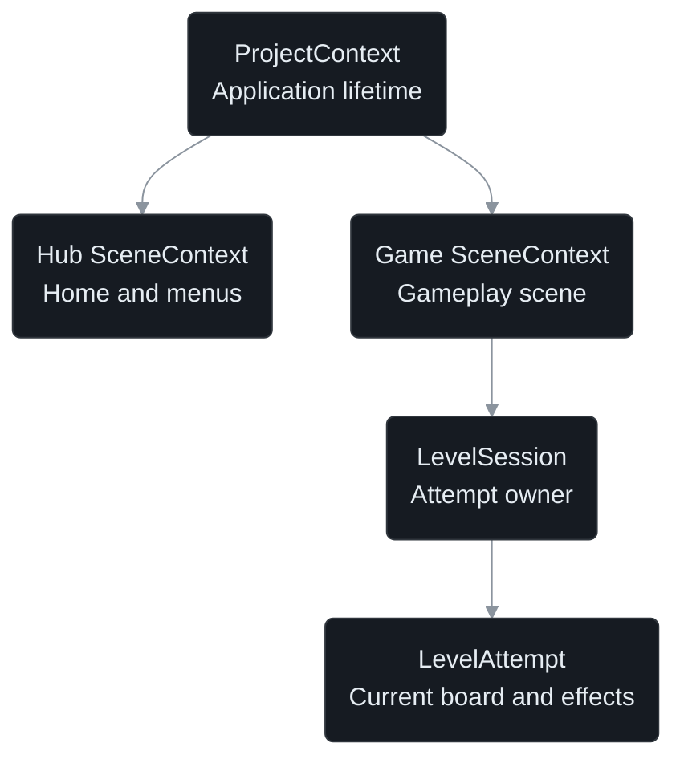
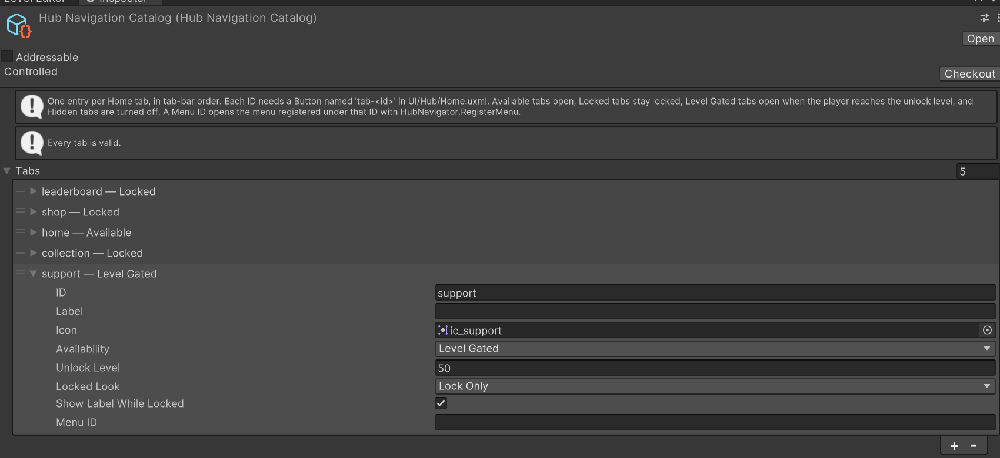

# Color Block Jam Case 2026

A Unity **2022.3.62f2** puzzle game for portrait mobile screens: Home, Settings,
the first five reference levels, a Level Editor, solvability checks, boosters,
Arrow blocks and Ice blocks. Target resolution: **1080 × 1920**.

[Run the project](#how-to-open-and-run-the-project) ·
[Architecture decisions](#architecture-decisions) ·
[Level Editor](#how-to-open-the-editor-and-make-a-level) ·
[Tests](#testing-and-verification)

## How to open and run the project

1. Open with Unity **2022.3.62f2** and Android Build Support. The first package
   restore needs Git and internet access.
2. Choose **Color Block Jam → Play The Game** from Unity's top menu.
   This opens Init and enters Play Mode; Init loads shared services and the
   level catalog, then opens Home.

You can also open `Assets/ColorBlockJam/Scenes/Init.unity` and press Play manually.
Hub and Game support direct Play for development.

Editor play uses an in-memory player save, reset on each Play session. A player
build saves to `persistentDataPath/player/player-save.dat`.

The submission consists of `Assets`, `Packages`, `ProjectSettings`, this README,
and the supplied APK or full-flow recording.

## Architecture decisions

Authored levels, a running attempt and saved player data have separate owners.
Restart replaces the attempt while keeping completed purchases and progress.

### 1. Layered architecture and Unity-independent rules

**Data, logic and view have separate owners.** Authored content lives in `Data`,
screen layouts in `UI`, and C# code in `Runtime`, grouped by responsibility.
Selected folders:

```text
Assets/ColorBlockJam/
├── Data/                  # Authored content and configuration
│   ├── Json/              # Level databases and piece templates
│   ├── Boosters/          # Booster definition assets
│   └── Currencies/        # Currency definition assets
├── UI/                    # UXML layouts, USS styles and themes
│   ├── Hub/               # Home and pre-level documents
│   ├── Game/              # HUD and result documents
│   └── Common/            # Shared styles and UI documents
├── Runtime/               # C# code, with an assembly per area
│   ├── Domain/            # Board rules, commands and session rules
│   ├── Core/              # Shared contracts, data types and app services
│   ├── Gameplay/          # Sessions, input, HUD and board presenters
│   ├── Player/            # Economy rules and persistent saves
│   ├── Hub/               # Menu flow, presenters and view adapters
│   ├── UI/                # Shared popup presenters and view adapters
│   ├── Presentation/      # Reusable board visuals and effects
│   └── Environment/       # Layout rules and environment visuals
├── Art/                   # Meshes, textures, materials and shaders
├── Prefabs/               # Reusable Unity object configurations
├── Editor/                # Authoring tools, excluded from player builds
└── Tests/                 # EditMode and PlayMode tests by area
```

ScriptableObject **instances** live in `Data`; their C# types stay with the
feature that owns them. Persistent player saves are separate from authored assets.

`Domain` has **no Unity or Onity dependencies**. `Gameplay` connects its rules
to input, services and presentation. Views forward input and display state;
rules and services own board and economy changes. Interfaces keep these owners
loosely coupled: a layout change does not require changing movement rules, and
a new block-effect module can reuse the existing input and board flow.

Separate `.asmdef` assemblies make dependency boundaries explicit and keep
Editor/test code out of runtime dependencies. Changes recompile the affected
assemblies and their dependents, helping shorten compile times while keeping
unrelated systems easier to maintain.

<a id="onity-game-architecture"></a>

### 2. Dependency injection and reactive programming with Onity

**Dependency injection:** project and scene installers register services and
their lifetimes. For example,
[PlayerDataInstaller](Assets/ColorBlockJam/Runtime/Player/PlayerDataInstaller.cs)
uses `BindInterfacesAndSelfTo<PlayerSaveService>().AsSingle()`.
`IWallet` and `IPlayerProgress` then resolve to the same app-owned service;
`HomePresenter` receives these interfaces in its constructor.

**Script communication:** views send input through C# events, and presenters
call injected service interfaces. Services expose state through Onity's
`IReadOnlyReactiveProperty<T>`. Home and HUD subscribe to balance, progress and
session changes. Each subscription returns an `IDisposable`, which its owner
keeps in a `CompositeDisposable`. For example, `HomePresenter` binds a currency
label to committed balance changes:

```csharp
m_subscriptions.Add(
    m_wallet.GetBalance(definition).Subscribe(binding.OnBalanceChanged));
```

**Why:** dependencies are explicit, tests can substitute implementations, and
state changes update the relevant UI without per-frame polling for those values.
[Presenter example](Assets/ColorBlockJam/Runtime/Hub/Home/HomePresenter.cs).



**Explicit cleanup:** every subscription, timer, tween and async operation has
an owner and a stop or completion point. Disabling `HubScreen` calls `Unbind`:
it detaches view events, clears reactive subscriptions and stops the screen's
scheduled timer. `CompositeDisposable.Clear()` disposes the current subscriptions
while allowing the presenter to bind again later.

When the Hub scene unloads, Onity disposes its container-owned services.
[`HomePresenter.Dispose`](Assets/ColorBlockJam/Runtime/Hub/Home/HomePresenter.cs)
also cancels its lifetime token and releases its resources:

```csharp
public void Dispose()
{
    if (m_disposed) return;
    Unbind();
    m_subscriptions.Dispose();
    m_lifetime.Cancel();
    m_lifetime.Dispose();
    m_disposed = true;
}
```

The attempt is owned by `LevelSession`, rather than a separate DI scope.
Restart or teardown disables input, stops gameplay work and returns borrowed
visuals. Excerpt from
[`LevelSession.Teardown`](Assets/ColorBlockJam/Runtime/Gameplay/Session/LevelSession.cs):

```csharp
m_countdown.Stop();
m_presenter.StopTweens();
m_attempt.Lifetime.Cancel();
m_attempt.Lifetime.Dispose();
m_presenter.ReturnPieces();
```

Cancellation is explicit: `Dispose` alone does not cancel every task.
Generation checks reject late results from an old attempt. This prevents closed
screens from receiving updates and old gameplay work from affecting a restart.
`ProjectContext` keeps saves and scene flow alive across scenes; an already-started
save or transition may finish under that application's lifetime, with its result
guarded before touching the current attempt.

<a id="commands-replay-and-player-data"></a>

### 3. Movement, gates, command pattern and replay

Blocks occupy integer grid cells. Dragging updates a validated preview;
releasing submits a **move command**, while matching gate contact submits a
**move-and-exit command**. Input does not directly change the committed board.

Example using the actual [command API](Assets/ColorBlockJam/Runtime/Domain/Commands/GameCommand.cs).
These are alternative actions; `from` and `to` are block origins in grid cells,
and `flushOrigin` places the block against the gate:

```csharp
// Move within the board.
GameCommand move = GameCommand.Move(blockId, from, to);

// Alternatively, move to a fitting right-side gate and leave.
GameCommand exit = GameCommand.MoveAndExit(blockId, from, flushOrigin, Side.Right);

CommandOutcome outcome = simulation.Commands.Execute(move); // Or execute exit.
```

Creating a command only creates data. The executor routes it to
[MoveBlockHandler](Assets/ColorBlockJam/Runtime/Domain/Movement/MoveBlockHandler.cs),
which checks the current origin, allowed axes and reachable cells before changing
the board. An exit also requires a matching color, the block's full span fitting
the gate, and a clear outward path. Arrow and Ice rules apply through the same hooks.

Commands change the board first, then record results in `BoardEventLog` for
`BoardPresenter` to animate. For example, an exiting block frees its cells
immediately, before its exit animation ends. Rules and replay therefore do not
depend on animation timing.

Only applied commands enter the bounded in-memory log. Excerpt from
[CommandExecutor](Assets/ColorBlockJam/Runtime/Domain/Commands/CommandExecutor.cs):

```csharp
CommandOutcome outcome = handler.Execute(command);
if (outcome == CommandOutcome.Applied)
{
    Log.Add(command, Tick, Seconds);
}
return outcome;
```

**Replay and Level Editor validation:**

- **Runtime replay:**
  [`ReplayCommandSource`](Assets/ColorBlockJam/Runtime/Domain/Commands/ReplayCommandSource.cs)
  supplies recorded commands through `ICommandSource` to the attempt's executor.
  It applies them in order and stops at the first refused command. It reproduces
  board actions, without replaying the original input timing.
- **Validate Level:** the Editor checks a copy of the draft on a worker thread.
  BFS explores board states using cached answers from the same Domain
  `MoveRules` and `ExitRules` used by gameplay, together with Arrow/Ice state.
  It records predecessor steps to reconstruct a path that clears the board.
- **Solution playback:** the resulting steps become copied board frames through
  [`LevelSolutionFrames`](Assets/ColorBlockJam/Editor/Validation/LevelSolutionFrames.cs).
  The 2D canvas and 3D scene preview show those same frames in Edit Mode,
  preserving the draft. [Playback controls](#level-validation-with-bfs).

**Why:** input and runtime replay share the command executor, while the solver
reuses the underlying rules for its search. This reduces the risk of Editor
validation disagreeing with gameplay and lets rules be tested without Unity
views. Solution preview displays the search result without modifying a live attempt.

Each record includes the command, turn, tick and elapsed **Playing** time.
Illustrative JSON representation of one recorded move:

```json
{
  "Turn": 1, "Tick": 192, "Seconds": 3.2,
  "Command": {
    "Kind": 1, "Block": 0,
    "From": { "X": 1, "Y": 1 },
    "To": { "X": 2, "Y": 1 },
    "Option": 0
  }
}
```

| Field | Meaning |
| --- | --- |
| `Turn` | Applied-command order, starting at 1. This is the attempt's first accepted command. |
| `Tick` | Gameplay update when the command applied: here, the 192nd Playing tick. This counts updates, not moves. |
| `Seconds` | Elapsed Playing time at that moment: 3.2 seconds, not the remaining level timer. |
| `Command` | The action data passed to the executor. |
| `Kind` | Action type. `1` means `MoveBlock`. |
| `Block` | Runtime ID of the affected block: here, block `0`. |
| `From` | Expected block origin before the move, `(1, 1)`; a different current origin makes the command stale. |
| `To` | Target block origin for this move, `(2, 1)`. For a `RemoveCell` command, it identifies the cell to remove. |
| `X`, `Y` | Integer grid column and row, not world-space positions. |
| `Option` | Extra data whose meaning depends on `Kind`. For this move, `0` keeps the block on the board; an exit move encodes the gate side. |

Pause, Saving and Home do not advance `Tick` or `Seconds`. This example moves
block `0` one cell to the right without leaving through a gate.

A future exporter could save these records with a match summary as JSON and
send them to Elasticsearch to analyze results and move patterns. The current
log stays in memory; replay reproduces board actions, not UI or economy changes.

<a id="how-the-game-loop-works"></a>

### 4. Gameplay tick

Gameplay systems use one
[Onity tick owner](Assets/ColorBlockJam/Runtime/Gameplay/Session/GameplayTickOwner.cs)
instead of separate `MonoBehaviour.Update` methods. Onity connects that owner
to Unity's frame loop. Simplified pseudocode:

```text
Onity tick:
    if state != Playing: return
    apply pending commands and boosters
    if no opening hold:
        read input; if state != Playing: return
        run queued commands; if state != Playing: return
    if board is clear: enter Won; return
    advance opening hold or active countdown
    if countdown expired: enter Failed; return
    sync board and HUD
```

One execution order makes pause and save states stop gameplay consistently.
Checking win before timeout gives a same-tick final exit priority.

A central [SessionStateMachine](Assets/ColorBlockJam/Runtime/Domain/Session/SessionStateMachine.cs)
controls transitions between `Home`, `Playing`, `Paused`, `Won` and `Failed`.
It distinguishes user, saving, purchase and background pauses, so a late save
completion cannot resume gameplay after the app moves to the background.

### 5. Data ownership: JSON, ScriptableObjects and runtime state

JSON stores level order, layouts and piece templates. ScriptableObject catalogs
hold Inspector configuration such as prices, palettes and prefab bindings.
Each attempt copies validated level data into plain C# state; `PlayerSnapshot`
holds progress, balances and settings. This keeps edits, restarts and player
progress from accidentally changing one another.

### 6. Addressables and level packs

Levels are split into packs targeting **100 levels**, with a small manifest defining
play order. Game loads only the required pack, avoiding one increasingly large
level file. Addressables ships these packs locally; the same structure leaves
room for future server delivery of new levels without submitting an app update
to Google Play or the App Store.
[Level loading](Assets/ColorBlockJam/Runtime/Core/Levels).

<a id="player-save-system"></a>

### 7. Transactional saves and encryption

[PlayerSaveService](Assets/ColorBlockJam/Runtime/Player/PlayerSaveService.cs)
writes one complete snapshot at a time; a purchase saves its cost and item
together. With **3 boosters**, using one pauses gameplay while saving **2**:
success updates the HUD and applies the effect to the still-current attempt;
failure keeps **3** and applies nothing. Saved spending survives Restart.

[PlayerEconomyRules](Assets/ColorBlockJam/Runtime/Player/PlayerEconomyRules.cs)
calculates balance and stock changes in plain C#, independently of storage.
Life refills compare a saved UTC timestamp with the current device UTC time,
so no timer needs to run while the app is closed. Passing time into the rules
also makes refill calculations easy to test.

Player files use **AES-256-CBC** encryption, **HMAC-SHA256** integrity checks
before decryption, and a previous-save backup. Editor play uses memory storage.
This keeps displayed balances, gameplay and saved data consistent.
[Encryption code](Assets/ColorBlockJam/Runtime/Player/Storage/PlayerSaveCipher.cs).

<a id="extending-block-effects"></a>

### 8. Extensible boosters and block effect modules

Booster assets configure price, stock, targeting and presentation. New boosters
reuse purchasing and save-before-use services while adding their own commands
and targeting/presentation code. A restriction matrix defines interactions
such as Rocket on Ice.

Block effects implement
[`IBlockEffectModule`](Assets/ColorBlockJam/Runtime/Gameplay/Effects/IBlockEffectModule.cs):
read typed level data, attach attempt rules and create an optional view.
Arrow limits movement axes; Ice locks a block until enough other blocks leave.
Keeping these rules in modules avoids spreading effect checks through input
and board presentation.

**Booster example — Hammer.** Shortened code from
[`BoosterUseCoordinator`](Assets/ColorBlockJam/Runtime/Gameplay/Boosters/BoosterUseCoordinator.cs),
after session, stock and target validation:

```csharp
GameCommand command = GameCommand.RemoveBlock(occupant, board.GetOrigin(occupant));
BoosterIntent intent = BoosterIntent.ForBoard(
    attempt.Generation, BoosterId.Hammer, command);
return Submit(intent)
    ? BoosterTargetResult.Accepted
    : BoosterTargetResult.Rejected;
```

`Submit` starts the shared save-before-use flow. The session applies the command
only after a successful stock debit, while the captured attempt is still current.

**Block effect example — Arrow.** The module's
[`AddHooks`](Assets/ColorBlockJam/Runtime/Gameplay/Effects/ArrowEffectModule.cs)
method adds movement and exit rules when an attempt is built:

```csharp
public IBlockEffectState AddHooks(IBlockEffectLevel level, AttemptHooksBuilder hooks)
{
    ArrowEffectLevel arrow = level as ArrowEffectLevel
        ?? throw new ArgumentException("Arrow needs its own typed level metadata.", nameof(level));
    if (!arrow.HasArrow)
    {
        return new ArrowEffectState(null);
    }
    AxisMask[] axes = arrow.CreateAxisMasks();
    hooks.Add(new ArrowAxisConstraint(axes));
    hooks.Add(new ArrowExitGate(axes));
    return new ArrowEffectState(new ArrowEffectPresence(axes));
}
```

Shared movement and exit code consult these hooks, so Arrow needs no separate
input loop. `Read` prepares its level data; `CreateView` supplies its visuals.

- **New booster:** add an ID and catalog definition, target-to-command routing,
  any new command handler, cast visuals and restriction rules; reuse the save flow.
- **New block effect:** add typed data/schema, implement the module, include it in
  `GameSceneInstaller`, and add editor and solver support for its rules.

<a id="how-pieces-and-gates-work"></a>

### 9. Grid rules and runtime board construction

Unity Grid maps the Domain's cells to world positions. Movement and gate checks
use those cells as described in [section 3](#commands-replay-and-player-data);
the following systems build their visuals.

The [block composer](Assets/ColorBlockJam/Runtime/Core/Board/BlockPieceComposer.cs)
composes blocks from modular center, edge and corner meshes at runtime.
New shapes and Rocket fragments reuse these pieces without dedicated shape prefabs.

**Rule-based environment:** our custom RuleTile-style system selects wall and
corner pieces from the board's shape. Each cell is split into **2 × 2 visual
quadrants**; the matcher checks the eight neighbors around a candidate void
quadrant. `Floor` means playable terrain, regardless of block occupancy;
`Void` means empty terrain, including outside the board; `Any` ignores that neighbor.

For example, the current straight-wall rule in
[`EnvironmentRuleSet`](Assets/ColorBlockJam/Data/Environment/EnvironmentRuleSet.asset)
requires void above and floor to the right:

```text
Any   Void   Any
Any    X     Floor    -> Wall
Any   Any    Any
```

`X` is the candidate void quadrant; up is board +Z and right is +X.
Rules run in list order, trying **0°, 90°, 180° and 270°** when rotation is
enabled. The first matching rule and rotation win, so an earlier corner rule
can take priority over this wall rule. The custom Inspector edits the pattern,
output prefab, rotation setting and rule order.

- **Level Editor:** the 2D canvas calls `EnvironmentComposer.Compose` on the
  draft layout. The 3D preview calls `EnvironmentView.Build`, so editing floor,
  holes or gate slots updates the boundary using the shared rules.
- **Gameplay:** `GameAttemptLoader` calls the same `EnvironmentView.Build`
  during level preparation. Its `ComposePlayArea` path, also used by the 3D
  preview, joins outer wall runs and adds rounded ends and authored gate spans.
  Unity Grid positions the pooled pieces; matching stays outside the gameplay tick.

This keeps editor and game layouts consistent and automatically handles holes
and notches without hand-placing each wall. Gate slots come from level data and
are reserved before wall matching. [Environment layout](docs/Environment-Layout.md).

<a id="ui-architecture"></a>

### 10. UI Toolkit and presenter architecture

UXML/USS own reusable screens and popups; thin views expose controls and C#
presenters subscribe to changing state. This keeps layouts editable in UI
Builder and behavior testable through interfaces. **1080 × 1920** documents,
safe areas, sliced panels and aspect-preserving backgrounds adapt to the device.
[UI authoring guide](docs/UI-Authoring.md).

### 11. Navigation catalog and overlay registration

[HubNavigationCatalog](Assets/ColorBlockJam/Runtime/Hub/Tabs/HubNavigationCatalog.cs)
defines tab labels, icons and availability. Registered `IHubOverlay` implementations
supply menu behavior. Availability changes stay in data; a new tab needs a
UXML slot, and a new menu needs implementation and registration.

<details>
<summary>Inspector example: tab availability and menu mapping</summary>



In this example, `home` is Available; `leaderboard`, `shop` and `collection`
are Locked. `support` has an unlock level of **50**, a **Lock Only** appearance
and its locked label enabled. The current level-gating rule keeps it locked
and displays `Lvl 50`; automatic unlocking is not implemented yet.

`ID: support` connects the entry to the `tab-support` button in Home's UXML.
`Menu ID` selects an overlay registered through `HubNavigator.RegisterMenu`;
it is empty here, so this example assigns no menu to the tab.

</details>

### 12. Input System and persistent EventSystem

One Input System EventSystem belongs to `ProjectContext`.
It survives additive scene unloads, preserving touch routing for UI Toolkit
panels that remain visible. Scene-local EventSystems previously took those
panels' input handlers with them when unloaded.

### 13. Additive scene loading and level preloading

Init handles startup loading. Home and the win popup use the
[preloader](Assets/ColorBlockJam/Runtime/Core/SceneFlow/LevelPreloader.cs) to
prepare one hidden Game scene. Ready Play/Continue transitions reveal it
directly; other transitions use a black fade until ready. This trades memory
for shorter waits and hides partially built boards. Restart rebuilds in place.

<details>
<summary>Screenshot: Game scene prepared while Home is visible</summary>


Hub and Game are loaded together in the Hierarchy. The Game view still shows
Home, while the Scene view shows the prepared board.

</details>

### 14. Onity object pooling

**Why pooling:** Rocket splits and repeated booster casts need reusable visual
objects. Prewarming moves routine `Instantiate` and component setup into level
preparation. Reusing instances avoids repeated creation/destruction and reduces
allocation churn, helping limit frame-time spikes during play. The trade-off is
keeping idle instances in memory.

These objects are borrowed when needed and returned to their pools after use:

| Pooled object | What it represents |
| --- | --- |
| Block roots (`ModularBlock`) | The visual root of each colored block, holding its mesh pieces. |
| Block mesh pieces | `Center`, `Edge`, `OuterCorner` and `InnerCorner` instances that form a block's shape. |
| Environment pieces | Floor, wall, corner and gate visuals, with a pool for each configured prefab. |
| Arrow markers | `Arrow_1`, `Arrow_2` and `Arrow_3` visuals attached to Arrow blocks. |
| Booster casts | Hammer, Rocket and Vacuum visuals together with their particle effects; two complete instances per kind. |
| Gate-exit emitters | Reusable particle emitters that play the fragments when a block exits. |

**Both idle and visible objects can belong to a pool.** `Environment`,
`BoardRoot`, `Blocks` and `Board Tiles` are containers, not pooled instances.
This condensed example uses the **blue 2×2 square** and **orange 1×2 vertical
block from Level 4**, inside `BoardRoot`. Color/shape labels are explanatory;
`×N` groups repeated child objects, each also pooled:

```text
Blocks                         [container]
├── Board Tiles                [container: unused mesh pieces]
│   ├── OuterCorner            [pooled / idle]
│   └── Edge                   [pooled / idle]
├── ModularBlock(Clone)        [pooled / in use: blue 2x2 square]
│   ├── Center × 1
│   ├── Edge × 4
│   └── OuterCorner × 4
├── ModularBlock(Clone)        [pooled / in use: orange 1x2 block]
│   ├── Edge × 2
│   └── OuterCorner × 4
└── ModularBlock(Clone)        [pooled / idle: empty spare]
```

Both shapes use the same `ModularBlock` prefab. Checkout assigns its color and
footprint, then borrows the required mesh pieces. Returning it clears the block
and sends those pieces back to `Board Tiles`; the empty root can later represent
another block. The shared mesh-piece pool includes spare capacity for Rocket
splits and can grow if needed. Booster visuals and their particles return
together after playback ends.
[Tile pool](Assets/ColorBlockJam/Runtime/Presentation/Board/BoardTilePool.cs) ·
[Booster pools](Assets/ColorBlockJam/Runtime/Gameplay/Board/BoosterCasts.cs).

### 15. ZString for text formatting

ZString formats changing HUD, popup and frequently redrawn Editor text.
Reducing intermediate formatting allocations lowers avoidable
garbage-collection pressure when these labels update.

For example, [`HomePresenter`](Assets/ColorBlockJam/Runtime/Hub/Home/HomePresenter.cs)
builds the Home screen's level-button text:

```csharp
// k_levelPrefix is "Level "; index 4 produces "Level 5".
m_view.SetLevel(ZString.Concat(k_levelPrefix, index + 1), true);
```

This runs when the displayed level changes. ZString reduces intermediate
formatting allocations; the final string passed to the UI is still created.

### 16. Art and rendering optimizations

- **Our color atlas:** board pieces, arrows, Hammer and Rocket share
  `MAT_Gameplay` and a **128 × 32** palette. Cached property blocks select
  colors and gate clipping without cloning materials.
  [Shared art](docs/art/shared-art/README.md).
- **Unity Sprite Atlases:** `HomeSettings` and `HudPopups` group UI sprites
  to reduce texture switches. Mobile atlases use ASTC 6×6; packed source sprites
  stay uncompressed to avoid double compression. Mipmaps are off, and large
  backgrounds stay separate to keep atlas pages smaller.
  [UI atlas setup](docs/UI-Asset-Import.md).
- **Mesh LODs and imports:** Blender-authored LODs reduce Hammer
  **1,900 → 940 triangles** and Rocket **2,972 → 1,228**. One LOD is visible at
  a time, with one submesh/material slot and no crossfade. Imports disable CPU
  Read/Write copies, animation, cameras, lights and colliders to remove unused data.
  [Booster models](docs/art/boosters/README.md).
- **Baked booster animation:** Vacuum's Blender motion becomes **32 frames**
  on a **768 × 1536** sprite sheet. One quad animates without a
  `SkinnedMeshRenderer`, rig or runtime skinning, trading texture storage for
  simpler animation. ASTC 6×6 uses **512 KiB compressed pixel data**;
  mipmaps and Read/Write are off. [Vacuum motion](docs/art/boosters/motion/README.md).
- **Shader effects:** Ice reuses block geometry with an additional shared
  material and rendering pass; Time Freeze uses a screen overlay. Neither
  needs duplicate block meshes.
- **Mobile rendering:** SSAO was disabled after Galaxy A16 profiling showed
  its GPU cost. The held-block outline uses half-resolution blur to reduce
  pixel work.

Device profiling determines the actual gains; sharing materials alone does
not imply a single draw call.

<details>
<summary>Visual example: shared material and color atlas</summary>


The selected board tile uses `MAT_Gameplay`; its Inspector shows the shared
atlas and per-object property overrides.

</details>

<details>
<summary>Visual example: Rocket LOD comparison</summary>

| LOD0 — 2,972 triangles | LOD1 — 1,228 triangles |
| --- | --- |
|  |  |

Isolated Unity previews with each LOD forced on. The lower-detail mesh retains
the silhouette with fewer triangles; these captures predate later palette changes.

</details>

<details>
<summary>Visual example: Blender-baked Vacuum animation</summary>


Blender animation study shown at half speed. The game plays the baked frames
on one quad, so the hose deformation needs no runtime skinning.

</details>

### 17. Native haptics and game adapter

The standalone `Haptics` library implements Android/iOS output without game
or Onity dependencies. The game's `IHaptics` adapter maps gameplay moments
and applies the player's vibration setting. Device output stays reusable,
while game behavior remains local.
[Haptics](docs/Haptics.md).

Project rules: [PROJECT.md](PROJECT.md).
Task contracts and revision-specific evidence: [production/tasks](production/tasks).

## How to open the editor and make a level

Open **Color Block Jam → Level Editor**. It opens the Level, Piece and Effect
Editor windows with a 3D preview.


1. Select a **Level Database** and **Target Level**, or create one with **+**.
   The database selection also chooses the content used by the game.
2. Set the name and timer; use the edge controls to resize the board.
3. Choose a color and piece, then click the board to place it with **Select**.
   Use **Pen** to edit cells or paint gates on the wall ring. **Eraser**, rotate
   and mirror edit existing pieces.
4. Use **Void** for permanent holes/notches. Select a block and use **Add Effect**
   for Arrow or Ice.
5. Use **Validate Level** to inspect the verdict and play a listed solution.
6. **Save Level** writes the selected database. **Test Level** saves pending edits
   and launches the saved level in Game; **Stop Test** returns to editing.
   Undo/Redo changes the draft; Restore reloads the saved backup.

Databases live in `Assets/ColorBlockJam/Data/Json/Levels/<Database>/`.
**Validate Before Save** adds a solvability check and asks before proceeding
when a solution cannot be confirmed. Structural validation always applies.

<a id="how-the-level-validator-works"></a>

### Level validation with BFS

[BFS](Assets/ColorBlockJam/Editor/Validation/LevelSolvabilityCheck.cs) searches
whole board states on a worker thread using Domain move rules. A FIFO queue,
visited states and predecessor links give a predictable search order and
reconstructable solutions without changing the draft or blocking the Editor.

The current check supports up to **16 blocks**, Arrow/Ice and a **15-second**
default budget. It reports **Solvable**, **Cannot be solved**, **Not confirmed**
(budget exhausted) or **Not checked** (unsupported rules). It checks moves
without boosters or timer simulation; exit pruning and merged cell steps mean
the result need not use the fewest player drags.

**Play a found solution:** click a solution in the validation panel. Its steps
appear on the **2D Level Editor canvas** and, with the `LevelEditor` scene open,
in the **3D Scene view preview**. Use **Open Level Editor Scene** if needed.

- **Auto Play** starts playback immediately; with it off, the solution opens paused.
- **Pause/Resume** controls playback. **Step** advances one frame; **← / →** move
  backward or forward when the Level Editor has focus outside a text field.
- **Stop**, or reaching the end during automatic playback, restores the draft
  in both views.

Both views use the same copied board frames, showing moves, gate exits and Ice
thawing without changing the draft or saved level. Solution playback runs in
Edit Mode; **Test Level** opens the saved level in the Game scene for manual play.

<details>
<summary>Animation: BFS finds a path from A to B</summary>


[Static version](docs/images/architecture/level-validation-bfs-poster.png).
This grid example illustrates BFS. The level validator searches whole board
states using legal puzzle moves.

</details>

### Piece Editor

Paint occupied cells on a grid and inspect the composed 3D piece. Empty margins
are removed on save. **Save piece** writes a library template. Level-linked
edits update the draft live and persist with **Save Level**; **Save as template**
explicitly adds that level piece to the reusable library.
This lets designers make a one-off shape without changing other levels.

[Piece Editor screenshot](docs/images/level-editor/piece-editor.png)

### Effect Constraints

Choose a block effect and tick which other effects may share the same block.
**Add Effect** filters incompatible choices using this configuration. Arrow and
Ice are the current block effects. The window also has a Gates tab; no gate
effects are registered in this case. Runtime modules own each effect's behavior.

[Effect Constraints screenshot](docs/images/level-editor/effect-constraints.png) ·
[Effect Editor screenshot](docs/images/level-editor/effect-editor.png)

## Known problems and incomplete parts

- **Level validation limits:** The solver supports up to 16 blocks with a default
  15-second search budget. The time budget is configurable in code and can easily
  be increased; supporting more blocks requires extending the search-state
  representation. Validation excludes boosters and timer simulation. Budget
  exhaustion returns “Not confirmed,” rather than proving the level impossible.
- **Level Editor:** Minor bugs or visual inconsistencies may occur during editing.

## Testing and verification

Tests live under [Assets/ColorBlockJam/Tests](Assets/ColorBlockJam/Tests).
Use **Window → General → Test Runner** for the relevant EditMode or PlayMode
assembly.

**How Onity helps:** runtime installers wire services through constructor-injected
interfaces. Tests can construct the same classes with small substitutes, without
loading Hub or Game or building a DI container. For example, `HomePresenter`
receives a fake wallet, progress service and navigator, then binds a fake view.

Onity's reactive properties let tests change a balance and immediately check the
UI response. The same tests verify that `Unbind` removes subscriptions and input
callbacks. Save tests inject a scripted store that can delay or fail writes,
making success, failure and publication timing repeatable in isolation.

| Boundary | Representative coverage |
| --- | --- |
| Architecture | [One gameplay tick, domain dependencies and board mutation ownership](Assets/ColorBlockJam/Tests/Gameplay/EditMode/Gameplay/GameplayArchitectureTests.cs) |
| Presenters | [Fake dependencies, reactive UI updates and subscription cleanup](Assets/ColorBlockJam/Tests/Hub/EditMode/HomePresenterTests.cs) |
| Commands | [Replay through the same rules](Assets/ColorBlockJam/Tests/Gameplay/EditMode/Domain/ReplayTests.cs) |
| Editor / runtime | [Solver and command legality parity](Assets/ColorBlockJam/Tests/Validation/EditMode/LevelCommandParityTests.cs) |
| Persistence | [Save success/failure and committed player state](Assets/ColorBlockJam/Tests/Player/EditMode/PlayerSaveServiceTests.cs) |

Recorded device work used an IL2CPP ARM64 build on a Samsung Galaxy A16
(Android 16), covering the Home-to-Game flow, touch input, pause and haptics.
Task evidence records each run's revision and scope; test counts and device
measurements apply to those recorded conditions.

## Feedback on the supplied assets

These observations were checked against the original delivery ZIP. Its 47 UI
PNGs, four FBXs and ice texture match the current files byte-for-byte; see the
[source verification and rename record](docs/UI-Asset-Import.md#original-source-verification).

- **Inconsistent UI names.** The original set mixed `Btn_`, `btn_`, `ic_`,
  PascalCase and bare names, for example `Btn_levelBg_normal`, `ActiveTab` and
  `Settings_Icon`. We standardized **31 supplied filenames**, preserving image
  contents and project GUIDs. A consistent naming convention would make assets
  easier to find and map to controls.
- **Unwanted internal geometry.** The original `WallAndDoor.fbx` contains a
  thin internal sheet inside `corner_3.002`. This mesh is excluded from the board.
  Its six-sided face also has a self-crossing projected outline; earlier import
  notes record a discarded-polygon warning, rather than a failure of the whole mesh.
- **Different local orientations.** To align the imported meshes with our
  Y-up board, we applied a 90-degree X rotation to blocks and arrows, and a
  180-degree X rotation to walls and doors in the prefab mesh children.
  Consistent local axes or a placement guide would reduce integration work.
- **Project-authored Blender adjustments around gates.** In Blender, we added
  `Door_End` caps using the supplied door's profile to round the gate ends.
  For `Corner_End` and `Corner_Join`, we reused the supplied `Wall` bevel profile
  within `Corner_1`'s bounds, closed and rounded the arm ends exposed when a
  gate lowers, and shaped the outer corner into a quarter-circle arc. These
  additions preserve the supplied mesh bounds; the rounding is a visual
  adjustment to match the reference. The original FBXs remain unchanged.
  The source is `ArtSource/BoardKit/WallBrick.blend`; see the
  [wall and gate art notes](docs/art/wall-brick/README.md).
- **Missing OFF toggle.** Only `btn_toggle_on` was supplied. We created the
  OFF appearance ourselves in USS.

## Third-party assets and tools

- **Unity Version Control (Plastic SCM)** — version control for project source and assets.
- **Onity 0.4.0** — the author's MIT-licensed DI, reactive, event and lifecycle framework.
- **PrimeTween 1.4.11** — tweens.
- **ZString 2.6.0**, **Newtonsoft Json.NET 3.2.2** and Microsoft's
  **System.Runtime.CompilerServices.Unsafe 6.0.0** — formatting and serialization dependencies.
- **Epic Toon FX 1.82** (Archanor VFX) — Level Complete confetti.
- **Highlight Plus 2 v32.6.1 URP** (Kronnect) — held-block outline, integrated
  through project assemblies and URP render features.
- **[Flaticon](https://www.flaticon.com/)** — some of the 2D icons used in the Level Editor.
- **LiberationSans** — UI font, SIL OFL 1.1.
- **MCP for Unity 10.2.0** — Editor tooling; excluded from player builds.

## LLM tools used

- **OpenAI Codex / Astra:** Blender scripting, 3D models, flipbook animation,
  shaders and visual validation.
- **Claude Code:** PRD creation, general implementation, reviews, tests and verification.
- Both worked under shared `AGENTS.md` / `CLAUDE.md` rules, with task contracts
  defining file ownership and scoped handoffs. MCP for Unity provided live
  Editor access for this Unity 2022 project.
- Project skills covered board-piece authoring and Editor/device profiling.

## Approximate work time

**45 hours of active work over six days (Thursday–Tuesday).** Main work by day:

| Day | Main work |
| --- | --- |
| Thursday, 24 September | Scope, PRD and architecture decisions; Unity project and package setup; supplied asset imports; Blender booster models and Vacuum flipbook; initial board kit and level JSON setup |
| Friday, 25 September | Modular board composition, environment rules, camera and shared art calibration; Level, Piece and Effect Editor windows and canvas tools; custom pieces and level editing; session, touch dragging, gates and board commands; Barrier gameplay |
| Saturday, 26 September | Level/Piece Editor refinements: template editing and deletion, colors, keyboard shortcuts, draft persistence and restore behavior; editor architecture review and controller extraction |
| Sunday, 27 September | Encrypted player saves and currency definitions; Home, Settings, pre-level selection and launch; Ice rendering and shared effect modules; booster gameplay implementation; startup loading screen; UI sprite atlases; rounded wall/gate pieces and gate motion |
| Monday, 28 September | Runtime/Editor/Tests folder organization and refactoring; Arrow gameplay and booster integration; Hammer, Rocket and Vacuum casts/VFX; HUD top bar, pause/retry and win/fail popups, confetti; life spending and refill; modular Home navigation and booster/effect restrictions; BFS validation, background checks and solution playback |
| Tuesday, 29 September | Mobile profiling and optimization; haptics integration and input improvements; level data refactoring; scene transitions and level preloading; bug fixes and UI polish; UI and package cleanup; focused verification and task review; architecture documentation, README and diagrams; video recordings and device testing |
