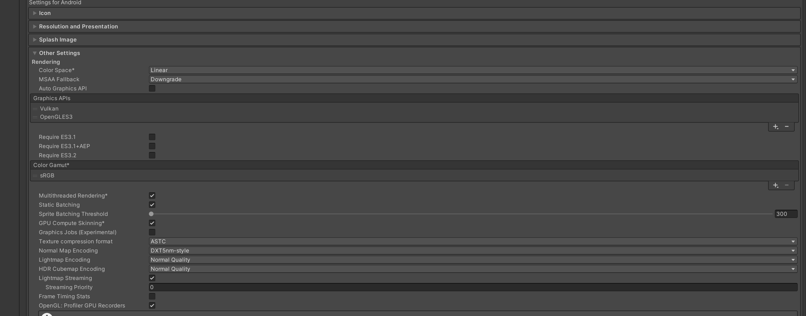

# Android Player Settings

Applied and checked on 2026-09-24 in Unity **2022.3.62f2**. This records the user's IL2CPP request and supplied Android Rendering screenshot. The target is `ColorBlockJamCase2026`; `CBJ Template` was inspected read-only. Both projects' actual `ProjectVersion.txt` files identify 2022.3.62f2.

## Applied configuration

The live Editor already matched every rendering value in the screenshot. The only required file changes were Android **Mono → IL2CPP** and **ARMv7 → ARM64 only** in `ProjectSettings/ProjectSettings.asset`. Settings were changed through Unity Editor APIs and saved by Unity; no manual YAML patch was used.

| Setting | Before | Final verified value | Technical reason |
| --- | --- | --- | --- |
| Android Scripting Backend | Mono | IL2CPP | Ahead-of-time native compilation; matches the case's device delivery requirement. |
| Android Target Architectures | ARMv7 | ARM64 only | Ships the required 64-bit binary without a second 32-bit payload. |
| Color Space | Linear | Linear | Lighting calculations use linear values; sRGB art retains its color interpretation. |
| MSAA Fallback | Downgrade | Downgrade | Keeps the requested policy for unsupported sample counts; does not enable MSAA. |
| Auto Graphics API | Off | Off | Keeps API order explicit. |
| Graphics APIs | Vulkan, OpenGLES3 | Vulkan, OpenGLES3 | Vulkan first; GLES3 remains the requested device compatibility path. |
| Require ES3.1 / ES3.1+AEP / ES3.2 | All off | All off | Avoids requiring unused newer GLES features. |
| Color Gamut | sRGB | sRGB | Matches the supplied UI art and ordinary mobile display target. |
| Multithreaded Rendering | On | On | Moves graphics submission away from the main thread. |
| Static Batching | On | On | Allows batching eligible stationary geometry; moving blocks remain non-static. |
| Sprite Batching Threshold | 300 | 300 | Retains the requested sprite vertex limit; UI Toolkit batching needs separate verification. |
| GPU Compute Skinning | On | On | Keeps GPU skinning available; ordinary block meshes gain no skinning benefit. |
| Graphics Jobs | Off | Off | Avoids enabling this experimental path without device evidence. |
| Texture compression format | ASTC | ASTC | Matches the mobile texture policy; per-texture overrides still apply. |
| Normal Map Encoding | DXT5nm-style | DXT5nm-style | Higher normal precision trades for additional shader decoding work. |
| Lightmap Encoding | Normal Quality | Normal Quality | Retains the requested baked-lighting encoding tier. |
| HDR Cubemap Encoding | Normal Quality | Normal Quality | Retains the requested reflection encoding tier. |
| Lightmap Streaming | On | On | Marks generated lightmaps for mip streaming. |
| Streaming Priority | 0 | 0 | Gives lightmaps neutral streaming priority. |
| Frame Timing Stats | Off | Off | No continuous frame-timing collection is requested. |
| OpenGL: Profiler GPU Recorders | On | On | Preserves GLES GPU profiling support. |

Rendering option semantics follow the [Unity 2022.3 Android Player settings reference](https://docs.unity3d.com/2022.3/Documentation/Manual/class-PlayerSettingsAndroid.html). The project-specific choices above are configuration decisions, not measured performance improvements. [Linear rendering](https://docs.unity3d.com/2022.3/Documentation/Manual/LinearRendering-LinearOrGammaWorkflow.html) explains the color-space workflow; [IL2CPP](https://docs.unity3d.com/2022.3/Documentation/Manual/IL2CPP.html) explains native compilation and its build-time tradeoffs. IL2CPP does not prove reflection-driven DTOs or DI work on device: PRD V-D2 still requires their AOT smoke test.

## Reference-project comparison

`CBJ Template/ProjectSettings/ProjectSettings.asset` explicitly uses Android IL2CPP, ARMv7 + ARM64, Gamma, GLES3 before Vulkan, and GPU skinning off. This project's final choices retain the user's screenshot and the PRD's ARM64-only target rather than copying those differences.

Both files explicitly have manual graphics APIs, all three additional GLES requirements off, sRGB gamut, Android multithreaded rendering on, sprite threshold 300, frame timing off and OpenGL profiler recorders on. The template leaves several per-platform lists empty (batching, graphics jobs, compression/encoding and lightmap settings); an empty list alone does not establish its effective Editor value. All final values in the table were read from the **target's live Android APIs/serialized properties**, including those inherited defaults.

## Verification and limits

- Exact Editor identity: `ColorBlockJamCase2026@99077e4df1ecfaa4`, Unity 2022.3.62f2. CLI 1.0.0-beta.11 verified; the repository's approved pre-Unity-6 MCP transport supplied live checks.
- Independent readback confirmed IL2CPP, ARM64 and all screenshot settings. The saved diff contains only `AndroidTargetArchitectures: 1 → 2` and `scriptingBackend.Android: 1` (IL2CPP).
- The single-asset save API did not persist this settings object. Unity's project asset save persisted it after checking unrelated dirty asset types; the scene stayed clean and the existing shader/scene file hashes were unchanged. An unsuccessful exploratory serializer call logged `You may not pass in objects that are already persistent` as a Console error; the later project save succeeded and the disk diff was verified. No source compilation failure occurred; the diagnostic Console entry was left intact.
- No scenes, prefab references, URP/Quality assets, texture imports or packages were changed. Existing source/art changes were preserved.
- Lightmap Streaming is a Player setting. The Quality assets currently disable texture mip streaming, so this setting alone produces no active streaming or demonstrated memory saving. No baking or Quality-policy change is implied.
- Static batching does not automatically batch runtime pooled blocks. GPU skinning does not optimize ordinary MeshRenderers. ASTC project defaults do not certify each texture's import overrides. Those checks belong to their implementation tasks.
- No APK or device performance run was made for this settings change. Android IL2CPP build/install, DI/JSON stripping checks, Vulkan/GLES rendering and ASTC device support remain release verification items in the [PRD](Color-Block-Jam-PRD.md).

## Portrait lock (2026-09-27, DEC-142)

Task `TASK-20260927-001142693-43e35c51-ui-atlases-portrait-lock` locks the app to portrait on Android and iOS, because every screen is laid out for 1080 x 1920 portrait and auto-rotation let a phone turn it sideways.

| Setting | Before | After | Technical reason |
| --- | --- | --- | --- |
| Default Orientation (`PlayerSettings.defaultInterfaceOrientation`, shared by Android and iOS) | Auto Rotation (`defaultScreenOrientation: 4`) | Portrait (`defaultScreenOrientation: 0`) | The UI Toolkit layouts and the board camera framing target 1080 x 1920 portrait (20:9 on device). |
| Allowed orientations for Auto Rotation (`allowedAutorotateTo*`) | all four on | unchanged (all four on) | Unity reads these only when Default Orientation is Auto Rotation, so they have no effect under Portrait; they were left untouched to keep the change to one field. |

Set through `PlayerSettings` in the live Editor and saved by Unity, not by a YAML edit. The same task set `EditorSettings.spritePackerMode` to Sprite Atlas V2 - Enabled for the two UI atlases ([UI Asset Import](UI-Asset-Import.md#sprite-atlases-dec-142)). Device portrait check: not run.

Completion note: applied the requested backend/architecture, retained and verified the matching rendering configuration, compared the template without changing it, and preserved the supplied screenshot unchanged. UI control-to-sprite assignments are documented separately in [UI Asset Mapping](UI-Asset-Mapping.md).
