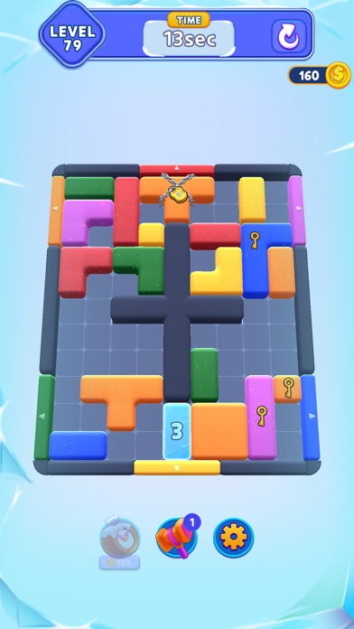
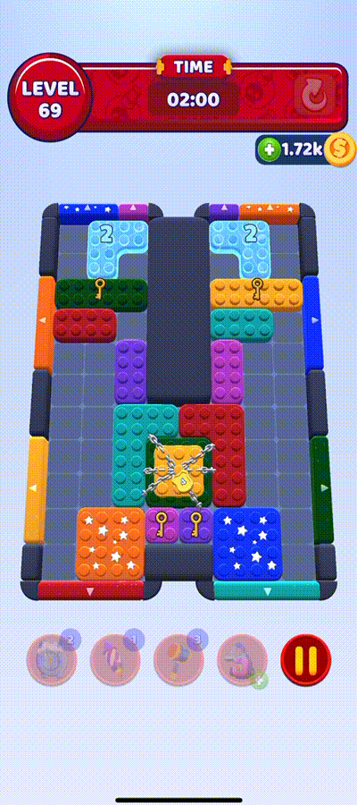
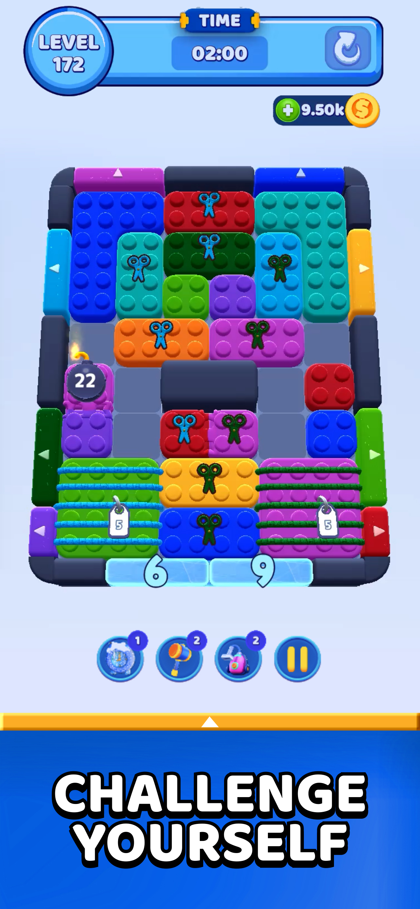
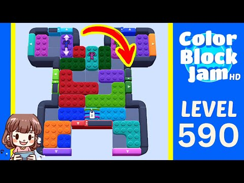
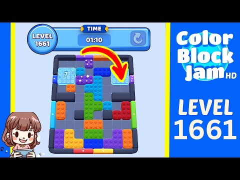
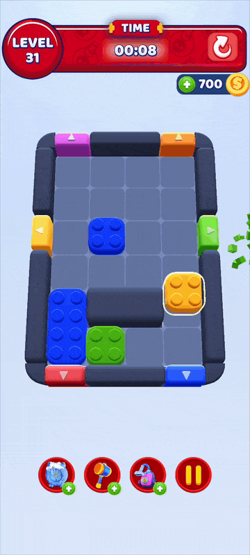

# Color Block Jam: Core Loop and 38 Mechanics

This document is a readable Markdown version of the 17-slide Color Block Jam presentation. It distinguishes the mechanics in Rollic's **full game** from the scope of the [Game Developer Case 2026](Game-Developer-Case-2026.md) assignment. Images are research references; they have not been added to the Unity project's `Assets` folder.

**Labels:** **Required by Rollic** = mandatory for the case; **Optional** = optional for the case; **Outside case scope** = present in the game but not requested in the case brief. Outside case scope does not mean prohibited.

## 01. Color Block Jam

The core loop, 38 named obstacle rules, a solving approach, and the 2026 case scope for understanding Rollic's game.

Sources: [Rollic game rules](https://rollic.helpshift.com/hc/en/24-color-block-jam/faq/1222-how-do-i-play-color-block-jam/), [Rollic obstacle guide](https://rollic.helpshift.com/hc/en/24-color-block-jam/faq/1234-obstacles-in-color-block-jam/), [App Store game page](https://apps.apple.com/us/app/color-block-jam/id6504332779). This document covers Rollic's mobile game; it does not verify the implemented features of a separate Unity template.

## 02. Basic Rule

1. **Drag:** Move the block through empty space.
2. **Align:** Bring its shape and color to a matching door.
3. **Clear:** Move every block out before time runs out.

**Required by Rollic:** The case requires the first five levels to be playable and completable. The GIF below is a general gameplay example from the 2025 version of the game; it is not claimed to show the case's first five levels.

Sources: [Rollic gameplay rules](https://rollic.helpshift.com/hc/en/24-color-block-jam/faq/1222-how-do-i-play-color-block-jam/), [case §4.3](Game-Developer-Case-2026.md#43-gameplay), [GameRes article containing the GIF](https://www.gameres.com/forum/t/911123).

## 03. A Block Exit Changes the Board

An exit can change the conditions for playing another block:

| Affected element | Possible change |
| --- | --- |
| Door | Opens or closes; its color or position may change. |
| Counter | Ice, crates, ivy, and locks may progress. |
| Block | A hidden piece appears or connected pieces separate. |

The conclusion that exit order matters is a game design interpretation derived from [Rollic's obstacle rules](https://rollic.helpshift.com/hc/en/24-color-block-jam/faq/1234-obstacles-in-color-block-jam/). Not all of these advanced state changes are within the case scope.

## 04. Map of the 38 Mechanics

| Group in this guide | Count |
| --- | ---: |
| Block effect | 18 |
| Gate / door effect | 11 |
| Board object | 9 |

This **18 + 11 + 9** split is a research classification, not Rollic's official code or prefab categorization. The `Star` block matches a special door but is counted only once among the 38 unique rules. Complete name lists appear in sections [16](#16-complete-list-18-block-effects) and [17](#17-complete-list-gates-and-board-objects).

Source: [Rollic obstacle guide](https://rollic.helpshift.com/hc/en/24-color-block-jam/faq/1234-obstacles-in-color-block-jam/).

## 05. Rollic Case: Requested Scope

| **Required by Rollic: mandatory** | **Optional: not mandatory** |
| --- | --- |
| First 5 playable levels | Ice blocker |
| Timer, coins, failure screen, pause, restart, and return to Home | Arrow block |
| Visual level editor: board size, door and block placement, time limit | Functional boosters |
| Home screen and settings | Unsolvable-level warning |

The first five levels must be created with the same editor, and the game must read the format saved by that editor. **Basic door placement is mandatory**, but the special `Door`/gate effects below are not separately requested. The other **36 special effects** in the full game are not named in the case brief.

Sources: [case §4: required scope](Game-Developer-Case-2026.md#4-required-scope), [case §5: optional scope](Game-Developer-Case-2026.md#5-optional-scope).

## 06. Block Effects: Movement and Locks

| Effect | Function in the game | Case status |
| --- | --- | --- |
| Arrow | Restricts movement direction | **Optional** |
| Ice | Thaws based on the number of exits | **Optional** |
| Chained Blocks | Requires a key block | Outside case scope |
| Ropes | Requires scissors of the same color | Outside case scope |
| Combined | Connected pieces separate | Outside case scope |
| Turn Based Arrow | Becomes unrestricted when the counter expires | Outside case scope |

The case terms `Arrow block` and `Ice blocker` were matched to `Arrow` and `Ice` in the full-game guide by name and context. The case PDF does not define their detailed behavior.

This GIF is an example from level 69 in 2025; it does not show all six effects listed in the table. Sources: [Rollic obstacle guide](https://rollic.helpshift.com/hc/en/24-color-block-jam/faq/1234-obstacles-in-color-block-jam/), [case §5](Game-Developer-Case-2026.md#5-optional-scope), [GameRes level 69 analysis](https://www.gameres.com/forum/t/911960).

## 07. Block Effects: Risk and Transformation

**Outside case scope:** These special effects are not requested in the assignment.

| Effect | Function in the game |
| --- | --- |
| Bomb | Must exit before exploding. |
| Dynamite | Must exit before its move count runs out. |
| Layer | Layers are revealed in sequence. |
| Color-Switching Block | The inner and outer colors change. |
| Time Capsule | Adds time when it exits. |
| Magnet Block | Combines matching blocks. |

The image does not individually verify every effect in the list. Sources: [Rollic obstacle guide](https://rollic.helpshift.com/hc/en/24-color-block-jam/faq/1234-obstacles-in-color-block-jam/), [App Store game page](https://apps.apple.com/us/app/color-block-jam/id6504332779).

## 08. Gate Effects: Door State

**Outside case scope:** These are special door behaviors, distinct from basic door placement.

| Effect | Function in the game |
| --- | --- |
| Door | Toggles open and closed after each clear. |
| Iced Door | Opens when the counter expires. |
| Locked Door | Requires key exits. |
| Colorful Door | Shows the next color. |
| Color-Switcher | Alternates between two colors. |
| Size-Changing Door | Changes width. |

The image does not prove that all of these door effects appear in the same level. Sources: [Rollic obstacle guide](https://rollic.helpshift.com/hc/en/24-color-block-jam/faq/1234-obstacles-in-color-block-jam/), [level 590 video](https://colorblockjam.wiki/level/590).

## 09. Gate Effects: Position and Conditions

**Outside case scope:** These special door effects are not named in the assignment.

| Effect | Function in the game |
| --- | --- |
| Moving Door Lock | The lock moves between doors. |
| Jumping Single Door | The blocked door position changes. |
| Colorful Jumping Door | The door moves and changes color. |
| Button Doors | A block of the correct color must stay on the button. |
| Laser Door | Closes if the beam is interrupted. |

The image alone does not verify every effect in the table. Sources: [Rollic obstacle guide](https://rollic.helpshift.com/hc/en/24-color-block-jam/faq/1234-obstacles-in-color-block-jam/), [level 1661 video](https://colorblockjam.wiki/level/1661).

## 10. Board Objects

**Outside case scope:** These are special rules beyond the basic board size and placement editor required by the assignment.

- **Control passage:** Colorful Path, Colorful Moving Path, Barrier.
- **Hide content:** Crate, Moveable Crate, Flower Crate, Colorful Crate.
- **Change the play area:** Ivy opens cells; Elevator brings out the next block.

Source: [Rollic obstacle guide](https://rollic.helpshift.com/hc/en/24-color-block-jam/faq/1234-obstacles-in-color-block-jam/).

## 11. Similar Rules and Their Differences

| Rule | Similar rule and the difference |
| --- | --- |
| Ice | Holds the block; Iced Door holds the door. |
| Colorful Door | Requires colors in sequence; Color-Switcher alternates between two colors. |
| Combined | Separates when one piece exits; Combined Locked Blocks unlock through other exits. |
| Dynamite | Clearly displays a move count; Rollic does not specify a single counter rule for Bomb. |

`Ice` is optional in the case; the other special behaviors in the table are not requested. Source: [Rollic obstacle guide](https://rollic.helpshift.com/hc/en/24-color-block-jam/faq/1234-obstacles-in-color-block-jam/).

## 12. How to Read a Difficult Level

1. Match exits to block shapes.
2. Identify key, scissors, and counter dependencies.
3. Leave clear corridors for long blocks.
4. Predict the door state after each exit.
5. Prioritize dangerous counters.

This sequence is a player strategy derived from the rules, not Rollic's mandatory implementation checklist.

Sources: [Rollic tips for hard levels](https://rollic.helpshift.com/hc/en/24-color-block-jam/faq/1223-tips-for-hard-levels/), [Rollic obstacle guide](https://rollic.helpshift.com/hc/en/24-color-block-jam/faq/1234-obstacles-in-color-block-jam/), [GameRes analysis containing the GIF](https://www.gameres.com/forum/t/911960).

## 13. Four Boosters

| Booster | Function in the game |
| --- | --- |
| Time Freeze | Pauses the clock, giving 10 extra seconds. |
| Hammer | Breaks a block or reduces an obstacle counter by 1. |
| Rocket | Removes a selected block. |
| Color Vacuum | Removes all blocks of the selected color. |

**Case status:** Booster buttons are not required to function. Functional boosters are **optional** scope. In the full game, winning on the first attempt may grant Pilot's Drop support for the next level; this meta feature is not requested in the case.

**Case-specific update (2026-09-24):** The table above summarizes Rollic's published rules and remains historical reference material. The [case PRD](Color-Block-Jam-PRD.md#710-functional-boosters-t1-req-o3) and [booster catalog](Color-Block-Jam-PRD-Mechanics-Catalog.md#2-boosters-t1) define this project's single Booster category: four in-level controls (Time Freeze, Rocket, Hammer, Vacuum) and two pre-level choices (Extra Time, Rocket). Time Freeze holds the main timer while a separate `10` to `0` countdown runs in `Playing`; when it expires, the main timer resumes without an additive bonus. Rocket removes exactly one cell while leaving a connected nonempty remainder; its two placements share one effect and stock. Hammer removes one semantic layer or piece: a plain block, a layered block's exposed layer, or an active Ice shell while preserving its block. It does not split footprints. The [PRD saving contract](Color-Block-Jam-PRD.md#76-coin-inventory-and-persistence) governs durable stock debits and purchases; Shop stays locked. The [23 user screenshots](Color-Block-Jam-Visual-References.md) document visual states, including [held outline](Color-Block-Jam-Visual-References.md#ref-14), [gate-exit cubes](Color-Block-Jam-Visual-References.md#ref-15), [3D Hammer](Color-Block-Jam-Visual-References.md#ref-16), and [nearest-block selection](Color-Block-Jam-Visual-References.md#ref-17). Nearest selection does not choose a destructive booster target. Winning Vacuum, Hammer, and gate-exit visuals may finish for at most 0.8 foreground seconds after `Won` latches, then full teardown precedes the popup. The approved upright Vacuum follow-up is [reference 18](Color-Block-Jam-Visual-References.md#ref-18); [Art Asset to PRD Mapping](Art-Asset-PRD-Mapping.md) distinguishes the imported HUD icons, cast prefabs and remaining integration. The case brief still treats functional boosters as optional.

Sources: [Rollic booster guide](https://rollic.helpshift.com/hc/en/24-color-block-jam/faq/1232-what-is-a-booster-what-are-they-for/), [Pilot's Drop explanation](https://rollic.helpshift.com/hc/en/24-color-block-jam/faq/1230-what-is-pilot-s-drop/), [case §4.3](Game-Developer-Case-2026.md#43-gameplay), [case §5](Game-Developer-Case-2026.md#5-optional-scope).

## 14. Progression Beyond the Puzzle

| Unlock point | System |
| --- | --- |
| Level 63 | Block Collection albums |
| Level 66 | Canyon Chase: 7 consecutive wins |
| Level 100 | Block Heist: win-streak multiplier |
| Level 200 | Rainbow Fest: a special block after 10 wins |

Daily quests and timed rankings also reward completing levels. These are progression details from the full game, outside the scope of the five-level case.

Sources: [Block Collection](https://rollic.helpshift.com/hc/en/24-color-block-jam/faq/1258-what-is-block-collection/), [Canyon Chase](https://rollic.helpshift.com/hc/en/24-color-block-jam/faq/1253-canyon-chase-1764768675/), [Block Heist](https://rollic.helpshift.com/hc/en/24-color-block-jam/faq/1254-block-heist-1764768607/), [Rainbow Fest](https://rollic.helpshift.com/hc/en/24-color-block-jam/faq/1251-rainbow-fest-1764768441/), [Daily Quest](https://rollic.helpshift.com/hc/en/24-color-block-jam/faq/1252-daily-quest-1764768510/).

## 15. No Fixed Final Level

- When new unique levels run out, the game switches to looping levels.
- Rollic states that it adds 50 new levels every two weeks.
- Earlier levels cannot be replayed; updates may change the board associated with the same level number.

These details describe progression through the full game's levels. The case requires only the first five levels.

Sources: [Rollic level information](https://rollic.helpshift.com/hc/en/24-color-block-jam/faq/1182-about-levels-in-color-block-jam/), [replaying levels](https://rollic.helpshift.com/hc/en/24-color-block-jam/faq/1231-how-do-i-replay-levels-that-i-ve-already-played/), [differences from video versions](https://rollic.helpshift.com/hc/en/24-color-block-jam/faq/1228-my-level-is-different-from-youtube-videos/), [level archive](https://colorblockjam.wiki/levels).

## 16. Complete List: 18 Block Effects

| No. | Effect | Case |
| ---: | --- | --- |
| 01 | Arrow | **Optional** |
| 02 | Layer | Outside case scope |
| 03 | Ice | **Optional** |
| 04 | Star | Outside case scope |
| 05 | Combined | Outside case scope |
| 06 | Chained Blocks | Outside case scope |
| 07 | Bomb | Outside case scope |
| 08 | Ropes | Outside case scope |
| 09 | Moving Blocks | Outside case scope |
| 10 | Combined Locked Blocks | Outside case scope |
| 11 | Hidden Blocks | Outside case scope |
| 12 | Dynamite | Outside case scope |
| 13 | Curtain | Outside case scope |
| 14 | Time Capsule | Outside case scope |
| 15 | Color-Switching Block | Outside case scope |
| 16 | Color Swapping Blocks | Outside case scope |
| 17 | Turn Based Arrow | Outside case scope |
| 18 | Magnet Block | Outside case scope |

Sources: [Rollic obstacle guide](https://rollic.helpshift.com/hc/en/24-color-block-jam/faq/1234-obstacles-in-color-block-jam/), [case §5](Game-Developer-Case-2026.md#5-optional-scope). The `Arrow` and `Ice` mapping is based on names and context; the case does not describe the behavior of these two mechanics.

## 17. Complete List: Gates and Board Objects

| No. | Gate / door | No. | Board object |
| ---: | --- | ---: | --- |
| 01 | Door | 01 | Colorful Path |
| 02 | Iced Door | 02 | Crate |
| 03 | Moving Door Lock | 03 | Moveable Crate |
| 04 | Colorful Door | 04 | Flower Crate |
| 05 | Locked Door | 05 | Barrier |
| 06 | Size-Changing Door | 06 | Colorful Crate |
| 07 | Color-Switcher | 07 | Colorful Moving Path |
| 08 | Jumping Single Door | 08 | Ivy |
| 09 | Colorful Jumping Door | 09 | Elevator |
| 10 | Button Doors |  |  |
| 11 | Laser Door |  |  |

The case requires **basic door placement**, not these special gate and board effects. The full game's `Door` rule toggles the door open and closed after each clear; it is not the same as the case's general `door placement` requirement.

Sources: [Rollic obstacle guide](https://rollic.helpshift.com/hc/en/24-color-block-jam/faq/1234-obstacles-in-color-block-jam/), [case §4.4](Game-Developer-Case-2026.md#44-level-editor), [case §5](Game-Developer-Case-2026.md#5-optional-scope).
