# Color Block Jam Case: User Visual References

These 23 screenshots were supplied by the user on 2026-09-24 and copied unchanged into `docs/media/color-block-jam/user-references/`. References 01 to 12 preserve the initial attachment order; 13 to 17 are the later Vacuum, held selection, gate-exit, Hammer and nearest-selection examples. Reference 18 groups six additional Vacuum design and suction-motion captures in the user's attachment order. References 19 and 20 (Settings on Home, the in-game pause menu) were supplied on 2026-09-27 and copied unchanged as `.webp`. Reference 21 (the Game HUD top bar) was supplied on 2026-09-28 and copied unchanged as `.webp`, so 26 screenshots are stored; reference 22 (the Retry confirmation) is described in text only. This document describes visible evidence separately from the case requirements in the [PRD](Color-Block-Jam-PRD.md). It is design evidence, not proof that these screens are implemented.

The user's correction is authoritative: **all tools are Boosters in one shared category/system**. Four are available during play; two are selectable before a level. Rocket uses one effect in both places. "Skill" is only the earlier conversational name for an in-game booster, not another class, inventory, or mechanic system.

| Context | Choices, in visual order | Activation |
| --- | --- | --- |
| In-game HUD | Time Freeze, Rocket, Hammer, Vacuum | Time Freeze applies immediately; the other three ask for a target. |
| Pre-level popup | Extra Time, Rocket | Toggle the choices, then Play applies them automatically at the start. Rocket selects a random valid target. |

This is six button placements for five distinct booster definitions. The purple Rocket HUD icon and the red/orange Rocket in the pre-level reference do not imply different effects or inventories.

## Reference index

| ID | Screen/state | Requirement |
| --- | --- | --- |
| [01](#ref-01) | Zero-stock purchase popup | PRD 7.10, AC-BST-0.6, AC-BST-0.9 |
| [02](#ref-02) | Hammer targeting banner | PRD 7.10, AC-BST-0.10 |
| [03](#ref-03) | Vacuum targeting banner | PRD 7.10, AC-BST-0.10 |
| [04](#ref-04) | Immediate Time Freeze feedback | PRD 7.10, AC-BST-1.1 to 1.5 |
| [05](#ref-05) | Level Complete overlay | PRD 7.4, AC-4.9 |
| [06](#ref-06) | Home, top UI and tab bar | PRD 7.1, AC-1.4a, AC-1.5 |
| [07](#ref-07) | Collection visual reference | PRD 7.1, locked placeholder |
| [08](#ref-08) | Shop visual reference | PRD 7.1, locked placeholder |
| [09](#ref-09) | Pre-level, both unselected | PRD 7.1, AC-1.1a, AC-1.9 |
| [10](#ref-10) | Pre-level, both selected | PRD 7.1, AC-1.9 |
| [11](#ref-11) | Opening booster presentation | PRD 7.5, AC-5.7 |
| [12](#ref-12) | Board after opening boosters | PRD 7.10, AC-BST-3.7, AC-BST-5.1 |
| [13](#ref-13) | Vacuum cast, outline and suction | PRD 7.10, AC-BST-4.5 to AC-BST-4.7 |
| [14](#ref-14) | Outline while a block is held | PRD 7.3, AC-3.17 |
| [15](#ref-15) | Fitting-door cube fragments | PRD 7.3, AC-3.18 |
| [16](#ref-16) | 3D Hammer and semantic layer removal | PRD 7.10, Hammer acceptance criteria |
| [17](#ref-17) | Nearest block from a board-area press | PRD 7.3, AC-3.19 to AC-3.21 |
| [18](#ref-18) | Vacuum upright silhouette, handle/hose deformation and intake | Vacuum motion correction; supplements reference 13 |
| [19](#ref-19) | Settings popup on Home | PRD 7.2, AC-2.1 to AC-2.6; PROJECT.md DEC-134, DEC-136 |
| [20](#ref-20) | In-game pause menu (Settings popup plus Home) | PRD 7.4, AC-4.4 to AC-4.6; PROJECT.md DEC-135, DEC-136 |

## Reading boundaries

- Build layouts from the supplied `Assets/ColorBlockJam/Art` sprites, UI Toolkit text and styles. These screenshots remain documentation references; do not crop them into runtime sprites.
- Keep Shop and Collection locked. Their full-game content, unlock levels, products, prices and progression are not case requirements.
- Ad badges, X2 rewards, Pilot's Drop, events, avatar systems, and level numbers 28/29/50/63/70 are contextual evidence only.
- The case keeps its five authored levels and current coin/reward policy. The zero-stock popup has a functional coin purchase for booster stock; it does not open the locked Shop.
- Exact bonus amounts and ambiguous behavior are governed by the PRD decisions and open questions, not inferred from one screenshot's timer or inventory value.

## 01 — Zero-stock booster purchase popup

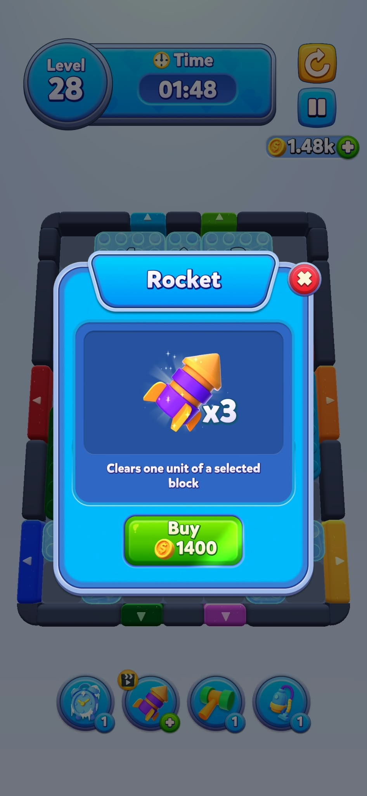

**Visible:** the selected booster name, close button, large icon with a bundle count, short effect description, and green Buy button with coin price. The board and HUD are dimmed. Rocket's empty HUD slot has a plus badge. The screenshot says the effect clears one unit of the selected block.

**Case requirement:** tapping an in-game booster with zero charges opens this popup for that booster instead of targeting/casting it. Populate its title, icon and description from the shared booster definition. Suspend gameplay before showing the modal; the underlying board and HUD cannot receive input. Close/Back spends nothing. Buy atomically spends 10 coins and grants one charge by the current tuning default; the screenshot's `x3` and `1400` are only visual examples. Insufficient coins, persistence failure, or a second tap during a purchase changes neither balance nor stock. Buying does not cast or select the booster, and the modal remains `Paused` until closed. The [PRD saving contract](Color-Block-Jam-PRD.md#76-coin-inventory-and-persistence) owns the durable transaction. A pre-level Buy remains on `Home`.

**Art:** `bg_popup`, `bg_popup_header`, `bg_popup_info_holder`, `btn_popup_close`, `btn_popup_green`, the relevant booster icon, `ic_coin_single`, and `ic_plus`.

## 02 — Hammer targeting

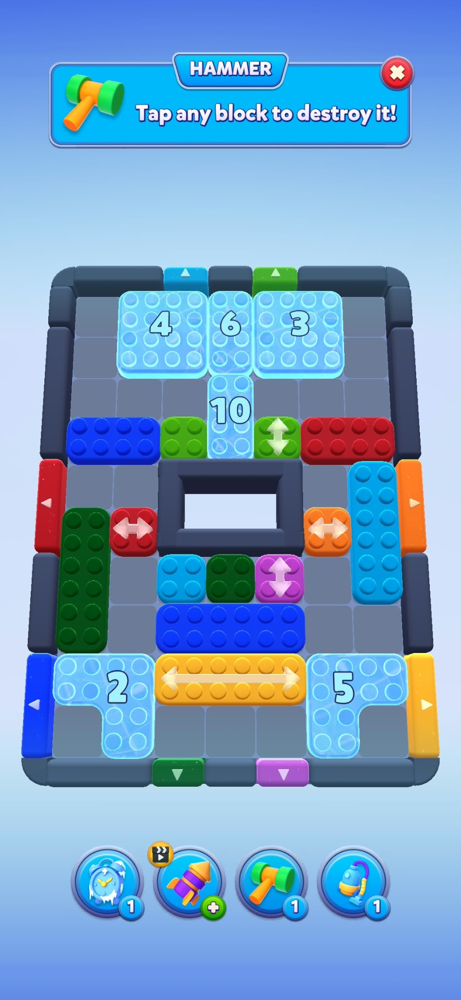

**Visible:** a wide cyan banner at the top with the Hammer icon, `HAMMER`, target instructions and a close button. The board remains unobscured and the four booster slots remain at the bottom.

**Case requirement:** a stocked Hammer enters targeting and shows a dismissible instruction banner. A valid target tap applies the shared Hammer rule and spends once. Close, Back or cancellation spends nothing. Hammer removes one semantic layer or block piece: the entire ordinary single-layer block, only the exposed layer of a layered block, or an active Ice shell while leaving its block. It does not cut one grid cell or split a footprint. Board dragging is suppressed while selecting a target; targeting adds no timer pause, but an active Time Freeze still applies.

**Booster-gameplay-flow update (DEC-147, DEC-150):** Hammer now removes the tapped block whole, whatever its footprint, including an active Ice shell and its block; it never splits. The banner sits under the timer band instead of over it, so the clock and a running freeze counter stay readable. Copy: "Tap any block to destroy it!".

**Game HUD update (DEC-155, user choice 2026-09-28 "Referans 02 gibi"):** with the reference top bar in place (DEC-153), a targeting mode hides the whole top bar, clocks included, and the banner takes the top, as in this capture. This supersedes the readable-clocks note above for Hammer, Rocket and Vacuum.

## 03 — Vacuum targeting

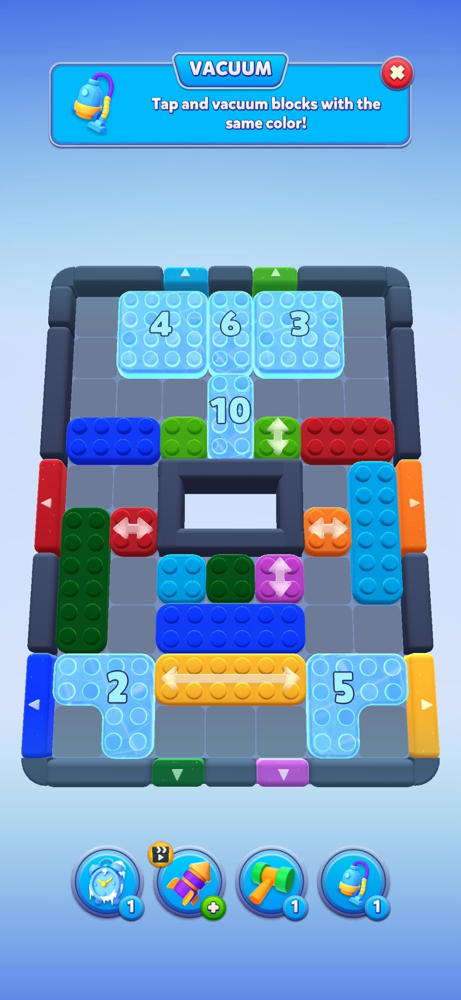

**Visible:** the same banner structure with Vacuum artwork and an instruction to select blocks of one color.

**Case requirement:** tap a block to choose its color, then remove all eligible blocks of that color in one command. The banner is shared with the other targeted boosters; its content changes by definition. Cancel does not consume stock. The selected target has a white outline, and the cast pulls matching pieces into the vacuum while shrinking them, as specified by the user's follow-up [reference 13](#ref-13). Pause/teardown still owns all effects.

**Booster-gameplay-flow update (DEC-147, DEC-150; banner position superseded by DEC-155, see reference 02):** the banner sits under the timer band. Vacuum shows no crosshair; the tapped block turns white (MPB tint until the DEC-117 outline exists). Copy: "Tap and vacuum blocks with the same color!".

## 04 — Immediate Time Freeze and frost presentation

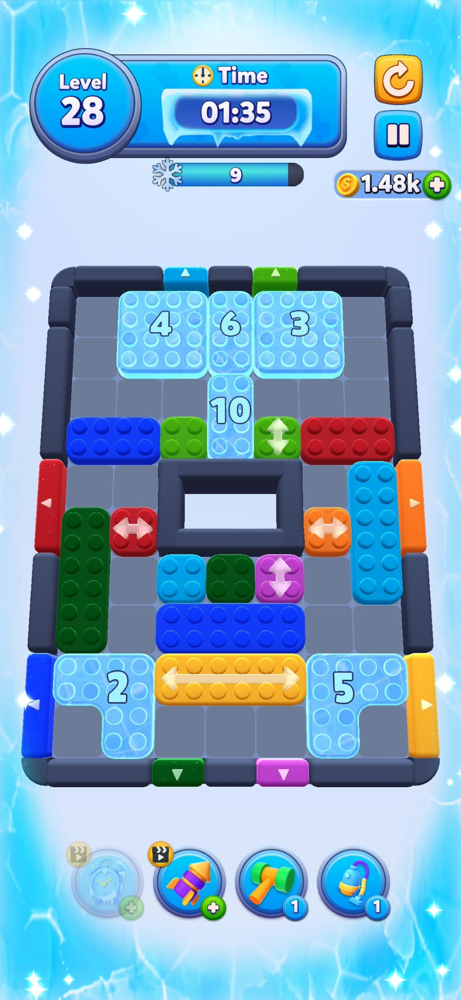

**Visible:** cyan frost around all screen edges, an iced timer holder, a snowflake progress bar showing `9`, and a dimmed Time Freeze button. Other blocks and controls remain visible.

**Case requirement:** this booster needs no board target. After its charge is durably saved, the main timer freezes at its current display and a separate Time Freeze countdown opens at `10`. That indicator counts down to `0` only in `Playing`; then the main timer resumes from its held value. It receives no additive bonus. A second activation while active is refused without spending. Shader Graph drives the surrounding frost. The screenshot's `9` is one observed indicator value within that separate countdown.

**Presentation:** keep the board readable; frost hugs the outer edges and respects safe-area controls. The separate `10` to `0` UI Toolkit indicator tracks the freeze duration while the main timer display stays unchanged. Pause preserves both remaining values. The frost clears when the separate countdown expires or the attempt ends. This screen-edge frost is separate from the ice blocker overlay and its projected UI Toolkit exit counter.

## 05 — Level Complete

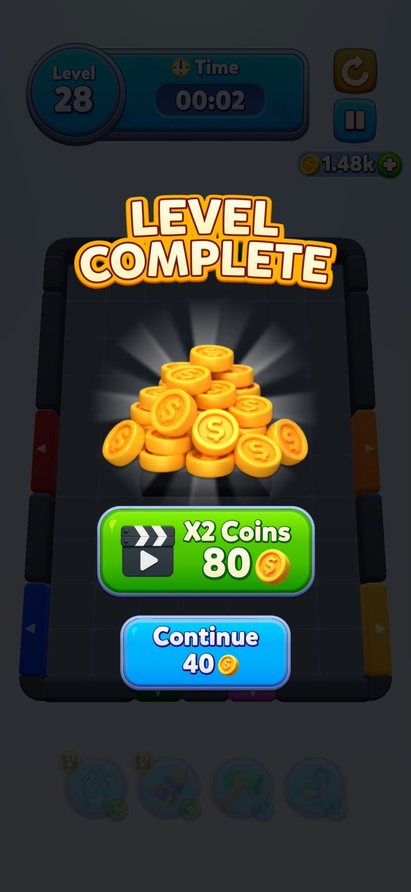

**Visible:** a dimmed background, large two-line completion title, coin pile, prominent reward action and a lower Continue action. The screenshot offers an ad-based double reward.

**Case requirement:** match the layout exactly without the ad button (user, 2026-09-28, DEC-173): the darkened screen, the arched two-line title, the coin pile over soft rays and one blue Continue button showing the reward amount and a coin. There is no separate Home button; Back acts as Home after the save. A confetti burst plays behind the coin pile when the popup opens. The current +10 reward is recorded exactly once; Continue starts the next level after the reward save succeeds. If that save fails, show Retry and disable the button until the intended snapshot is durable, as specified by [PRD 7.6](Color-Block-Jam-PRD.md#76-coin-inventory-and-persistence). After the last level the numbers keep counting and the levels play again (PRD AC-4.10). The `40`, `80`, X2 and ad action are not adopted. Reuse `ic_coin_single` and UI Toolkit styled text where dedicated title/coin-pile art is absent. After bounded Finish and full teardown, the popup dims a static board capture from a prewarmed target; no live gameplay remains behind it.

## 06 — Home and tab bar

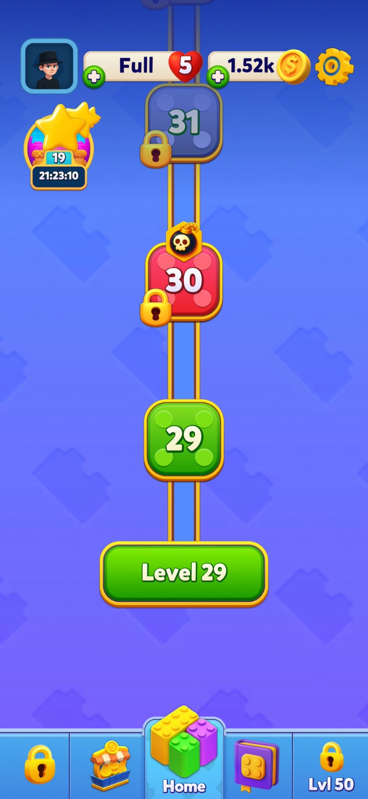

**Visible:** top resource holders and Settings, a central level route, large green Level button, and a five-slot bottom tab bar. Home is visually raised and selected.

**Case requirement:** use the top-resource hierarchy, large Level button and raised active Home tab as layout references. Keep the case's five placeholder tabs and safe-area/20:9 rules. Shop and Collection must look locked even though the reference Home screen shows their icons. The level route decoration does not require extra playable levels, event timers, or progression systems.

## 07 — Collection reference, locked in this case

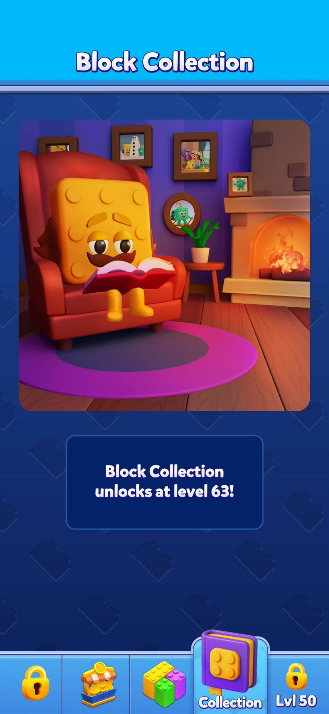

**Visible:** the Collection tab is selected, the page has an illustrated card and a notice that it unlocks at level 63.

**Case requirement:** the book icon identifies Collection, but this case keeps its tab locked and does not navigate to a functional collection page. Press feedback is required. The illustration, level-63 unlock, albums and rewards are outside scope; the image explains the identity and visual language of the placeholder.

## 08 — Shop reference, locked in this case

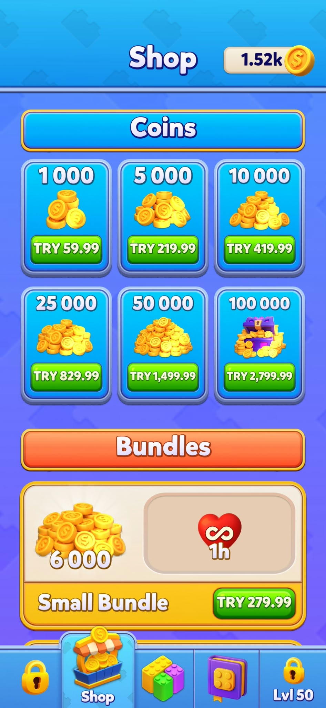

**Visible:** Shop is selected, with a balance holder, coin product cards, local-currency prices and bundles.

**Case requirement:** keep the Shop icon and a visible lock in the case tab bar, with press feedback. No shop page, IAP, products, prices or bundles are implemented. The zero-stock booster popup is a separate in-level overlay; it does not unlock or navigate to Shop.

## 09 — Pre-level popup, unselected

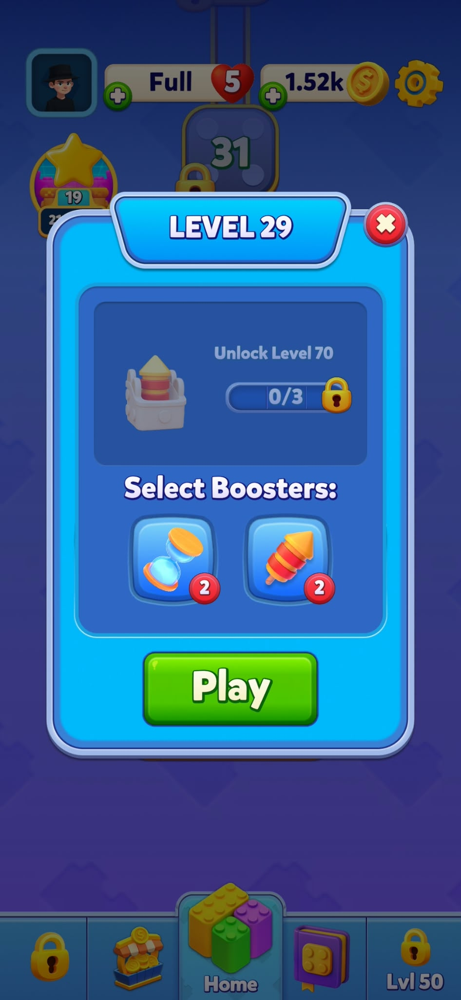

**Visible:** tapping Level opens a dimmed-Home modal titled `LEVEL 29`, with a close button, `Select Boosters`, blue hourglass and Rocket buttons with counts, and a green Play button. A separate reward panel above is locked at level 70.

**Case requirement:** show Level N, exactly two selectors (**Extra Time**, **Rocket**), close, and Play. Start with neither selected. Each displays its available count; zero stock cannot be selected. The locked level-70/Pilot's Drop panel is not part of this case and is omitted. Closing discards the temporary selection and consumes nothing.

## 10 — Pre-level popup, selected

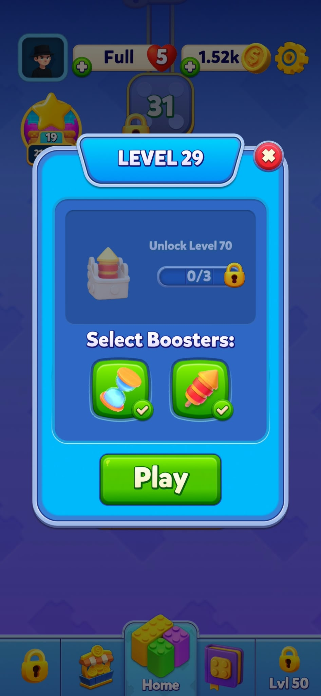

**Visible:** both booster buttons change from blue to green; count badges are replaced by green check badges. Play remains the confirmation action.

**Case requirement:** selectors toggle independently. A second tap deselects and restores the count; selecting is not consuming. The check badge provides a non-color cue. Play commits each applicable selected booster once. Shared Rocket stock must not be copied into separate pre-level and in-game inventories.

## 11 — Opening booster sequence

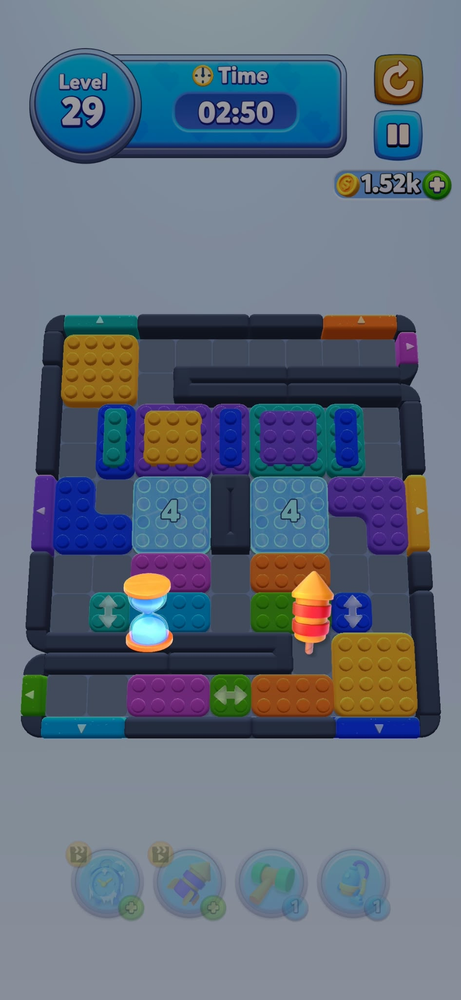

**Visible:** the level board is loaded, the background/HUD are dimmed, and enlarged hourglass and Rocket icons appear above the board. The shown time is `02:50`.

**Case requirement:** after Play and board/pool preparation, show the selected boosters' short opening sequence. Extra Time applies its configured time bonus; Rocket automatically chooses a valid random target and uses the same rule as the in-game Rocket. Do not request a player target. Hold ordinary board/HUD booster input and countdown during the opening feedback. Pause preserves progress, Resume does not reapply, and teardown cancels all session-owned work.

## 12 — Opening booster result

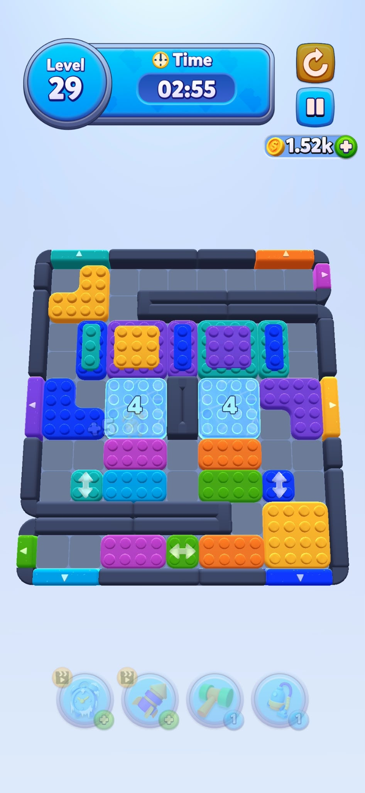

**Visible comparison with 11:** the top-left yellow 2×2 block has become an L-shaped three-cell block. The displayed clock has changed from `02:50` to `02:55`; the opening icons are gone. This supports a one-cell Rocket effect, rather than proving removal of the whole multi-cell block. The timer difference does not establish the configured bonus because these are separate captures.

**Case requirement:** both contexts use the PRD's common Rocket effect. Pick only a cell whose removal leaves at least one connected cell; 1x1 blocks and last-cell targets are invalid and spend nothing. Exclude them from the pre-level random target set. Recompose the remaining block through the same modular composer. A seeded random source makes starting-target tests repeatable. Release the opening input/countdown hold when presentation finishes. The in-game Rocket badge reflects the same persistent stock spent at the start.

**Booster-gameplay-flow update (DEC-146, DEC-150; banner position superseded by DEC-155, see reference 02):** Rocket may now split a block. Removing a bridge cell leaves several 4-connected parts, each an independent block with its own runtime ID; only a final or only cell is refused. Starting candidates include split-causing cells. In game, a crosshair marks every eligible cell, and the banner ("Tap and destroy one unit of a block!") sits under the timer band.

## 13 — Vacuum cast, selected outline and suction

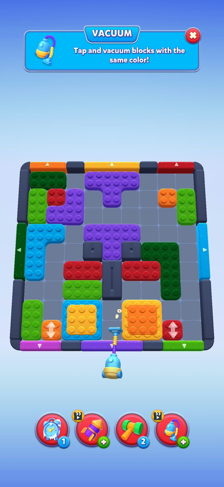

**Visible:** the Vacuum instruction banner remains above the board. A large vacuum illustration sits below the board center with its hose/nozzle reaching toward the board. Small light-colored particles are visible near the nozzle. The vacuum has a flat, illustrated appearance against the dimensional blocks.

**User-described motion and selection:** the chosen target is surrounded by a white outline; when cast, pieces are pulled into the vacuum and shrink as they travel. These animation requirements come from the user's accompanying text; a single frame cannot establish the full trajectory, timing or easing.

**Later design correction:** [reference 18](#ref-18) supplies six closer views. The user accepted the current entry/exit and requested the handle/hose suction motion to be corrected. The cast needs the upright body-below/nozzle-above silhouette; the supplied floor-cleaner HUD icon alone does not establish that active pose. Current authored colors may remain.

**Case requirement:**

- Mark the selected block's outer silhouette with a clear white outline, keeping its color and shape readable. Keep the outline stable while the visual moves/scales; remove it on cancel, completion, pool return and teardown. Do not add visible seams around every modular tile.
- Present the vacuum near the lower board edge as a camera-facing 2D sprite or equivalent flat visual, with the active design and hose motion from [reference 18](#ref-18). Keep the supplied `ic_vacuum.png` as its HUD icon. Its upper nozzle is the suction destination. The board remains the existing 3D perspective board (`BoardCamera`, pitch 75, FOV 60; DEC-103); this visual treatment does not change collision, footprints or simulation.
- After a valid color selection, matching block/piece visuals move toward the nozzle and shrink to disappearance at it. A brief stagger may clarify multiple targets, but all removals commit together in the domain command. Other colors remain unaffected.
- Use pooled visual pieces and session-owned PrimeTween motion/scale effects. Return pieces once on animation completion or teardown; never wait for an animation callback to update occupancy or award a win. No runtime `Instantiate` or per-piece `Update`.
- Pause freezes the pull and resumes from the same position/scale. On a winning cast, `Won` latches immediately: domain play, input, and clocks stop and the reward is recorded once. A visual-only Finish interval of at most 0.8 foreground seconds may show the final pull before full teardown and the popup. Backgrounding, Home, or timeout forces cleanup; animation callbacks cannot change gameplay or reward. Restart and failure also clear the vacuum, particles, and outlines.

**Verification:** check the white silhouette, nozzle destination, simultaneous shrinking and suction, unaffected other colors, flat vacuum appearance, 1080×1920/20:9 safe-area fit, pause/resume and terminal cleanup. A manual clip or ordered captures are needed to verify the motion; this source image is only the static reference.

## 14 — Held-block selection outline

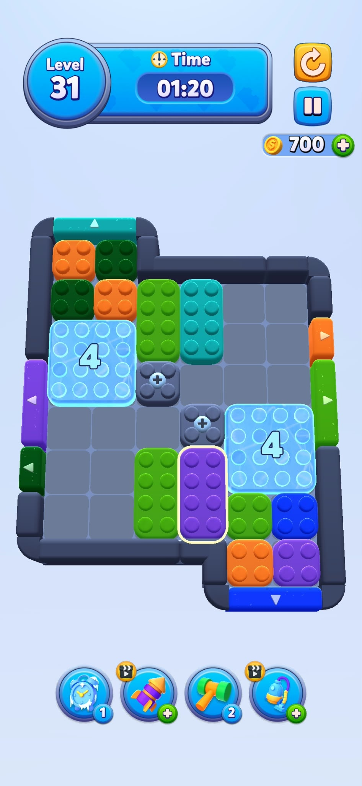

**Visible:** the purple vertical block near the lower-right has a continuous light outline around its entire silhouette; adjacent blocks do not have that selection outline.

**User requirement:** while the finger remains pressed on the selected block, show a **white** outline. This applies to ordinary block selection/dragging, not only Vacuum targeting. A warm tint in the capture does not override the requested white color.

**Case rule:** show on pointer-down, keep through the held drag, and clear on release, cancellation/lost pointer, pause, restart, Home, terminal teardown and pool return. Outline the whole polyomino silhouette rather than each modular tile. A blocked/frozen selection may show feedback but must not bypass its movement constraint. The later [reference 17](#ref-17) extends selection to nearby board-area presses. The local CBJ Template is a behavior reference for this outline; its assets/code are not copied into the case.

## 15 — Fitting-door exit disintegration

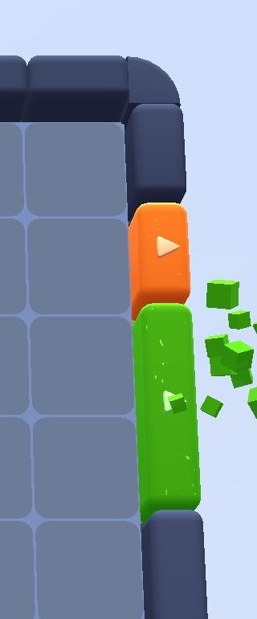

**Visible:** a close-up of a green door with small green cubic fragments just outside it.

**User-described behavior:** an approaching block that fits through its matching passage breaks apart into small pieces as exit polish. A similar effect and code exist in the local reference project.

**Case rule:** start the disintegration only for a valid exit: correct color, sufficient door span and the existing contact/push rule. Use same-color pooled cube fragments near the gate as the visual block disappears through it. A too-wide or wrong-color block stays blocked and does not emit exit fragments. The domain commits the exit once; particles never update board occupancy or trigger rewards. Pause suspends the effect. A final winning exit may keep its fragments visible during the bounded Finish interval before teardown; interruption or timeout forces cleanup. Reference implementation paths are listed below after inspection.

## 16 — 3D Hammer cast and layer removal

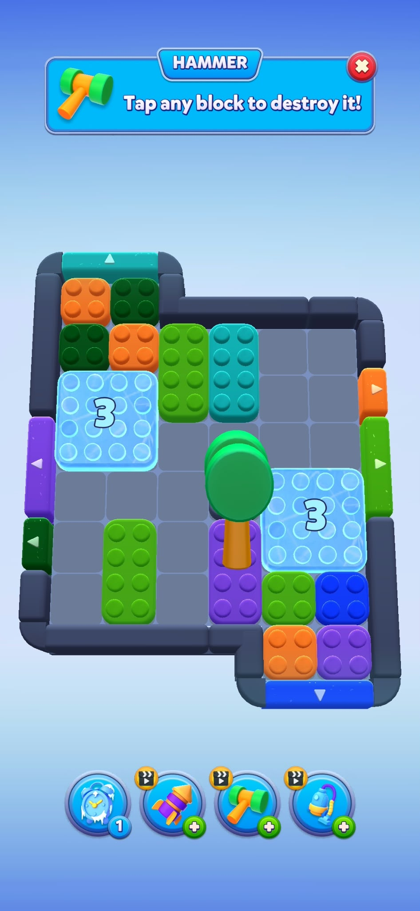

**Visible:** a large green mallet with an orange handle is presented in 3D above a purple block. The Hammer instruction banner and bottom HUD remain visible.

**Visible evidence and later clarification:** the still frame shows a 3D mallet over a block; it cannot establish the damage rule. An earlier one-cell Hammer interpretation is superseded by the user's later clarification: Hammer removes one semantic layer or block piece. The one-cell geometric effect belongs to Rocket.

**Case rule:** an ordinary single-layer block disappears entirely. A layered block loses its exposed layer and retains its lower layers and footprint. If the target has an active Ice shell, Hammer removes that obstacle shell, sets its counter to zero, and leaves the block in place; one hit produces one of these effects, not several. The future T2 layer mechanic remains a roadmap item. Restart restores the authored board, while persistent booster stock retains charges already spent. Hammer has no connected-component splitting requirement. Rocket removes only one grid cell and refuses split-causing or last-cell targets.

**Presentation:** a pooled 3D mallet strikes the chosen target and returns through a session-owned tween. A winning hit may finish its visible stroke during the bounded Finish interval; interruption or timeout forces cleanup. Do not replace its cast with the flat HUD icon. The separately authorized Blender-authored HammerEffect prefab is now imported; its exact path and PRD criteria are in [Art Asset to PRD Mapping](Art-Asset-PRD-Mapping.md). No reference-project art was imported.

**Booster-gameplay-flow update (DEC-146, DEC-147):** the case rule above is superseded. Hammer removes the tapped block whole, including an active Ice shell and the block under it, with no layer or shell-only result; the removed root shrinks at the mallet's strike contact. Rocket, not Hammer, now splits blocks (see [reference 12](#ref-12)).

## 17 — Nearest-block selection inside the board area

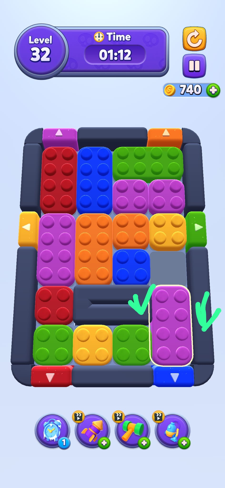

**Visible:** the lower-right purple block is outlined; the user's green arrows mark neighboring wall/border locations rather than only the block surface.

**User requirement:** while touching within the play area, a tap on a gate, a block, a border/wall or another board surface selects the Lego block closest to the finger. Exact collider hits are not required to select the nearby block.

**Case rule:**

- On ordinary gameplay pointer-down, first reject HUD/popup input and points outside the board interaction area. That area includes the interior and boundary walls/gates/border. A direct block hit selects that block. Otherwise find the closest on-board block by screen-space distance to its projected occupied footprint, not its center; L-shape empty corners are not occupied area.
- Treat wall/gate hits as selection input, never as draggable objects. There is no arbitrary small pick-radius cutoff inside the board area. Removed/mid-exit blocks are not candidates; no candidates means no selection. Equal distances use stable block-ID order.
- Choose once for that press and keep the same block until release/cancel. Preserve its starting offset so a wall/gate press does not teleport the block under the finger. Pointer movement moves the selected block through the existing collision/axis rules; crossing another block does not retarget it.
- Show the white held outline from reference 14. A selected frozen block still refuses movement and gives the existing blocked feedback; nearby selection never bypasses Ice or Arrow constraints.
- Apply this fallback to normal selection/dragging. Booster targeting retains its explicit cell/color validity and cancellation rules; no destructive booster fires merely because a wall press was near a block.

**Verification:** direct hit, gate, interior wall, outer border and empty board cells all select the closest footprint; include a long block beside a short block, concave shapes, equal-distance ties, no candidates, pointer leaving/releasing, Ice/Arrow and HUD overlap. Run at 1080×1920 and 20:9. Candidate search occurs once per pointer-down, without a scene-wide query or per-frame allocation.

## 18 — Vacuum active design and hose deformation

The six captures below preserve the user's supplied order. Entry/exit labels describe their reference role; still frames do not establish an exact animation timeline.

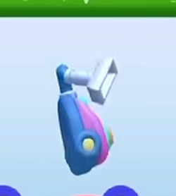

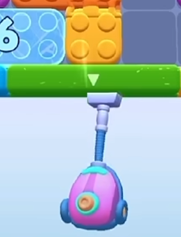

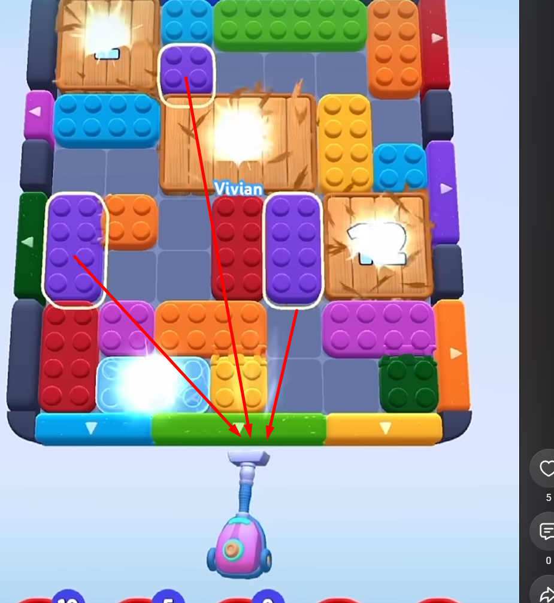

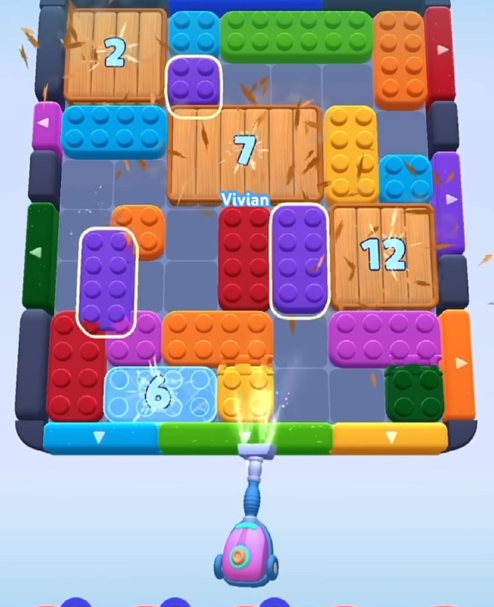

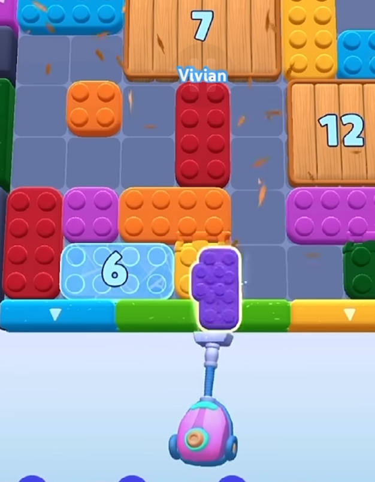

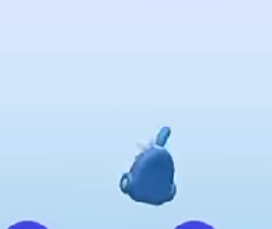

**Visible design:** a compact canister sits below the board. A flexible hose rises from its top into a short rigid grip/neck and a broad horizontal nozzle above the body, facing the board. The hose is narrow and extended in 18b; its middle is visibly wider and bent in 18d. The active silhouette has no large side loop or floor-facing head. Captures 18c and 18e place the block convergence point at the upper nozzle.

**User correction:** keep the accepted entry/exit presentation, which can remain tween-driven. Correct the handle/hose movement during suction instead of substituting whole-body fading, scaling or tiny rigid sway for that movement. The existing authored colors are acceptable; matching this design is the priority. Hammer and Rocket movement are not part of this Vacuum correction.

**Motion interpretation:** animate the flexible section with a clear local swelling/compression and recovery while the grip and nozzle retain their rigid shape. A bulge traveling from the nozzle toward the body is a proposed interpretation of the suction action. Exact travel direction, speed, easing, cycle count and timings cannot be recovered from these stills. Keep the nozzle mouth as a stable intake anchor during full-size active suction, with continuous connections at both hose ends. Preserve the accepted tween-driven appearance/disappearance separately from the baked deformation.

**Implementation boundary:** author any revised mesh or deformation in Blender. These source captures remain unchanged documentation references and are not cropped into runtime artwork. The board blocks, highlights, shrinking paths and particles illustrate the intended future cast composition; adding these references or changing the vacuum asset does not implement domain removal, targeting, inventory, board occupancy or reward logic. Existing lifecycle and Finish rules from reference 13 still apply.

**Verification:** compare the upright full-size pose, visible hose deformation, rigid head/grip, fixed intake position, continuous joints and unclipped frames against these references. Check entry/exit preservation independently. Six archived copies were verified against the supplied originals with matching SHA-256 hashes; rendered motion needs its own preview or runtime evidence.

## 19 — Settings popup on Home

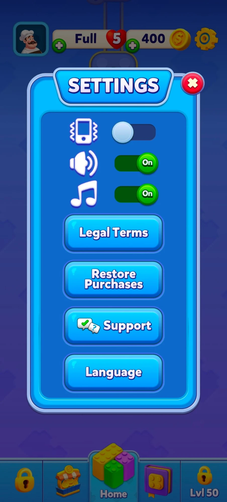

**Visible:** Home stays visible but dimmed. A cyan popup shell carries an overlapping `SETTINGS` title tab and a red close button at its top-right corner. A dark blue inset holds three rows, Vibration, Sound and Music (icon on the left, toggle on the right), then four stacked blue buttons: `Legal Terms`, `Restore Purchases`, `Support` (with the two speech-bubble icon) and `Language`. Vibration is off: a light grey knob sits at the left of a dark navy track. Sound and Music are on: a green knob reading `On` sits at the right of a dark green track.

**Case requirement (user, 2026-09-27; DEC-134):** Settings is this popup, an overlay on `Home`. Keep the row order Vibration, Sound, Music. Toggles store and show state only (NG-3) and persist through the save service (AC-2.5). ON uses the supplied `btn_toggle_on` knob (its baked `On` is the ON label) at the right of a dark green track; OFF uses a plain light grey knob at the left of a dark navy track. Position, knob art and track colour make the states differ in greyscale (AC-2.2). `Legal Terms`, `Restore Purchases`, `Support` and `Language` are placeholders with press feedback only (brief 4.2, AC-2.4); no legal page, store restore or language switch is added. Close and Android Back return to Home, and Home receives no input while the popup is open (AC-2.3, AC-2.6).

**Art:** `bg_popup`, `bg_popup_header`, `btn_popup_close`, `bg_popup_info_holder`, `ic_settings_vibration`, `ic_settings_sound`, `ic_settings_music`, `btn_toggle_on`, `btn_popup_blue`, `ic_support`. No supplied sprite exists for the OFF knob or the tracks; they are UI Toolkit shapes. `bg_menu` is not used by this popup.

## 20 — In-game pause menu

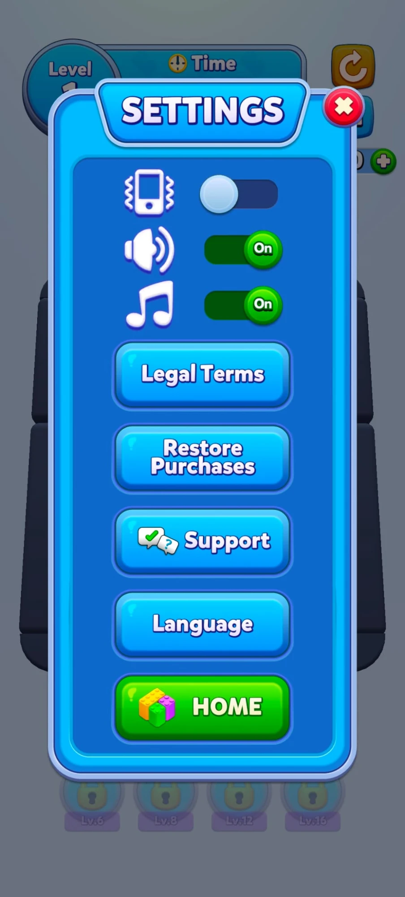

**Visible:** during a level the dimmed HUD (level badge, time holder, orange restart button at the top right) and board stay behind the same Settings popup as reference 19, with one extra green `HOME` button (brick icon and text) at the bottom of the inset.

**Case requirement (user, 2026-09-27; DEC-135):** the pause menu reuses the Settings popup component and adds the `HOME` button (`btn_popup_green` with `ic_home`). The pause button, Android Back or backgrounding enter `Paused` through Suspend before it opens (AC-4.4, AC-3.12). The close button resumes `Playing` exactly as before (AC-4.6). `HOME` tears the attempt down and returns to Hub (AC-4.7). Restart moves to the HUD restart button (`btn_square_retry` with `ic_restart`), as in this capture, instead of a popup button; the fail popup keeps its own Restart and Home (AC-4.3). Toggles changed here commit through the save service after the Suspend, outside any Playing tick.

**Scope:** the pause menu and the HUD restart button belong to the Game-scene HUD work, not the Hub tasks. The Hub Settings task builds the popup as a shared component so that work can reuse it (DEC-136).

**Implemented (DEC-154):** the Game HUD hosts this popup with HOME over a 49 % black scrim; see [Game HUD](Game-Hud.md).

## 21 — Game HUD top bar

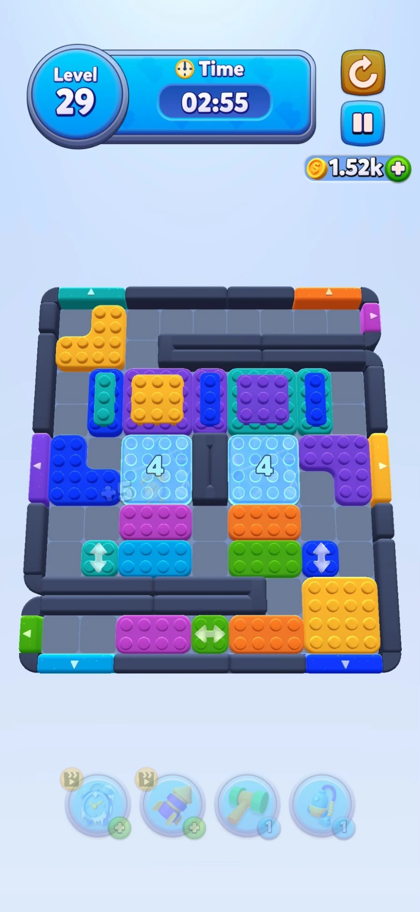

**Visible:** a circular "Level 29" badge overlaps the left end of a wide patterned "Time" panel with a clock icon and a dark rounded timer field reading `02:55`. At the top right an orange square Retry button sits above a blue square Pause button. Below them a translucent blue coin pill shows a coin, `1.52k` and a green plus.

**Case requirement (user, 2026-09-28; DEC-153):** the Game HUD top bar matches this layout with the supplied `btn_level_bg_normal` (badge and panel drawn whole), `ic_time`, `bg_gameplay_time_holder`, `btn_square_retry` + `ic_restart`, `btn_settings_normal` + `ic_pause`, `bg_home_coin_holder`, `ic_coin_single` and `btn_circle_green_small` + `ic_plus`. The timer stays `m:ss` (RULE-21); the coin amount uses the compact format; the plus gives press feedback only (RULE-24). The user's before-capture showed only a centred clock pill; that layout is replaced.

## 22 — Retry confirmation (text only)

The user's 2026-09-28 screenshot is not stored in the repository; it is described here. Over the dimmed game a cyan `bg_popup` shell carries a `bg_popup_header` tab reading "Level 34" and the red close button at its top-right corner. A `bg_popup_info_holder` inset holds a dark blue box with a broken red heart and a white "-1", then "You will lose 1 life!" in white heavy text. A green `btn_popup_green` button reads "Retry".

**Case requirement (user, 2026-09-28 "Onay popup'ı sor"; DEC-155):** the HUD Retry opens this confirmation after Suspend; its Retry restarts the level once, and Close, the scrim or Back resume. No broken-heart art is supplied, so the whole `Heart` carries the "-1". Lives remain a placeholder (NG-3): the copy is shown but no life is deducted.

## Supplied art and gaps

The [UI Asset Mapping](UI-Asset-Mapping.md) is the authoritative screen/control-to-imported-sprite map, with exact `Assets/ColorBlockJam/Art/UI` paths and Unity GUIDs. The compact selection below preserves the visual-reference context; keep source names and import rules from `AGENTS.md`. The [Art Asset to PRD Mapping](Art-Asset-PRD-Mapping.md) adds board-kit and authored cast assets, readiness and requirement IDs.

| Purpose | Existing art |
| --- | --- |
| In-game icons | `Icons/Boosters/ic_clock_freeze.png`, `ic_rocket_purple.png`, `ic_hammer.png`, `ic_vacuum.png` |
| Shared Rocket in both contexts | `Icons/Boosters/ic_rocket_purple.png` |
| Extra Time fallback | `Icons/Gameplay/ic_clock.png` with an explicit Extra Time label |
| Panels and headers | `Panels/bg_popup.png`, `bg_popup_header.png`, `bg_popup_info_holder.png`, `bg_popup_info_holder_2.png` |
| Buttons and badges | `Buttons/btn_booster_normal.png`, `btn_circle_blue_small.png`, `btn_circle_green_small.png`, `btn_popup_green.png`, `btn_popup_blue.png`, `btn_popup_close.png` |
| Counts, plus, reward | UI Toolkit text, `Icons/Currency/ic_plus.png`, `ic_coin_single.png` |
| Tabs and locks | `Panels/bg_active_tab.png`, `Icons/Navigation/ic_home.png`, `ic_shop.png`, `ic_block_collection.png`, `ic_lock.png` |

The original supplied set lacks a dedicated hourglass, red/orange Rocket, large completion lettering, coin pile and 3D mallet. Existing sprites/text cover the UI layout. The later authorized Blender work supplies imported Hammer/Rocket/Vacuum models and cast effects; the Hammer HUD icon remains separate from the 3D cast, and Vacuum uses the approved upright bake. See the [art-to-PRD map](Art-Asset-PRD-Mapping.md). A selected check badge is composed with the existing circle and a text/check glyph. Runtime frost remains a Shader Graph implementation task.

## Local template code references

Read-only inspection of `C:/Users/e-fur/Documents/Repos/CBJ Template` on 2026-09-24 found the following. These paths identify behavior examples; they are not dependencies of the case, and no code or assets were copied.

| Topic | Inspected source | Finding and case adaptation |
| --- | --- | --- |
| Press/release lifecycle | [RaycastController.cs](<C:/Users/e-fur/Documents/Repos/CBJ Template/Assets/Project Files/Game/Scripts/Input/RaycastController.cs:18>), [BlockMovementManager.cs](<C:/Users/e-fur/Documents/Repos/CBJ Template/Assets/Project Files/Game/Scripts/Level System/BlockMovementManager.cs:59>) | Picks/releases the held block and handles its movement. The case uses its own Input System/session path, with the requested nearest-footprint fallback. |
| Outline capability | [Block.shader](<C:/Users/e-fur/Documents/Repos/CBJ Template/Assets/Project Files/Game/Shaders/Watermelon Shaders/Shaders/Block.shader:42>), [Base Block Material.mat](<C:/Users/e-fur/Documents/Repos/CBJ Template/Assets/Project Files/Game/Materials/Colors/Base Block Material.mat:117>) | A white outline pass exists, but the inspected base material disables it. No press-driven runtime toggle was found in the inspected selection/movement code. Treat the shader as a reference, not proof that the full held-outline behavior already runs. |
| Accepted exit and clipping | [LevelController.cs](<C:/Users/e-fur/Documents/Repos/CBJ Template/Assets/Project Files/Game/Scripts/Level System/LevelController.cs:295>), [BlockClip.cs](<C:/Users/e-fur/Documents/Repos/CBJ Template/Assets/Project Files/Game/Scripts/Other/BlockClip.cs:15>) | Accepted collection starts clipping and an exit tween, then stops particle emission and resets clipping when it finishes. Preserve the appearance while making the case's session teardown an independent cleanup path. |
| Same-color cube fragments | [BlockDestructionParticle.cs](<C:/Users/e-fur/Documents/Repos/CBJ Template/Assets/Project Files/Game/Scripts/Other/BlockDestructionParticle.cs:11>), [Block Destroy Particle.prefab](<C:/Users/e-fur/Documents/Repos/CBJ Template/Assets/Project Files/Game/Prefabs/Particles/Block Destroy Particle.prefab:44>) | Effect cases are placed along the gate-facing edge and use the block material. The prefab uses cube mesh particles, looping emission with Play on Awake off, and a 0.52 s particle lifetime. These are reference settings, not mandatory tuning. |
| Particle recycling | [ParticlesController.cs](<C:/Users/e-fur/Documents/Repos/CBJ Template/Assets/Watermelon Core/Scripts/Particles/Scripts/ParticlesController.cs:63>) | Recycles after systems are no longer alive. The case must also stop/recycle on Pause/teardown as specified, because relying only on a tween completion callback can leave effects behind when interrupted. |

The original model kit contains `Arrows.fbx`, `BlockParts.fbx`, `GroundGrid.fbx` and `WallAndDoor.fbx`. Later Blender production added the models and effect prefabs under `Assets/ColorBlockJam/Art/Models/Boosters`, including Hammer's 3D cast and reference 18's approved baked Vacuum motion. These are case-owned assets; the local template remains a behavior reference.

## Documentation change note

- Added all 23 original screenshots with stable local links and explicit screen/state descriptions, including Vacuum, held outline, gate fragments, Hammer and nearest-selection follow-ups.
- Added reference 18's six Vacuum captures: corrected the active upright silhouette and handle/hose deformation target while preserving accepted entry/exit and current authored colors; separated visible evidence from inferred motion timing.
- Corrected the shared Booster terminology and documented the two usage contexts.
- Reconciled later user clarification: Time Freeze suppresses the countdown for 10 `Playing` seconds, Rocket keeps a nonempty connected remainder, Hammer removes one semantic layer or block piece, and Buy purchases persistent stock for coins.
- Clarified the separate `10` to `0` Time Freeze indicator, durable purchase/use timing, and bounded visual Finish after a winning Vacuum, Hammer, or gate exit; screen-space badges use UI Toolkit.
- Linked the references to Home, targeting, purchase, completion and opening-sequence requirements.
- Preserved locked Shop/Collection scope and separated visual evidence from economy/ad/progression decisions.
- Verification: image copies are checked byte-for-byte against the supplied files; Markdown paths and requirement links are checked separately. No runtime implementation or gameplay verification is claimed.
