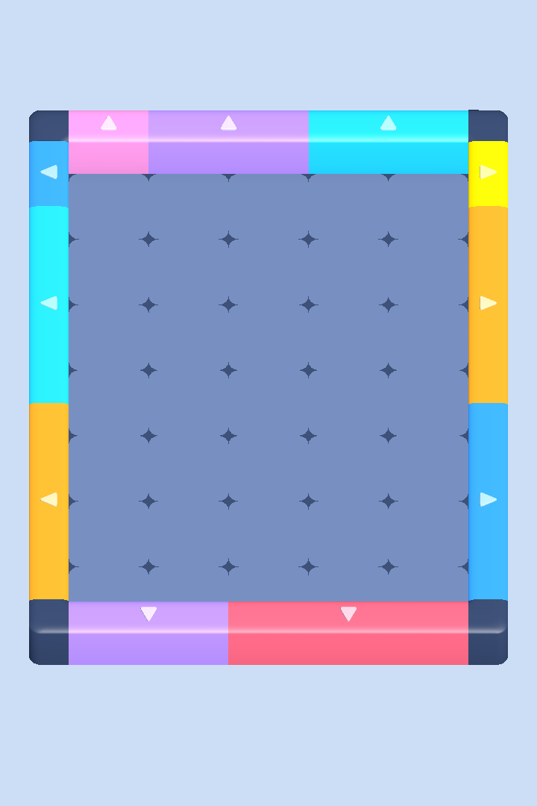
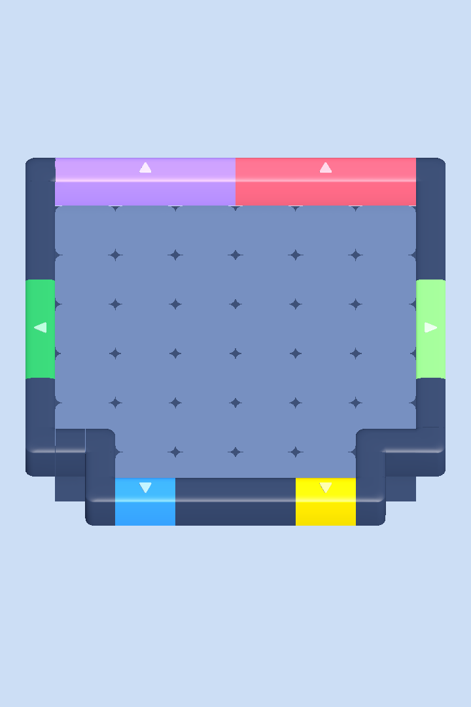
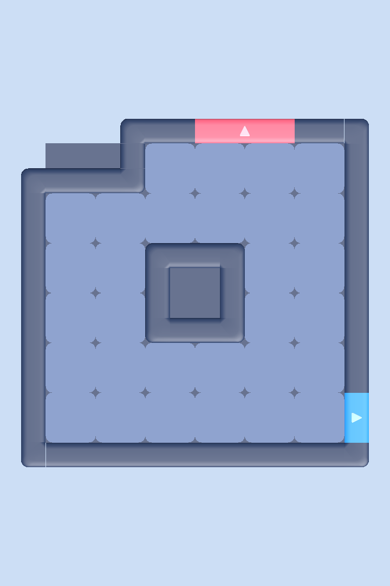
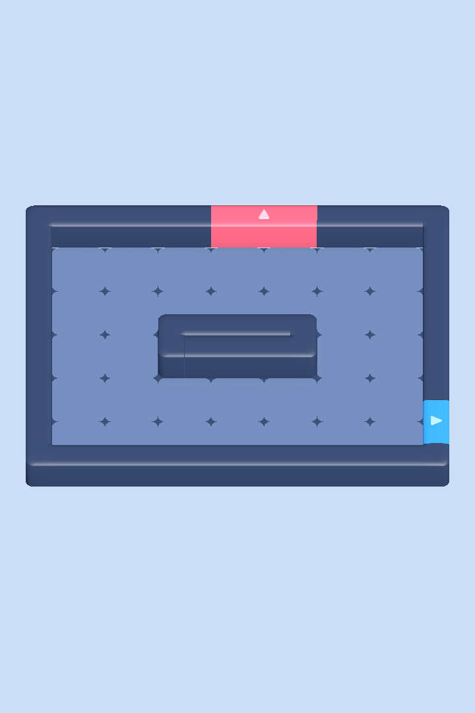

# Play-Area Environment

The environment turns one level record into the 3D play area: a floor tile on
every floor cell, walls and rounded corners on every floor/void boundary, and
coloured doors whose spans come from the level JSON. Blocks and gate rules are
separate systems that place themselves on this layout. The board camera
framing (`BoardCameraFraming`, `BoardCamera`) lives in this assembly and reads
the built board's bounds; see Board camera below.
Decision: DEC-100 in `PROJECT.md`. Task:
`production/tasks/TASK-20260924-185655569-dea430a7-play-area-environment`.

## Assemblies and dependencies

| Assembly | Code | Depends on |
|---|---|---|
| `ColorBlockJam.Runtime` | `Runtime/Layout`: `IBoardLayout`, `BoardLayout`, `DoorSlot` | Unity value types, `Runtime.Levels`, `Runtime.Art` |
| `ColorBlockJam.Environment` | `Environment/`: `EnvironmentRuleSet`, `EnvironmentNeighbor`, `EnvironmentRuleMatcher`, `EnvironmentDatabase`, `EnvironmentComposer`, `EnvironmentPiecePlacement`, `EnvironmentBarrierComposer`, `EnvironmentBarrier`, `EnvironmentGate`, `EnvironmentGateSpan`, `EnvironmentView`, `EnvironmentSceneInstaller`, `EnvironmentPreview`, `BoardCameraFraming`, `BoardCamera` | `Runtime`, `Presentation` (`BoardPieceView`), `Onity.DI`, `Onity.Unity`, `Onity.Pooling`, `PrimeTween.Runtime` (barrier and gate motion) |
| `ColorBlockJam.Environment.Editor` (Editor only) | `Environment/Editor/`: `EnvironmentRuleSetEditor` (UI Toolkit inspector) and its USS | `Environment`, `Presentation` |

The environment uses no package beyond Unity's built-in Grid: the Rule Tile
package (`com.unity.2d.tilemap.extras`) and every Tilemap were removed on
2026-09-25 (task `TASK-20260924-231413359-d89f8597-environment-rule-set-grid`).
`Runtime` stays package-free, so later movement and exit rules can read
`IBoardLayout` without a cycle; `Runtime` never references
`ColorBlockJam.Environment`. Its dependents are the Gameplay composition
(`ColorBlockJam.Gameplay`: `GameAttemptLoader`, later the barrier adapter),
the level preview (`ColorBlockJam.Editor.LevelPreview`), `ColorBlockJam.Editor`,
the tests and the Game scene.

## Coordinates

- Cell `(x, y)` sits at board-local `(x, 0, y)`: `+X` is the column, `+Z`
  the row, one cell is one unit (`BoardLayout.CellSize`).
- Walls stand in a half-cell ring outside every floor edge, so
  `IBoardLayout.LocalBounds` spans `x -1..W`, `z -1..H`, `y 0..0.72`.
- `EnvironmentView.BoardRoot` is moved so the bounds centre sits on the
  Environment object; later systems parent to `BoardRoot` and use
  `CellToLocal`/`TryLocalToCell`.

### The Unity Grid on BoardRoot

`BoardRoot` carries the environment's only Unity `Grid` (cell size 0.5,
swizzle `XZY`, rectangular layout, no gap). It is the single authority that
turns environment grid coordinates into board-local positions:

- The grid cell is one half-cell quadrant. Cell `(x, y)` covers grid cells
  `(2x - 1 | 2x, 2y - 1 | 2y)`, so the cell centre is the grid vertex
  `(2x, 2y)` and a quadrant's centre is its grid cell centre.
- `EnvironmentComposer` stays plain C# and emits `GridPosition` values in these
  grid units: floor `(2x, 2y)`, walls and corners at quadrant centres, doors at
  the midpoint of their two ring quadrants and arrows at the middle of a door.
- `EnvironmentView` maps each one with `Grid.CellToLocalInterpolated`. The
  results equal the previous hand-computed positions exactly (golden composer
  tests and pixel-identical before/after captures).

## Data: `EnvironmentDatabase`

`Data/Environment/EnvironmentDatabase.asset` is the only source of environment
data. The Game `SceneContext` binds it through `EnvironmentSceneInstaller`.

| Field | Value | Why |
|---|---|---|
| Rule set | `EnvironmentRuleSet.asset` (`EnvironmentRuleSet`) | The project-owned wall and corner rules |
| Floor piece | `Prefabs/Board/Pieces/Grid.prefab` | One per floor cell |
| Floor base piece | `Prefabs/Environment/FloorBase.prefab` | One grey square per floor cell, just under its tile; the play area also puts one under each wall quadrant and door slot (DEC-139), and a void cell gets no full square |
| Block fill piece | `Prefabs/Environment/BlockFill.prefab` | Flat top for Barrier quadrants without an exposed edge (`EnvironmentBarrierComposer.AppendBarrierPieces`); reuses the floor-base quad at wall height |
| Brick end piece | `Prefabs/Board/Pieces/WallBrick/Brick_End.prefab` | Caps both ends of each straight wall run in the play area (DEC-139): `Wall.prefab` with only its mesh replaced by the Blender-authored `Art/Models/BoardKit/WallBrick.fbx` |
| Corner end piece | `Prefabs/Board/Pieces/WallBrick/Corner_End.prefab` | A corner of the outer boundary in the play area (DEC-139): `Corner_1.prefab` with only its mesh replaced by `Corner_End` from `WallBrick.fbx`, a Corner_1 footprint with one large quarter-round outer arc and both arm ends closed and rounded |
| Corner join piece | `Prefabs/Board/Pieces/WallBrick/Corner_Join.prefab` | A board corner beside a one-cell void, merged into its shorter wall (DEC-139): `Corner_1.prefab` with only its mesh replaced by `Corner_Join` from `WallBrick.fbx`, the same arc with one arm open to join a Wall and the other rounded |
| Door piece | `Door_1x1.prefab` | One per door-covered edge segment; in the play area only the slots between a gate's two ends |
| Door end piece | `Prefabs/Board/Pieces/WallBrick/Door_End.prefab` | Closes both ends of each gate in the play area (DEC-139): `Door_1x1.prefab` with only its mesh replaced by `Door_End` from `WallBrick.fbx`, Door_1x1's cross-section with one rounded end |
| Door arrow piece | `Door_Arrow.prefab` | One per door, at the span centre |
| Palette | `Data/Art/GamePalette.asset` | Door colour from the level `colorId` |
| Wall piece scale | (0.5, 1, 0.5) | The kit prefabs are calibrated to a full cell; the play area uses half-cell pieces so rings stay thin (references 02, 17) |
| Door piece scale | (1, 1, 0.5) | Half-cell-thick doors that match the ring |
| Door arrow scale | (0.5, 1, 0.5) | Keeps the arrow inside the thinner door |
| Arrow white blend | 0.6 | Arrows read as a light tint of the door colour |
| Floor colour | `PaletteColor.Ground` | Tint of the floor tiles; pieces carry no colour of their own, so every placement is tinted (DEC-123) |
| Wall colour | `PaletteColor.Wall` | Tint of the wall and corner pieces (DEC-123) |
| Floor base colour | `PaletteColor.Wall` | The grey squares under the floor tiles and, in the play area, under the walls and gates; they show through the gaps at the tiles' rounded corners and between wall units like the darker seams in the references |
| Barrier colour | `PaletteColor.Wall` | Tint of Barrier board-object pieces; a designer can set barriers apart from the fixed walls |

The floor, door, arrow and rule-output prefabs come from the board kit
(`Prefabs/Board/Pieces`) and are used as-is. `FloorBase.prefab` is not a kit
piece: it is an environment-owned flat quad (Unity's built-in Quad mesh,
`MAT_Gameplay`) under `Prefabs/Environment`. `BlockFill` reuses that exact mesh
at the Wall's inner joining height (0.66764, below its 0.72 bevel crest), so
there is no vertical slit under the cap. Both carry `BoardPieceView`; the composer resolves
their tint from the database palette (DEC-123), with no material clones.

## Rules: `EnvironmentRuleSet`

`Data/Environment/EnvironmentRuleSet.asset` is the single rule authority. It
holds an ordered list of rules; each has an output `BoardPieceView` prefab,
eight neighbour states (`Any`, `Floor`, `Void`) in RuleTile's neighbour order
(upper row left to right, left, right, lower row left to right; upper is
`+Z`) and a `Rotated` flag (also try 90, 180 and 270 degrees). A quadrant
outside the mask, including anything beyond the one-cell ring, is `Void`.
Mirroring is not offered because it would flip 3D mesh winding. `Validate`
requires an output, eight known neighbour values and at least one non-`Any`
neighbour per rule.

The rules were migrated from the former `WallRuleTile` with the same order,
neighbour positions, values and outputs:

| Order | Rule | Neighbours at rotation 0 | Output | Meaning |
|---|---|---|---|---|
| 1 | InnerCorner | right `Floor`, up `Floor` | `Corner_1` | Floor wraps around this corner (hole, notch, wall-block end) |
| 2 | Wall | right `Floor`, up `Void` | `Wall` | Straight wall along a floor edge |
| 3 | OuterCorner | left `Void`, down `Void`, down-left `Floor` | `Corner_1` | Convex corner of the floor (board corners, peninsulas) |

`EnvironmentRuleMatcher` evaluates the rules against a reused floor `bool[]`
over the quadrant grid. It keeps RuleTile's semantics exactly: rules in order,
angles 0, 90, 180, 270 in order, and a clockwise turn of each neighbour offset
(`(x, y)` becomes `(y, -x)` at 90). On the XZ board that equals Unity's
positive yaw, so the matched angle is the piece yaw. `Corner_1` at yaw 0 has
its rounded edge at local `(+X, +Z)`; `Wall` at yaw 0 runs along Z.

Before the RuleTile was removed, an EditMode test compared the old
`WallRuleTile` (on a temporary Tilemap) with the rule set and matcher for all
256 neighbour patterns at all four angles (3,072 rule/angle checks plus 256
first-match checks): no difference. `EnvironmentRuleSetTableTests` keeps
those recorded RuleTile results as a table.

### Rule set inspector

`EnvironmentRuleSetEditor` (UI Toolkit, Editor-only assembly) shows each rule
as a card: a 3x3 grid with a fixed blue `Piece` centre and eight neighbour
buttons that cycle `Any` (grey), `Floor` (green) and `Void` (red) with
tooltips, the output prefab field and the `Rotated` toggle. Rules can be
added, moved up or down and removed. Every edit goes through the
`SerializedObject`, so it records Undo and marks the asset dirty; an invalid
rule set shows its `Validate` error at the top.

## Composition: `EnvironmentComposer`

1. Reset the matcher's floor mask to the board plus its one-cell ring and
   mark the four quadrants of every floor cell; add one floor piece per floor
   cell and one floor-base square at the same cell centre, 0.01 below the
   tile, tinted with the database floor-base colour.
2. Mark the two ring quadrants behind every door segment.
3. For every quadrant of every non-floor cell in the one-cell ring around the
   board, skip door quadrants and ask `EnvironmentRuleMatcher.TryMatch`. The
   first matching rule and angle place its output at the quadrant centre with
   the matched yaw. Unmatched quadrants stay empty, preserving board holes.
4. Place one `Door_1x1` per door segment (yaw 0 on top/bottom, 90 on
   left/right), tinted with the door colour, and one `Door_Arrow` per door at
   the span centre pointing out of the board (bottom 0, left 90, top 180,
   right 270).

Composition runs once per level load, never in a tick; recomposing a
prepared board allocates 0 B, and so does matching a prepared mask.

### Rule placements and the play area (DEC-139)

`Compose(layout, output)` returns exactly the placements above: one rule piece
per wall quadrant. The Level Editor canvas draws them, and the Barrier
composer keeps the same rule pieces. `ComposePlayArea(layout, output, gates)`
is what `EnvironmentView` builds, so the player sees separate wall units as in
the reference game:

- The rule decides every wall quadrant as in step 3. A flood fill from the
  one-cell ring marks the outer boundary: void cells connected to the ring,
  notches included. On the outer boundary, a quadrant with floor on exactly
  one side is straight. Each maximal run of straight quadrants with the same
  rule and yaw, between corners and gates, becomes one brick: `Brick_End` on
  its first and last quadrant with its open mouth turned into the run, and
  the rule's `Wall` on every quadrant between them. A one-quadrant run gets
  two half-length caps back to back.
- A corner of the outer boundary (floor only diagonally, or on two adjacent
  sides at a notch) becomes `Corner_End` with the corner rule's yaw: Corner_1's
  footprint with one large quarter-round outer arc, as in the reference
  (D-004), and both arm ends closed and rounded, so it reads as its own unit
  and a lowered gate beside it shows a rounded end, not a cut face (D-001).
- Around a one-cell void (a notch or stub: an outer void cell inside the board
  with no void cell beside it) no unit is shorter than one cell. Each ring
  corner there (floor only diagonally) merges into the shorter straight run
  that continues one of its arms: it becomes `Corner_Join`, whose open arm
  meets that run's plain `Wall` end (a one-quadrant run becomes one full
  `Brick_End` whose mouth meets the corner), mirrored by a negative X scale
  when the other arm joins. The void's inner corners stay `Corner_End`,
  rounded on both arms, like the board's own corners (user decisions
  2026-09-28).
  An interior hole keeps all its rule pieces, so it stays one continuous
  frame, as in reference 02 and like a Barrier (user decision 2026-09-27).
  Floor, floor base, doors and arrows are Compose's placements.
- Every wall quadrant and door slot, interior holes included, also gets one
  `FloorBase` square in the floor-base colour, just under floor level. It
  reaches every side of the quadrant that meets floor, another wall or a gate,
  and stops a quarter quadrant short of a side that faces open void, so it
  never shows outside the board or inside a hole. A ring corner (floor only
  diagonally) always stops short on its two sides away from the floor, where
  its outer arc curves away, even when another wall meets that side; where a
  wall does meet such a side, a quarter-sized square fills the small pocket
  at that side's floor end, inside the joint. The gaps between wall units, beside
  rounded wall corners and at the floor tiles' rounded corners along walls and
  gates then read dark instead of showing the background (D-002).
- Every placement stays on its rule quadrant, so board topology, holes,
  notches and door slots are unchanged; only which mesh shows a quadrant
  changes, plus the bases under walls and gates.
- Each gate is closed like a brick (D-003): `Door_End` on its first and last
  slot with the rounded end facing out of the span, `Door_1x1` on the slots
  between them, and two half-length `Door_End` pieces back to back on a
  one-slot gate. All of them keep the door colour.
- `gates` gets one `EnvironmentGateSpan` per authored door, in door order:
  the range of that door's slot pieces and arrow in `output`, so the whole
  gate sinks and rises together.

`Brick_End` is authored in Blender inside the Wall mesh's exact bounds, so
Wall's prefab calibration fits it. Its mouth faces local -Z at yaw 0.
`Corner_End` is authored inside Corner_1's exact bounds; its outer side is one
quarter-round arc whose radius is the piece's side minus the soft end radius,
and every side drops with the supplied Wall bevel, as `Brick_End`'s closed end
does. `Corner_Join` is `Corner_End` with one arm left open with Wall's full
cross-section; in Unity its open arm faces local -X and its rounded arm local
-Z at yaw 0 (the FBX import mirrors X, the prefab's Visual child turns X180).
`Door_End` is authored inside Door_1x1's exact bounds with the same
closed end; in Unity (which mirrors the FBX's X axis) its rounded end faces local +X at yaw 0.
`ArtSource/BoardKit/WallBrick.blend` holds all four next to unchanged
`Wall_Reference`, `Corner_Reference` and `Door_Reference` copies.
`export_wall_brick.py` writes only `Brick_End`, `Corner_End`, `Corner_Join` and
`Door_End` to `Art/Models/BoardKit/WallBrick.fbx`, with the supplied kit's FBX
unit scale (100), and
checks the round trip. `Color Block Jam > Art > Build Wall Brick`
(`EnvironmentWallBrickAssets`) then imports the FBX with the kit's settings,
rejects each piece unless its bounds equal its source piece's, and saves
`Brick_End.prefab` from `Wall.prefab`, `Corner_End.prefab` and
`Corner_Join.prefab` from `Corner_1.prefab` and `Door_End.prefab` from
`Door_1x1.prefab`, all in `Prefabs/Board/Pieces/WallBrick/`, each with only the
mesh replaced. It binds the four prefabs in the database and writes nothing
else. [Wall brick art](art/wall-brick/README.md) lists what the project added
to the supplied kit and why.

Examples include rounded corners, pinched floors, corridors, gates at board
corners and level 9's corner notches. Exterior walls are automatic; there
is no Board boundary group or Wall brush. The existing Wall and Gate
prefabs still render the board boundary and authored gates.

## Barrier fill: `EnvironmentBarrierComposer`

`EnvironmentBarrierComposer.AppendBarrierPieces` composes one barrier
footprint: the supplied wall/corner kit on its outline and the shared
`BlockFill` cap on every unmatched interior quadrant. Single cells, 3x1,
2x2, 3x3, L shapes and footprints with floor holes use the same parts, so
wide barriers have a closed top. The former `EnvironmentSolidComposer` was
folded into `EnvironmentBarrierComposer` on 2026-09-28 (DEC-178); there is
no separate caller.

The permanent solid Block obstacle (`solid-block`, painted by the former
**Obstacles > Block** tile) was removed on 2026-09-25 by user decision; the
Barrier is the one board obstacle, and its `startsOpen` is set in the Level
Editor's Effect Editor window. The play area no longer composes static
blocks (`TASK-20260925-184759859-c962353f-barrier-starts-closed-no-solid-block`).
[Solid obstacle art](art/solid-obstacles/README.md) is kept as the history
of the `BlockFill` art.

## Board objects: Barrier (`EnvironmentBarrierComposer`)

Barrier (catalog OBJ-05) is a level cell object with the `barrier` effect:
its cells are walls while closed and floor while open, starting at
`startsOpen`. Its cells are floor in `BoardLayout`, so the play area under
them (floor tile and floor-base square) is composed as usual. DEC-121 in
`PROJECT.md`; task
`production/tasks/TASK-20260925-102657924-08cc082b-barrier-board-view`.

- **Composition.** For one barrier at a time, `EnvironmentBarrierComposer`
  resets the rule matcher's mask so that everything but that barrier's cells
  is floor: the board floor, other barriers (each moves on its own), void
  cells and the ring. It then matches the unchanged rule set on the barrier
  cells' quadrants only. The result is exactly what an interior wall block on
  those cells gets (a test compares the two), wherever the barrier stands: a
  barrier flush with the board edge or a hole still walls every quadrant of
  its cells, back to back with the fixed wall. Pieces get wall scale, grid
  height 0 (closed) and the database barrier colour. It uses the existing
  rule outputs and their pools. Unmatched interior quadrants now use the shared
  `BlockFill` prefab, so wide barriers also have a closed top. The solid-obstacle
  task supplies this missing art capability; the wall rules and meshes remain unchanged.
  The composer reads the typed `BarrierObject` parameters, so it runs on Home
  only. It refuses a barrier cell off the board floor and an empty or repeated
  ID before anything is shown.
- **Heights.** Closed pieces stand at the wall height 0. Open pieces sit
  0.8 below it (the kit's 0.72 wall height plus a margin), under the floor
  tile and base square of their own cells.
- **API.** `SetBarrierOpen(objectId, open, animate)` moves one shown barrier.
  With `animate` each piece runs one PrimeTween `LocalPositionY` of 0.25 s
  (`InOutQuad`) targeting its `Transform`, starting from where it is; without
  it the piece snaps. An ID-to-index dictionary built in `Build` finds the
  piece range, so the call allocates 0 B (PlayMode test with
  `Is.Not.AllocatingGCMemory`). A piece at rest below the floor has its
  renderer off (snap, or the sink tween's cached `OnComplete` callback), so an
  open barrier costs no draw or shadow pass; a rise turns it on before it
  moves, and `Clear` turns it on before the piece returns to the shared wall
  pools. The view never changes domain state.
- **Owner and stop point.** Owner: the gameplay session's barrier adapter
  (an `IBoardEventListener`), which animates each flip in the Playing command
  phase and snaps at attempt build and Restart. Suspend step 3 calls
  `SetBarrierTweensPaused(true)` and Resume `false`; Teardown step 3 calls
  `StopBarrierTweens()`; `Clear` (level change, `OnDisable`) and `Release`
  stop them too, before the pieces return to their pools. The view starts no
  tween in Edit Mode (the LevelEditor preview only snaps), so PrimeTween is
  not touched there.
- **Game scene.** The runtime gate still marks Barrier unimplemented, so no
  runtime level carries one yet. The gameplay session switches
  `GameAttemptLoader` to `Build(layout, level)` and adds the adapter together
  with the Barrier rule.
- **LevelEditor preview.** `LevelPreviewHost` passes the published draft to
  `Build(layout, level)`, so barriers show in their start state and every
  republished draft (cells or `startsOpen` changed) rebuilds them.

## Lifecycle and pooling: `EnvironmentView`

- `Build(IBoardLayout, LevelData)` runs on `Home`, before `Playing`
  (`Build(IBoardLayout)` is the same with no board objects). It composes
  first, so an invalid layout or barrier keeps the current play area, then
  rents every piece from one Onity `PrefabComponentPool<BoardPieceView>` per
  prefab and sets position, yaw, scale and tint on every rent.
- Building the layout and level that are already shown (Restart) keeps every
  piece and only snaps the barriers and gates back to their start state.
  Building another level returns every piece first; pools grow only inside
  `Build`, never during an attempt. A pool grows to the most pieces of its
  kind any built level needed, so switching between levels whose wall runs
  split differently between `Wall` and `Brick_End` can grow one pool once.
- `Build` binds one `EnvironmentGate` per authored door, on Home, to the door
  slots and arrow of its gate span. The board presenter moves a gate only
  through `TryOpenGate` (sink, hold, rise). The unused `TryLowerGate` and
  `TryRaiseGate` motion was removed on 2026-09-28 (DEC-178).
  Each gate has one PrimeTween sequence that moves its pieces' height and
  clips them at the floor. `SetGateTweensPaused` is Suspend and Resume,
  `StopGateTweens` is Teardown step 3, and `ResetGates` is Teardown step 6
  and Restart: built height, no clip, no motion. `Clear` stops them too.
- `Clear` stops barrier and gate tweens and returns every piece; `Release`
  also disposes the pools. `OnDisable` clears, `OnDestroy` releases.
- No environment component has `Update`, a tickable, a subscription or a
  coroutine. The only tweens are barrier moves, started by `SetBarrierOpen`
  (see Board objects: Barrier), and gate moves, started by the board
  presenter's gate calls.
- Floor-base squares are pooled pieces like every other: `FloorBase.prefab`
  has `BoardPieceView` on its root and a flat child quad (Unity's built-in
  Quad mesh, `MAT_Gameplay`, rotated X90, no shadow casting). The user revision of
  2026-09-25 replaced the earlier single stretched plane, so the centre of a
  hole wider than one cell and the outer quarter of a corner notch (level 9)
  now show the background. `Environment.prefab` holds no permanent plane.
  The floor-base pool grows to the floor-cell count plus one base per wall
  quadrant and door slot in the play area (DEC-139). `k_poolMaxSize` (1024)
  only limits how many released pieces each pool keeps: a board with more
  pieces still builds, and the extra pieces are destroyed on `Clear`.
  `LevelData.Validate` limits boards to 8 x 10: a full 8 x 10 board has 80
  floor-cell squares and 76 wall bases, well under the cap.

## Game scene

`Game.unity` holds one `Environment` prefab instance under `SceneScope`, and
the `SceneContext` lists `EnvironmentSceneInstaller`. `GameAttemptLoader`
resolves the level (Hub launch request, Level Editor Test Level, or the
installer's serialized index), builds the environment and the board, and
frames the scene's main camera once per build (below). The pre-drag
`EnvironmentPreview` scaffold this section used to describe was deleted on
2026-09-28 (DEC-178); `GameAttemptLoader` owns the build and the framing, not
`BoardPresenter`.

## Board camera

The Game view shows the board from the reference game's angle (DEC-103).

- `BoardCameraFraming` (plain C#) takes the board's world bounds, the camera's
  vertical FOV and aspect, the pitch and two margins, and returns the pose:
  rotation `Euler(pitch, 0, 0)`, distance
  `max((size.x + side) / (2 tan(FOV/2) aspect), (size.z + vertical) / (2 tan(FOV/2)))`,
  position `bounds.center - forward * distance`. It never reads the previous
  camera position, unlike the CBJ Template `CameraController.Reposition`.
- Pitch 75 and FOV 60 come from the CBJ Template Game scene and match the real
  game's perspective (board top edge 0.85-0.89 as wide as its bottom edge).
  Side margin 1.5 and vertical margin 5 are calibrated to the real-game
  screenshots (DEC-118): level 1 spans viewport x 0.067-0.933 and y 0.23-0.75
  at 1080x1920, and x 0.077-0.923 at 1080x2400. The template's 4 and 12 left
  the board at about half the screen width. Very deep, narrow boards stay
  depth-limited; a HUD safe-area fit waits for the HUD.
- The camera clears to solid pale blue #D6E4FC with post-processing off and
  far plane 50; lighting and render settings are in DEC-118.
- `BoardCamera` is a thin component on the camera (serialized target camera,
  pitch and margins). It has no `Update`; `Frame(bounds)` runs once per board
  build. `GameAttemptLoader` calls `BoardCamera.Frame` in the Game scene after
  it builds the board; `LevelPreviewHost` calls it for the LevelEditor scene
  preview (DEC-102, DEC-103, DEC-178). `BoardPresenter` does not frame the
  camera.
- `Game.unity` Main Camera carries `BoardCamera`, and its saved pose is the
  level 1 framing, so the edit-mode camera already matches the Play framing.
  The scene holds no board geometry in edit mode: the board appears only in
  Play Mode, once the environment builds, or in the LevelEditor scene preview.
- Re-framing on a resolution change is out of scope: the pose uses the aspect
  at build time.

## Handoff notes for the board-kit owner

- The wall-family prefabs are full-cell pieces; the play area scales them to
  (0.5, 1, 0.5) at runtime. If the kit is recalibrated to half cells, set the
  database scales to (1, 1, 1) in the same change.
- `corner_3` (pre-assembled Wall + Corner + Wall) and `corner_5` (denser
  `Corner_1`) are not used and have no prefab (removed 2026-09-29).
- `Brick_End` shares `Wall`'s mesh space and bounds, `Corner_End` and
  `Corner_Join` share `Corner_1`'s and `Door_End` shares `Door_1x1`'s. If one
  of those prefabs' calibration changes, run `Color Block Jam > Art > Build
  Wall Brick` so the four prefabs take the same calibration. If a shape
  changes, edit `ArtSource/BoardKit/WallBrick.blend` (the generators are
  `build_brick_end.py`, `build_corner_end.py`, `build_corner_join.py` and
  `build_door_end.py` in the DEC-139 task folder's
  `implementation/approved-brick`), then run
  `blender --background --factory-startup ArtSource/BoardKit/WallBrick.blend --python ArtSource/BoardKit/export_wall_brick.py`
  before the menu item.
- `Door_1x1` is one cell thick in Z; the play area scales it to 0.5.
- `Grid` tiles have rounded corners (radius about 0.13); the floor-base
  squares fill those vertex gaps with the base colour.
- Wall and corner meshes stop just short of ±0.5 (for example Wall ±0.4985),
  so at 0.5 scale some Wall/Corner joins show hairline seams in close-up
  captures. Extending the butt faces to exactly ±0.5 in the prefabs removes
  them.

## Verification

Run on 2026-09-24 in an isolated copy of the project with Unity 2022.3.62f2
batchmode, while the live Editor stayed untouched. The environment assets,
prefab and Game scene change were authored there through Unity APIs and copied
back with their `.meta` GUIDs.

| Check | Result | Evidence |
|---|---|---|
| EditMode (environment, layout, composer, reference levels, inspector) | 37/37 passed | [editmode.xml](verification/environment/editmode.xml) |
| Shared editor EditMode suite in the same run | 105/106; the one failure is the board-kit `PieceEditorSavesIndependentJsonAndRejectsStaleDisk`, which passed in the first clean run and depends on shape-library state left by an earlier run | same file |
| PlayMode (environment lifecycle, floor base, board kit, boosters, scene flow with the edited Game scene) | 26/26 passed | [playmode.xml](verification/environment/playmode.xml) |
| Game direct Play with ten levels in the database | Passed, no preview warning or exception | [playmode-game-with-levels.xml](verification/environment/playmode-game-with-levels.xml) |
| Game direct Play with an empty database | One "Environment preview skipped" warning, as designed | playmode.xml log |
| Recompose allocation | 0 B | `RecomposingAPreparedBoardAllocatesZeroBytes` |

Captures (orthographic, 55° pitch; `-top` files look straight down to check
yaw). Doors, arrows (pointing out on every side), rounded outer corners, hole
rings, the grooved wall block, the notch and pinch shapes match the rule table.

| | |
|---|---|
|  |  |
|  |  |

All ten reference levels are in `docs/environment/level-NN.png`; the fixtures
are `fixture-*.png`. Device and Frame Debugger measurements are not done yet.
These captures predate the per-tile floor base, so hole centres and notch
corners still show the old plane. The 2026-09-25 per-tile captures (live
Editor, perspective camera) show the background there instead:
[fixture](environment/floor-base-per-tile-fixture-top.png) and
[level 1](environment/floor-base-per-tile-level-01.png); before/after pairs
are in the floor-base-per-tile task folder.

## Open items

- Void cells: the level JSON cannot mark cells as void until the delegated
  `formatVersion` 2 schema lands (`handoff-voidcells-schema.md` in the task
  folder). `BoardLayout.TryCreate(LevelData)` then passes the level's void
  cells; until then every level cell is floor.
- The Corner, Wall, Door and Door_Arrow yaw constants were confirmed in the
  captures above.
- The board camera frames on build only; a device rotation or resolution
  change after the build does not re-frame it.
- Frame Debugger batch counts and device checks are still pending.
- Reference levels 1-10: `docs/Reference-Levels.md`.
