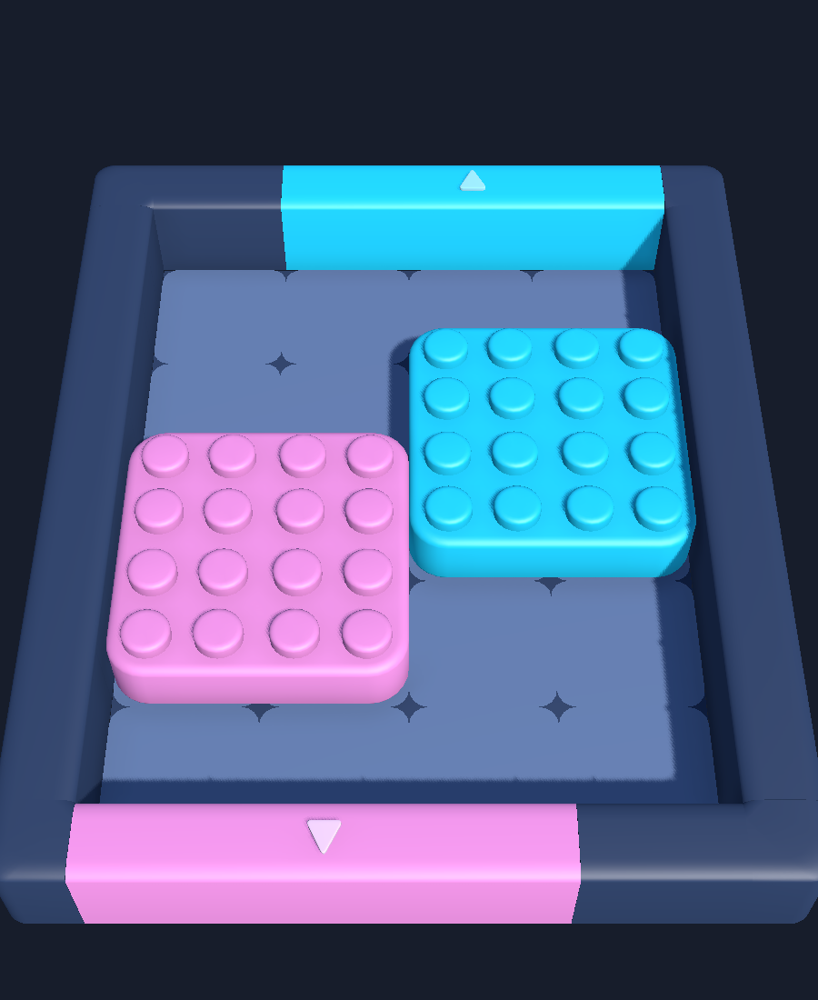

# Level Editor Scene Preview

While `Assets/ColorBlockJam/Scenes/LevelEditor.unity` is loaded, the Scene view
shows the level selected or edited in the Level Editor window
(`Color Block Jam > Level Editor`) the way the game builds it: floor, walls,
corners, doors and every block with its shape, colour and cells. The preview is
editor-only, is never saved into the scene, and does nothing while any other
scene is open. Decision: DEC-102 in `PROJECT.md`. Task:
`production/tasks/TASK-20260924-222616741-46522211-level-editor-scene-preview`.

## How to use

1. Run **Color Block Jam > Open Level Editor Scene**. It offers to save modified
   scenes, opens `LevelEditor.unity` and focuses the Level Editor window.
2. Pick a database and a level in the window. The Scene view frames the level.
3. Edit the draft (size, doors, block type, rotate or flip). The preview follows
   on the next editor tick. A draft that does not validate keeps the last valid
   preview and logs the reason once in the Console.
4. Press Validate Level and click a listed solution in the validation panel. The
   preview plays the same frames as the canvas, then shows the draft again
   (DEC-170, see [Solution playback frames](#solution-playback-frames)).

## Parts

| Part | Assembly | Responsibility |
|---|---|---|
| `LevelDatabaseWindow.DraftLevelPublished` | `ColorBlockJam.Editor` | Publishes a snapshot of the draft on load/selection, after draft edits (coalesced to the next tick), after Save/Reload/Restore, or `null` when no valid level is selected. `LastPublishedLevel` keeps the last one. |
| `LevelDatabaseWindow.SolutionFramePublished` | `ColorBlockJam.Editor` | Publishes each board a solution playback shows on the canvas, the cleared board included (DEC-170). A frame never becomes `LastPublishedLevel`. |
| `LevelPreviewBlockMapper` | `ColorBlockJam.Editor.LevelPreview` | Maps level blocks to spawn records: shape from `ShapeId` (library type name), colour from `ColorId` (the eleven gate colours), cells relative to the origin, position `IBoardLayout.CellToLocal(origin)`. Rejects an unknown shape or colour, naming the block. |
| `LevelPreviewHost` | `ColorBlockJam.Editor.LevelPreview` | Owns one DontSave root in the target scene: a plain `Environment.prefab` clone (`EnvironmentView.Build`), a `Blocks` root under `BoardRoot` fed by `BlockPieceFactory`, a directional light, and a `Preview Camera` with `BoardCamera` that frames each build from the game angle, so the Game view shows the level as the game does. Validates fully before touching the scene; `TryShowFrame` shows a playback frame and skips only `LevelData.Validate`. |
| `LevelPreviewOwner` | `ColorBlockJam.Editor.LevelPreview` | `[InitializeOnLoad]` owner: listens to the window's draft and frame events only while the LevelEditor scene is loaded, frames the Scene view when a draft's level ID changes (never for a frame), and tears the host down. Also the menu command. |

Blocks sit on their floor cells because `ModularBlockView` centres footprint
cell `(x, y)` at local `(x, 0, y)` and the composer places floor cell `(x, y)`
at `CellToLocal(x, y)`, both under `EnvironmentView.BoardRoot`.

### Arrow markers

`TASK-20260926-212320271-98b25efa-level-editor-arrow-markers` (revision 1,
catalog BLK-01). Each block with a valid Arrow effect shows the matching
`Arrow_N` prefab on its block root. The host uses the shared
`BlockArrowMarkers` owner (`ColorBlockJam.Presentation`, `Presentation/Board`),
which the Game scene's `BoardPresenter` also uses.

- **Placement.** `ArrowMarkerRun` centres the marker on the footprint's
  bounding box, in the root's cells; a 2 x 2 block's marker sits on the line
  between its columns. The box's extent along the axis, clamped to 1-3, picks
  `Arrow_1`-`Arrow_3`; a longer block reuses `Arrow_3` without stretching. The
  calibrated prefabs are long along their local Z (checked against their mesh
  bounds in `PreviewArrowMarkerTests`), and level y maps to board local Z, so a
  Vertical marker keeps the prefab's turn and a Horizontal one turns Y90.
  Revision 1 overrides the catalog's BLK-01 view rule (the run through the
  bounds centre, ties to the lower index); PROJECT.md and the catalog still
  state the old rule until a decision row updates them.
- **Art.** The prefabs come from `BoardPieceCatalog.TryGetArrow`, which finds
  `Arrow_1`-`Arrow_3` by name in the catalog's existing environment list; no
  serialized field changed. The marker is tinted with `BoardArt.ArrowColor`
  through `BoardPieceView.SetColor` on the shared material.
- **Pools.** One Onity pool per variant, warmed with the block pools and stored
  under the `Blocks` node. Pools only grow: when a rebuild needs more markers of
  a variant (for example after an axis flip), that variant's pool is replaced by
  a larger one on that rebuild. Reselecting levels shown before instantiates
  nothing. A marker deleted in the Hierarchy is not reused: its slot stays
  taken until the next rebuild replaces that variant's pool. A level whose
  catalog lacks a needed prefab is rejected before the scene changes.
- **Lifetime.** Markers return to their pools before the block roots on every
  rebuild. `null` publish, scene close, domain reload and quit dispose the owner
  with the scene root. An invalid draft keeps the last valid preview with its
  markers.
- **Scope.** The markers are presentation only; the Arrow drag and exit
  constraint is not implemented yet.

### Solution playback frames

DEC-170, `TASK-20260928-091128541-cb48c84a-level-editor-validation-panel-solutions`.
When a listed solution plays in the Level Editor's validation panel, the preview
plays it too.

- **Event.** `LevelDatabaseWindow.SolutionFramePublished` carries every board the
  canvas shows during a playback: the start board (the listed level itself), the
  board after each one-cell step and each exit, and the cleared board, which has
  no block. It is separate from `DraftLevelPublished`: a frame never becomes
  `LastPublishedLevel`, and when the playback ends or stops the window publishes
  its draft on the next editor update (`OnDisable` publishes it at once), so the
  preview shows the draft again. A reopened scene shows `LastPublishedLevel`,
  never a frame.
- **Host.** `LevelPreviewHost.TryShowFrame` runs `TryShow`'s path without
  `LevelData.Validate`: a frame is the validated level after legal solver moves,
  and `Validate` refuses the cleared board ("needs at least one block").
  `BoardLayout.TryCreate`, `LevelPreviewBlockMapper.TryMap`, the effect adapters'
  checks, the build and the restore after a failed build still run, so the
  cleared board shows the floor, walls and gates with no active block. `TryShow`
  still refuses a level without blocks. A frame the host cannot map, dress or
  build keeps the previous frame and returns the reason; a failed build restores
  the last board shown in full, frame or draft. Frames of one level reuse the
  warm pools.
- **Owner.** `OnSolutionFrame` ignores `null`, does nothing unless the scene is
  loaded, creates the host when none exists and never frames the Scene view. A
  frame keeps its level's ID, so the draft publish after the playback does not
  reframe it either. A frame that cannot be shown logs one warning ("Level
  preview keeps the previous playback frame; …") and throws nothing into the
  window; the same warning stays silent until a shown draft or a host teardown
  clears it, so one playback warns once per reason.
- **Rejected draft after a playback.** The host keeps the last valid draft
  apart from the last shown frame. A draft the preview rejects while a playback
  frame shows (for example after an undo to a draft with errors) builds that
  last valid draft again, so the preview never keeps a frame, such as the empty
  cleared board, as if it were the draft (DEC-102). A draft rejected while the
  draft shows keeps it, as before, and the owner still warns once per reason.
  If the last valid draft cannot be built again, the preview stays as the
  failed build's restore left it.

## Lifecycle

There is no `Update` or tick loop; every rebuild comes from a window event.

| Subscription or resource | Owner | Stop point |
|---|---|---|
| `EditorSceneManager.sceneOpened`, `sceneClosing`, `sceneManagerSetupRestored`, `EditorApplication.playModeStateChanged` | `LevelPreviewOwner` (domain lifetime) | `Shutdown` on `AssemblyReloadEvents.beforeAssemblyReload` or `EditorApplication.quitting` |
| `AssemblyReloadEvents.beforeAssemblyReload`, `EditorApplication.quitting` | `LevelPreviewOwner` | `Shutdown` removes both |
| `LevelDatabaseWindow.DraftLevelPublished` | `LevelPreviewOwner`, only while the scene is loaded | `StopListening` on scene closing, domain reload or quit |
| `LevelDatabaseWindow.SolutionFramePublished` (DEC-170) | `LevelPreviewOwner`, only while the scene is loaded | `StopListening`, with the draft publish subscription |
| Window publish (one-shot `EditorApplication.update`) | `LevelDatabaseWindow` | `PublishDraft` unsubscribes itself on its one run; `OnDisable` removes a publish that has not run. Not `delayCall`, which Unity skips while the Editor is unfocused |
| Host root, environment pools, block factory, Arrow marker pools (`BlockArrowMarkers`) | `LevelPreviewHost` | `Dispose`: return blocks, `BlockArrowMarkers.Dispose` (markers leave the block roots first), `BlockPieceFactory.Dispose`, `EnvironmentView.Release`, `DestroyImmediate(root)`; called on `null` publish, scene closing, domain reload and quit |

`sceneManagerSetupRestored` exists because `RestoreSceneManagerSetup` (used by
the Unity Test Runner) reopens scenes without raising `sceneOpened`.

`playModeStateChanged` exists for the Level Editor's Test Level (DEC-127). Its
Play Mode starts the Game scene, which closes this scene with `sceneClosing`;
leaving Play Mode reopens it with neither `sceneOpened` nor
`sceneManagerSetupRestored` (measured on 2026-09-27). On `EnteredEditMode` the
owner listens again when the scene is loaded. The window publishes `null`
before Test Level starts Play Mode, so no DontSave preview object joins the
Game scene, and publishes its draft again afterwards.

## Rules

- **DontSave.** The root is created with `HideFlags.DontSave`; after every build
  the host sets `DontSave` on every descendant GameObject and component,
  including pooled clones created lazily. The environment is an
  `Object.Instantiate` clone with no prefab connection. Saving the scene writes
  no preview object, and the preview never marks the scene dirty.
- **Pools.** The environment reuses its Onity pools across builds. The block
  factory cannot grow a prepared pool, so when a level needs more pieces or
  cells of a shape, the host replaces the factory with one sized for the union
  of the old and new needs. Reselecting levels shown before creates nothing.
- **Other scenes.** Nothing is created unless `LevelEditor.unity` is loaded,
  and the root always moves into that scene, even when another scene is active.
- **Read only.** The preview never writes level JSON, prefabs, data assets or
  the scene file. It adds no preview-specific Environment, Presentation or
  Runtime API; for the Arrow markers it uses the shared `BlockArrowMarkers`,
  `BoardPieceCatalog.TryGetArrow` and `ArrowMarkerRun`, which the Game scene
  uses too.

## Verification

- EditMode: `Assets/ColorBlockJam/Tests/LevelPreview/EditMode` (mapping of level 1,
  unknown shape/colour rejection, host build → rebuild → invalid draft →
  dispose leaving no object or pool; `PreviewArrowMarkerTests` for the Arrow
  markers' variant, parent, box-centre position, axis turn, tint and pool
  return, a catalog without the prefab and a marker deleted in the Hierarchy;
  `LevelPreviewPlaybackTests` for the playback frames: moved blocks on their new
  cells with warm pools, the cleared board with no active block, `TryShow`
  still refusing a level without blocks, a frame that cannot be mapped, dressed
  or built keeping the previous one, a draft rejected after a playback showing
  the last valid draft again, and the owner, in the LevelEditor scene
  opened additively and closed without saving, showing window frames without
  changing `LastPublishedLevel`, warning once, showing the draft again and
  unsubscribing when the scene closes).
- Live Editor (2026-09-25): level 1/3/5 selection, draft width 5 → 0 (one
  warning, preview kept) → 4, `null` publish, scene close through a scene-setup
  restore, Game-only publish creating nothing, domain reloads leaving one root;
  `LevelEditor.unity` SHA-256 unchanged and the scene never dirty.
