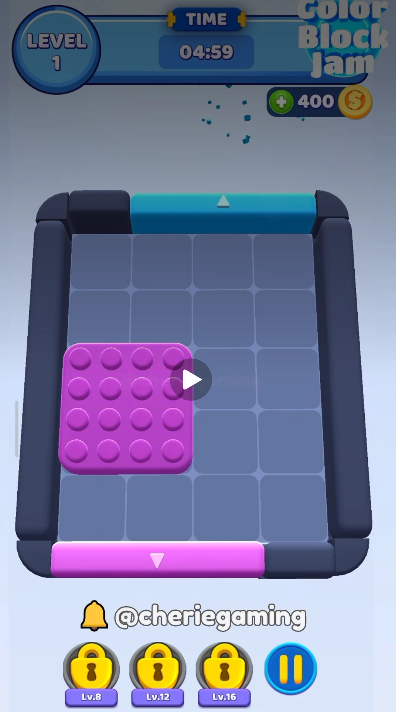
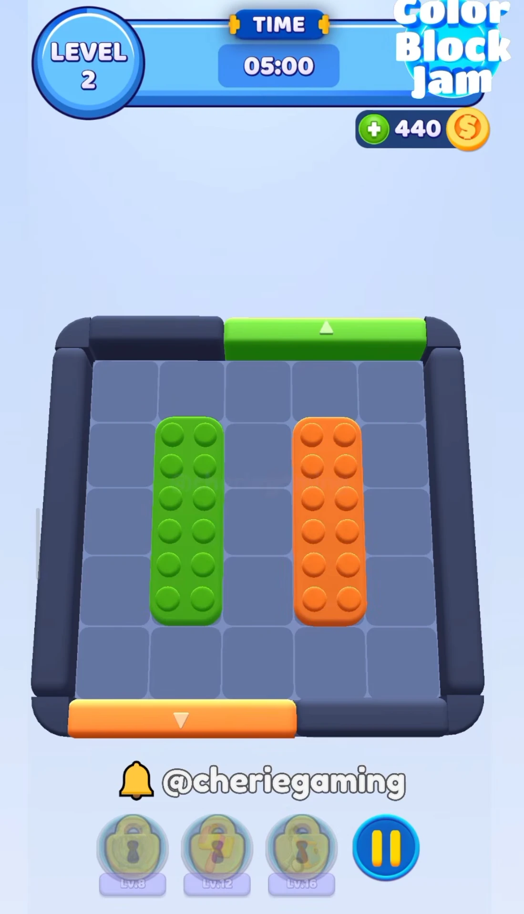
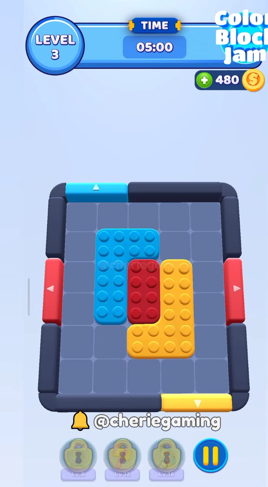
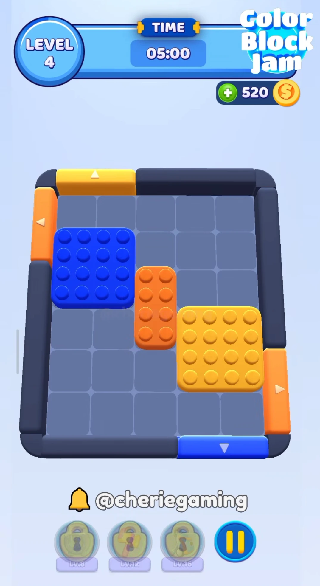
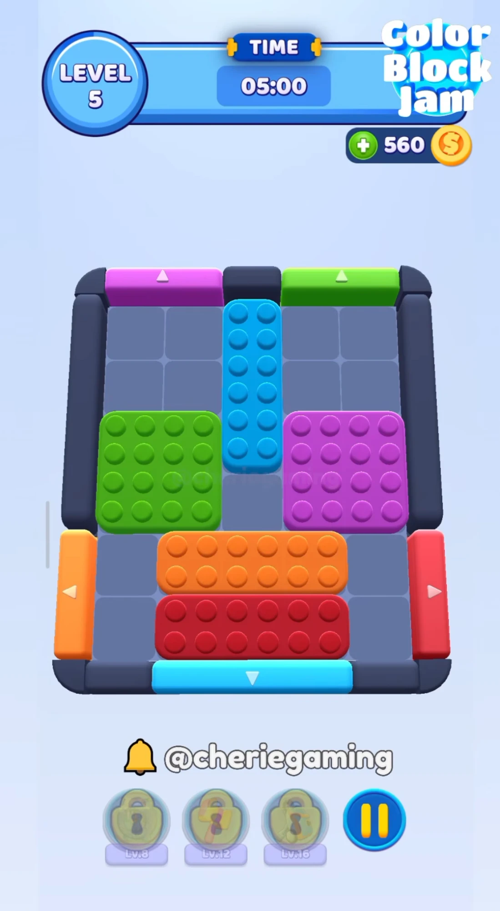
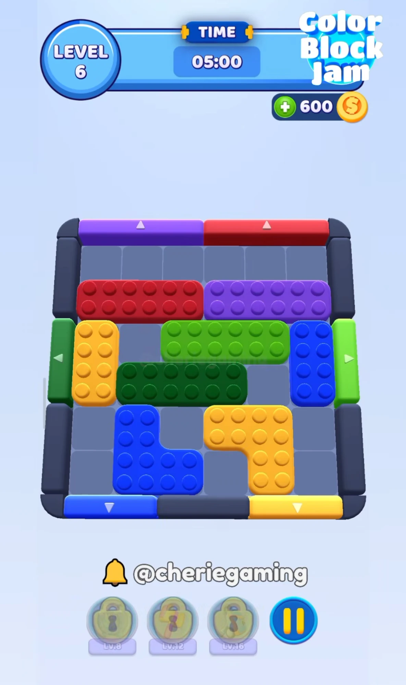
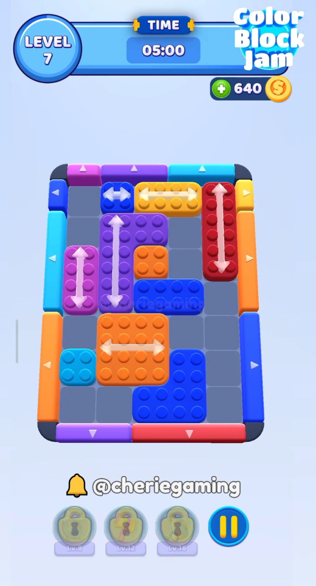
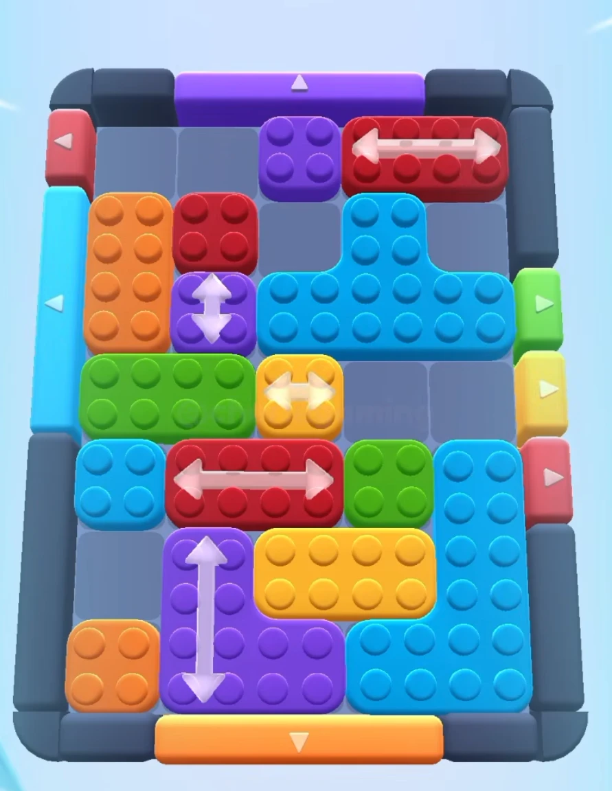
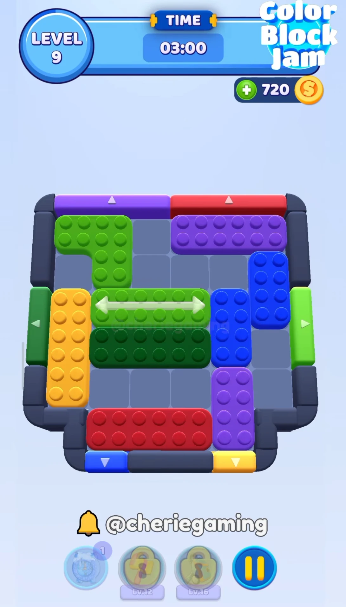
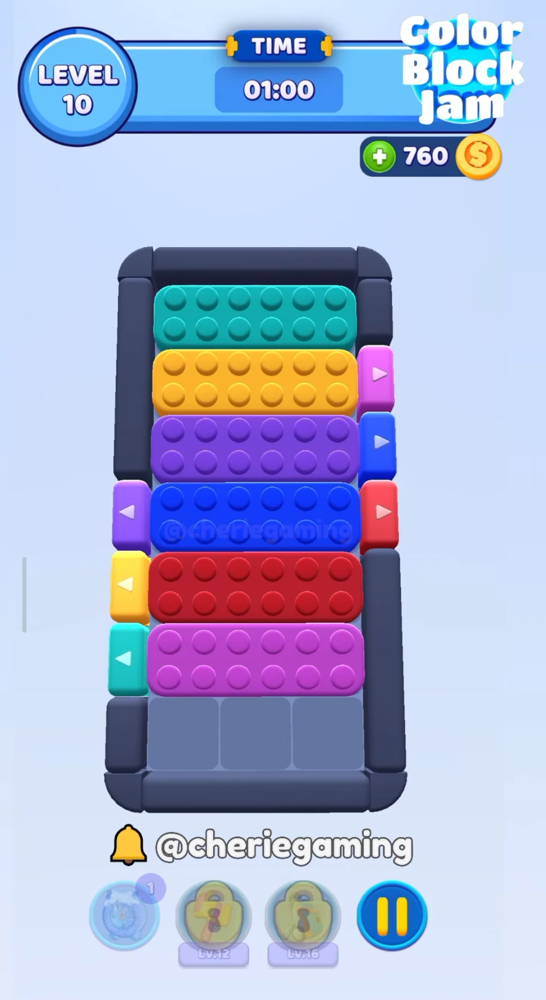

# Reference Levels 1–10

The user supplied gameplay captures of the first ten Color Block Jam levels on
2026-09-24 to test the play-area environment and, later, blocks and doors. This
page stores the captures unchanged and transcribes each board into the level
JSON schema. The captures carry a third-party creator watermark and are
behavior references only; no capture is imported as runtime art (DEC-47).

## Files

| File | Purpose |
|---|---|
| `docs/media/color-block-jam/reference-levels/level-NN.webp` | Unchanged captures, one per level |
| [`docs/levels/reference-levels.json`](levels/reference-levels.json) | Full transcription in the planned `formatVersion` 2 schema: `board.voidCells` and `arrow` block effects |
| [`docs/levels/reference-levels.v1.json`](levels/reference-levels.v1.json) | Subset the current `formatVersion` 1 loader accepts: arrows dropped, level 9 left out |
| `Assets/ColorBlockJam/Data/Json/Levels/Main/` (`manifest.json`, `pack-001.json`, DEC-196) | The game's active level database now holds levels 1–5 from the v1 file (user decision, 2026-09-25); levels 6–10 stay in the docs files |

`formatVersion` 1 cannot express void cells or block effects
(`LevelDatabaseJson` rejects both). The v2 file follows the schema handoff
(`production/tasks/TASK-20260924-185655569-dea430a7-play-area-environment/handoff-voidcells-schema.md`)
and the PRD arrow record `{"type": "arrow", "params": [{"key": "axis", "value": "Horizontal"}]}`.
Replace the v1 file with the v2 file once the level pipeline reads v2 and arrow effects.

## CBJ source format

The user also shared one level in the CBJ data format, stored unchanged as
[`docs/levels/cbj-example-level.json`](levels/cbj-example-level.json). It lists
floor cells (`CMS`), ring walls (`WMS`), ring door cells (`DMS`, `IH` =
horizontal) and blocks (`BMS`, colour `BCT`, absolute cells `BPMS`, mechanic
fields) with Newtonsoft `$type` metadata. The project keeps its own schema and
imports CBJ files through an editor importer (DEC-101,
`TASK-20260924-210811262-93892dee-cbj-level-import`). The example decodes to a
5 x 7 board with two top door groups, two left doors, five vertical triples and
three corner/T blocks; its `BCT 11` colour is not in the CBJ Template's 0–10
colour list, so the importer's colour table must confirm it.

### Importer

`Color Block Jam > Levels > Import CBJ Level...` (`Assets/ColorBlockJam/Editor/Core/Levels/CbjLevelImport.cs`)
picks one or more CBJ files and a target level database manifest, asks each
import's timer (PRD default 60 s), converts every file, and appends the
result through the existing validated save path (`LevelDatabaseAssets`, DEC-196). Nothing
is written when any selected file fails to convert. The pure conversion logic
is split by responsibility under `Editor/Core/Levels/Cbj/`:

- `CbjLevelSource.cs`: the raw block/door/wall/floor/ring-origin model.
- `CbjLevelReader.cs`: safe `JObject` parsing (`$type` is never read, so it
  never resolves a type) plus the mechanics gate — any non-default block
  mechanic field or non-empty mechanic array is collected and reported
  together, since no matching project effect exists yet.
- `CbjLevelConverter.cs`: board (bounding box, ring origin, void cells), doors
  (side/contiguity/`IH` agreement), the wall-consistency check against the
  project's own derived ring, block cells (duplicate removal with a warning)
  and shape matching, and colour resolution.

Colours come from the editable `CbjColorTable` asset
(`Assets/ColorBlockJam/Data/Levels/CbjColorTable.asset`, class
`CbjColorTable.cs`): one BCT-to-`PaletteColor` entry per known value, seeded
with the CBJ Template's default order (`BCT` 0-10 = Red, Orange, Yellow,
LightGreen, DarkGreen, LightTurquoise, DarkTurquoise, LightBlue, Blue, Purple,
Pink). A BCT value the table does not cover (the example's `BCT 11`) fails the
whole import naming that value and every block or door that uses it; a
designer adds the missing entry in the Inspector and imports again.

A block keeps only its cells; its piece is their footprint key (`ShapeKey`,
DEC-193), which is the same for every rotation and mirror, so a CBJ block drawn
as a vertical triple or a mirrored corner is the same piece as the library's base
orientation, and nothing is matched against the piece library. A footprint beyond
the piece limits (more than 25 cells, wider or taller than 5, or not 4-connected)
fails the level's own validation, which names the block.

A `CMS` gap inside the floor's bounding box converts to a `formatVersion` 2
`voidCells` entry (docs/Level-Data-Format.md) instead of failing the import;
`formatVersion` 1 predated void cells and could not express this (corrected
2026-09-28, once the v2 schema landed).

EditMode coverage:
`Assets/ColorBlockJam/Tests/Editor/EditMode/CbjLevelImportTests.cs` proves the
stored worked example (AC-1), the default table's `BCT 11` failure naming
every user (AC-2), each precise structural rejection plus the void-cell
conversion (AC-3), that a `$type` naming a real .NET type is never resolved
(AC-4), and an automated slice of the append through the database save
(`LevelDatabaseFiles`, AC-5); the interactive menu command itself is a manual Editor check.

## Transcription conventions

- Cell `(x, y)`: `x` is the column from the left, `y` the row from the bottom
  (the `LevelData` convention). Grids below list the top row first.
- `.` is an empty floor cell, `#` a void cell, a letter a block cell.
- Doors: `Top`/`Bottom` `start` counts columns from the left; `Left`/`Right`
  `start` counts rows from the bottom. `length` is the covered edge segments,
  so the JSON sets each door's width.
- Every block uses the exact `BlockShapeLibrary` shape whose cells match its
  footprint (RULE-5). `origin` is the footprint's lower-left cell.
- Timers are the HUD value at the start of the level. The level 1 capture
  shows 04:59, so its authored value is 300 s.

## Colour mapping

Screenshot colours map to the nearest `PaletteColor` gate id:

| Screenshot colour | `colorId` | Levels |
|---|---|---|
| Red | `Red` | 3, 5, 6, 7, 8, 9, 10 |
| Orange | `Orange` | 2, 4, 5, 7, 8 |
| Yellow | `Yellow` | 3, 4, 6, 7, 8, 9, 10 |
| Bright green | `LightGreen` | 2, 5, 6, 8, 9 |
| Dark green | `DarkGreen` | 6, 9 |
| Cyan | `LightBlue` | 1, 3, 5, 7, 8 |
| Royal blue | `Blue` | 4, 6, 7, 9, 10 |
| Violet | `Purple` | 6, 7, 8, 9, 10 |
| Magenta | `Pink` | 1, 5, 7, 10 |
| Teal | `DarkTurquoise` | 10 |

Judgement calls to confirm when a level is played:

- Level 1's top door is dimmed by the tutorial overlay; it reads as cyan
  (`LightBlue`). Its cyan block had already exited in the capture; its start
  position is inferred (see Level 1).
- Levels 6 and 9 have one dark and one bright green block. The darker left
  door is `DarkGreen`, the brighter right door `LightGreen`.
- Level 8's capture has no HUD, so its timer is assumed to be 300 s like
  levels 2–7.

## Board features the environment must show

| Feature | Levels |
|---|---|
| Plain rectangle with rounded outer corners | all |
| Door wider than one cell (JSON `length` 2–3) | 1, 2, 3, 4, 5, 6, 7, 8, 9 |
| Several doors on one side | 5, 6, 7, 8, 9, 10 |
| Doors meeting a board corner | 1, 3, 4, 5, 6, 7, 9 |
| Every edge segment of a side covered by doors | 7 |
| Void cells (bottom-corner notches with inner corners) | 9 |
| Narrow board (3 wide) | 10 |

Arrow blocks (`arrow` effect) appear in levels 7, 8 and 9. The environment
ignores them; they matter for the later block task.

## Levels

### Level 1



- Board: 4 x 5, timer 300 s, void cells: none.

```text
y4  . . . .
y3  . . B B
y2  A A B B
y1  A A . .
y0  . . . .
    0 1 2 3
```

| Block | Letter | Colour | Shape | Origin | Arrow |
|---|---|---|---|---|---|
| b1 | `B` | LightBlue | Square | (2,2) | - |
| b2 | `A` | Pink | Square | (0,1) | - |

The capture was taken one second in, after the cyan block had already left:
its cube fragments are still visible above the top door. The user confirmed
level 1 has two blocks (two gates). The cyan block's start is inferred as the
mirror of the pink block; it reaches the three-wide top door in one move.

| Door | Side | Start | Length | Colour |
|---|---|---|---|---|
| d1 | Top | 1 | 3 | LightBlue |
| d2 | Bottom | 0 | 3 | Pink |

### Level 2



- Board: 5 x 5, timer 300 s, void cells: none.

```text
y4  . . . . .
y3  . G . O .
y2  . G . O .
y1  . G . O .
y0  . . . . .
    0 1 2 3 4
```

| Block | Letter | Colour | Shape | Origin | Arrow |
|---|---|---|---|---|---|
| b1 | `G` | LightGreen | TripleVertical | (1,1) | - |
| b2 | `O` | Orange | TripleVertical | (3,1) | - |

| Door | Side | Start | Length | Colour |
|---|---|---|---|---|
| d1 | Top | 2 | 3 | LightGreen |
| d2 | Bottom | 0 | 3 | Orange |

### Level 3



- Board: 5 x 6, timer 300 s, void cells: none.

```text
y5  . . . . .
y4  . C C . .
y3  . C R Y .
y2  . C R Y .
y1  . . Y Y .
y0  . . . . .
    0 1 2 3 4
```

| Block | Letter | Colour | Shape | Origin | Arrow |
|---|---|---|---|---|---|
| b1 | `C` | LightBlue | LTypeB1 | (1,2) | - |
| b2 | `R` | Red | DoubleVertical | (2,2) | - |
| b3 | `Y` | Yellow | LTypeT1 | (2,1) | - |

| Door | Side | Start | Length | Colour |
|---|---|---|---|---|
| d1 | Top | 0 | 2 | LightBlue |
| d2 | Left | 2 | 2 | Red |
| d3 | Right | 2 | 2 | Red |
| d4 | Bottom | 3 | 2 | Yellow |

### Level 4



- Board: 5 x 6, timer 300 s, void cells: none.

```text
y5  . . . . .
y4  B B . . .
y3  B B O . .
y2  . . O Y Y
y1  . . . Y Y
y0  . . . . .
    0 1 2 3 4
```

| Block | Letter | Colour | Shape | Origin | Arrow |
|---|---|---|---|---|---|
| b1 | `B` | Blue | Square | (0,3) | - |
| b2 | `O` | Orange | DoubleVertical | (2,2) | - |
| b3 | `Y` | Yellow | Square | (3,1) | - |

| Door | Side | Start | Length | Colour |
|---|---|---|---|---|
| d1 | Top | 0 | 2 | Yellow |
| d2 | Left | 4 | 2 | Orange |
| d3 | Right | 0 | 2 | Orange |
| d4 | Bottom | 3 | 2 | Blue |

### Level 5



- Board: 5 x 6, timer 300 s, void cells: none.

```text
y5  . . C . .
y4  . . C . .
y3  G G C P P
y2  G G . P P
y1  . O O O .
y0  . R R R .
    0 1 2 3 4
```

| Block | Letter | Colour | Shape | Origin | Arrow |
|---|---|---|---|---|---|
| b1 | `C` | LightBlue | TripleVertical | (2,3) | - |
| b2 | `G` | LightGreen | Square | (0,2) | - |
| b3 | `P` | Pink | Square | (3,2) | - |
| b4 | `O` | Orange | TripleHorizontal | (1,1) | - |
| b5 | `R` | Red | TripleHorizontal | (1,0) | - |

| Door | Side | Start | Length | Colour |
|---|---|---|---|---|
| d1 | Top | 0 | 2 | Pink |
| d2 | Top | 3 | 2 | LightGreen |
| d3 | Left | 0 | 2 | Orange |
| d4 | Right | 0 | 2 | Red |
| d5 | Bottom | 1 | 3 | LightBlue |

### Level 6



- Board: 6 x 6, timer 300 s, void cells: none.

```text
y5  . . . . . .
y4  R R R P P P
y3  Y . G G G B
y2  Y D D D . B
y1  . L . K K .
y0  . L L . K .
    0 1 2 3 4 5
```

| Block | Letter | Colour | Shape | Origin | Arrow |
|---|---|---|---|---|---|
| b1 | `R` | Red | TripleHorizontal | (0,4) | - |
| b2 | `P` | Purple | TripleHorizontal | (3,4) | - |
| b3 | `Y` | Yellow | DoubleVertical | (0,2) | - |
| b4 | `G` | LightGreen | TripleHorizontal | (2,3) | - |
| b5 | `B` | Blue | DoubleVertical | (5,2) | - |
| b6 | `D` | DarkGreen | TripleHorizontal | (1,2) | - |
| b7 | `L` | Blue | CornerLB | (1,0) | - |
| b8 | `K` | Yellow | CornerRT | (3,0) | - |

| Door | Side | Start | Length | Colour |
|---|---|---|---|---|
| d1 | Top | 0 | 3 | Purple |
| d2 | Top | 3 | 3 | Red |
| d3 | Left | 2 | 2 | DarkGreen |
| d4 | Right | 2 | 2 | LightGreen |
| d5 | Bottom | 0 | 2 | Blue |
| d6 | Bottom | 4 | 2 | Yellow |

### Level 7



- Board: 5 x 7, timer 300 s, void cells: none.

```text
y6  . b y y r
y5  . u u . r
y4  m u o . r
y3  m u n n .
y2  . O O . .
y1  c O O e .
y0  . . e e .
    0 1 2 3 4
```

| Block | Letter | Colour | Shape | Origin | Arrow |
|---|---|---|---|---|---|
| b1 | `b` | Blue | Single | (1,6) | Horizontal |
| b2 | `y` | Yellow | DoubleHorizontal | (2,6) | Horizontal |
| b3 | `r` | Red | TripleVertical | (4,4) | Vertical |
| b4 | `u` | Purple | LTypeB1 | (1,3) | Vertical |
| b5 | `m` | Pink | DoubleVertical | (0,3) | Vertical |
| b6 | `o` | Orange | Single | (2,4) | - |
| b7 | `n` | Blue | DoubleHorizontal | (2,3) | - |
| b8 | `O` | Orange | Square | (1,1) | Horizontal |
| b9 | `c` | LightBlue | Single | (0,1) | - |
| b10 | `e` | Blue | CornerRB | (2,0) | - |

| Door | Side | Start | Length | Colour |
|---|---|---|---|---|
| d1 | Top | 0 | 1 | Pink |
| d2 | Top | 1 | 2 | Purple |
| d3 | Top | 3 | 2 | LightBlue |
| d4 | Left | 6 | 1 | Blue |
| d5 | Left | 3 | 3 | LightBlue |
| d6 | Left | 0 | 3 | Orange |
| d7 | Right | 6 | 1 | Yellow |
| d8 | Right | 3 | 3 | Orange |
| d9 | Right | 0 | 3 | Blue |
| d10 | Bottom | 0 | 2 | Purple |
| d11 | Bottom | 2 | 3 | Red |

### Level 8



- Board: 5 x 7, timer 300 s (not visible in the capture; assumed), void cells: none.

```text
y6  . . p r r
y5  o R . T .
y4  o q T T T
y3  g g Y . .
y2  c s s G L
y1  . P y y L
y0  O P P L L
    0 1 2 3 4
```

| Block | Letter | Colour | Shape | Origin | Arrow |
|---|---|---|---|---|---|
| b1 | `p` | Purple | Single | (2,6) | - |
| b2 | `r` | Red | DoubleHorizontal | (3,6) | Horizontal |
| b3 | `o` | Orange | DoubleVertical | (0,4) | - |
| b4 | `R` | Red | Single | (1,5) | - |
| b5 | `T` | LightBlue | TTypeT | (2,4) | - |
| b6 | `q` | Purple | Single | (1,4) | Vertical |
| b7 | `g` | LightGreen | DoubleHorizontal | (0,3) | - |
| b8 | `Y` | Yellow | Single | (2,3) | Horizontal |
| b9 | `c` | LightBlue | Single | (0,2) | - |
| b10 | `s` | Red | DoubleHorizontal | (1,2) | Horizontal |
| b11 | `G` | LightGreen | Single | (3,2) | - |
| b12 | `L` | LightBlue | LTypeT1 | (3,0) | - |
| b13 | `P` | Purple | CornerLB | (1,0) | Vertical |
| b14 | `y` | Yellow | DoubleHorizontal | (2,1) | - |
| b15 | `O` | Orange | Single | (0,0) | - |

| Door | Side | Start | Length | Colour |
|---|---|---|---|---|
| d1 | Top | 1 | 3 | Purple |
| d2 | Left | 6 | 1 | Red |
| d3 | Left | 3 | 3 | LightBlue |
| d4 | Right | 4 | 1 | LightGreen |
| d5 | Right | 3 | 1 | Yellow |
| d6 | Right | 2 | 1 | Red |
| d7 | Bottom | 1 | 3 | Orange |

### Level 9



- Board: 6 x 6, timer 180 s, void cells: (0,0), (5,0).

```text
y5  g g . p p p
y4  . g . . . B
y3  Y l l l b B
y2  Y d d d b .
y1  Y . . . v .
y0  # r r r v #
    0 1 2 3 4 5
```

| Block | Letter | Colour | Shape | Origin | Arrow |
|---|---|---|---|---|---|
| b1 | `g` | LightGreen | CornerRT | (0,4) | - |
| b2 | `p` | Purple | TripleHorizontal | (3,5) | - |
| b3 | `B` | Blue | DoubleVertical | (5,3) | - |
| b4 | `Y` | Yellow | TripleVertical | (0,1) | - |
| b5 | `l` | LightGreen | TripleHorizontal | (1,3) | Horizontal |
| b6 | `b` | Blue | DoubleVertical | (4,2) | - |
| b7 | `d` | DarkGreen | TripleHorizontal | (1,2) | - |
| b8 | `v` | Purple | DoubleVertical | (4,0) | - |
| b9 | `r` | Red | TripleHorizontal | (1,0) | - |

| Door | Side | Start | Length | Colour |
|---|---|---|---|---|
| d1 | Top | 0 | 3 | Purple |
| d2 | Top | 3 | 3 | Red |
| d3 | Left | 2 | 2 | DarkGreen |
| d4 | Right | 2 | 2 | LightGreen |
| d5 | Bottom | 1 | 1 | Blue |
| d6 | Bottom | 4 | 1 | Yellow |

### Level 10



- Board: 3 x 7, timer 60 s, void cells: none.

```text
y6  t t t
y5  y y y
y4  p p p
y3  b b b
y2  r r r
y1  k k k
y0  . . .
    0 1 2
```

| Block | Letter | Colour | Shape | Origin | Arrow |
|---|---|---|---|---|---|
| b1 | `t` | DarkTurquoise | TripleHorizontal | (0,6) | - |
| b2 | `y` | Yellow | TripleHorizontal | (0,5) | - |
| b3 | `p` | Purple | TripleHorizontal | (0,4) | - |
| b4 | `b` | Blue | TripleHorizontal | (0,3) | - |
| b5 | `r` | Red | TripleHorizontal | (0,2) | - |
| b6 | `k` | Pink | TripleHorizontal | (0,1) | - |

| Door | Side | Start | Length | Colour |
|---|---|---|---|---|
| d1 | Right | 5 | 1 | Pink |
| d2 | Right | 4 | 1 | Blue |
| d3 | Right | 3 | 1 | Red |
| d4 | Left | 3 | 1 | Purple |
| d5 | Left | 2 | 1 | Yellow |
| d6 | Left | 1 | 1 | DarkTurquoise |
