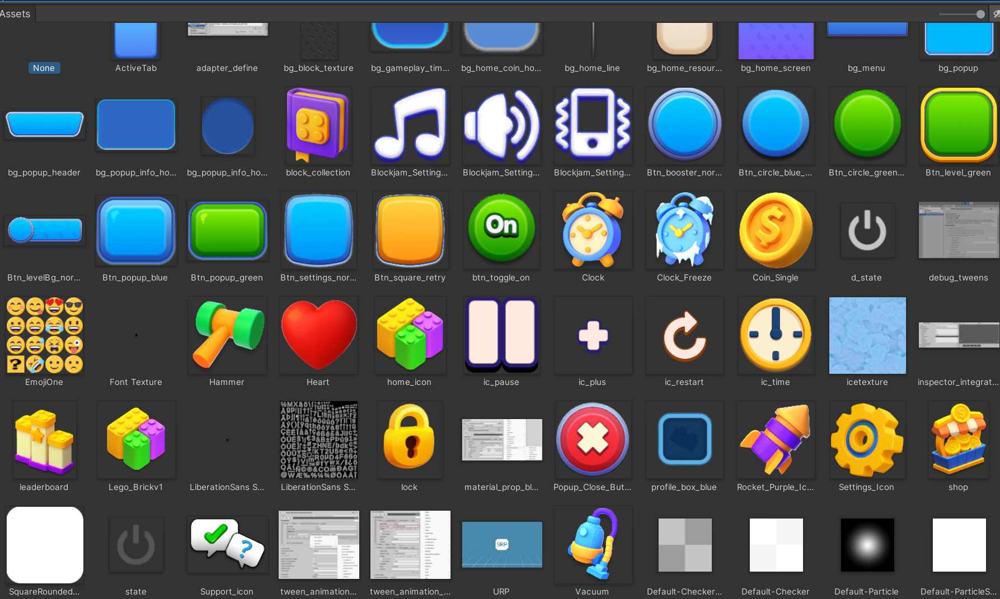

# UI Asset Mapping

This is the screen/control map for the PNG sprites actually present under `Assets/ColorBlockJam/Art/UI` on 2026-09-24. Paths are relative to the repository; GUIDs come from each adjacent Unity `.meta` file. It is an art selection reference, not a claim that a runtime `UIDocument` already assigns these sprites. Keep the source filenames. The imported-assets screenshot below was supplied by the user and copied unchanged; it also shows Unity/package debug textures that are not game UI art.

For PRD requirement ownership, imported cast prefabs and all 65 art files, use [Art Asset to PRD Mapping](Art-Asset-PRD-Mapping.md). These screen tables include all 47 supplied UI sprites, including reserved utilities.

## Gameplay and boosters

| Screen/control | Actual PNG path | GUID | Use |
| --- | --- | --- | --- |
| HUD Time Freeze | `Assets/ColorBlockJam/Art/UI/Supplied/Icons/Boosters/ic_clock_freeze.png` | `595a0397295c38948a7aea1604b256ea` | Blue iced clock icon. |
| HUD and pre-level Rocket | `Assets/ColorBlockJam/Art/UI/Supplied/Icons/Boosters/ic_rocket_purple.png` | `26eda7e8b8a114e49a96cdf2ea529cdb` | One icon for the shared effect and stock. |
| HUD Hammer | `Assets/ColorBlockJam/Art/UI/Supplied/Icons/Boosters/ic_hammer.png` | `7c749acedd2fb114383b37d7bf12f588` | Illustrated button icon; not a 3D mesh. |
| HUD Vacuum | `Assets/ColorBlockJam/Art/UI/Supplied/Icons/Boosters/ic_vacuum.png` | `99253d5b51f461c48a9913738f29c99a` | HUD icon only. The approved upright cast is `Prefabs/Boosters/Effects/VacuumEffect.prefab`; see the art-to-PRD map. |
| Pre-level Extra Time | `Assets/ColorBlockJam/Art/UI/Supplied/Icons/Gameplay/ic_clock.png` | `c6ec5808a77154449adcef75009c5427` | Alarm-clock fallback plus explicit UI Toolkit “Extra Time” label; no dedicated hourglass imported. |
| Four HUD button backs | `Assets/ColorBlockJam/Art/UI/Supplied/Buttons/btn_booster_normal.png` | `f8c21e0c1e476644796c46ffbdac013b` | Shared slot background; state and stock are separate UI Toolkit elements. |
| Gameplay timer holder | `Assets/ColorBlockJam/Art/UI/Supplied/Panels/bg_gameplay_time_holder.png` | `d1532cdaa44f9744f98209ebfb479b7d` | Main timer background. Time Freeze's separate 10-to-0 count is a UI Toolkit label. |
| Timer, pause, restart glyphs | `Assets/ColorBlockJam/Art/UI/Supplied/Icons/Gameplay/ic_time.png`; `Assets/ColorBlockJam/Art/UI/Supplied/Icons/Gameplay/ic_pause.png`; `Assets/ColorBlockJam/Art/UI/Supplied/Icons/Gameplay/ic_restart.png` | `195b567d34a82944f8b385a5ad6a0d9c`; `6b78223fff4898542bfe5025d6ac7d2f`; `ae45d62ab6946fc47a3a2736a5e30046` | HUD controls and time symbol. |

## Home, pre-level selection, and navigation

| Screen/control | Actual PNG path | GUID | Use |
| --- | --- | --- | --- |
| Home background and route | `Assets/ColorBlockJam/Art/UI/Supplied/Backgrounds/bg_home_screen.png`; `Assets/ColorBlockJam/Art/UI/Supplied/Backgrounds/bg_home_line.png` | `3c026b678bd7c7246b92d103317a560f`; `f017487a8327c804eb914c46fcf9686c` | Full-screen background and route decoration. |
| Settings background / optional decoration | `Assets/ColorBlockJam/Art/UI/Supplied/Backgrounds/bg_menu.png`; `Assets/ColorBlockJam/Art/UI/Supplied/Backgrounds/bg_block_texture.png` | `3ebc1a9d81ab8714389a88bcf4cb4a63`; `c0caab1f906d8974eb3570b81b2c77c8` | bg_menu is the Settings background. bg_block_texture is an optional tinted decoration with no required screen placement; the board uses the 3D kit. |
| Home coin and resource holders | `Assets/ColorBlockJam/Art/UI/Supplied/Panels/bg_home_coin_holder.png`; `Assets/ColorBlockJam/Art/UI/Supplied/Panels/bg_home_resource_holder.png` | `e1e3b04b16d42ee4d9e4c6ce5f4ac7c6`; `3b06c5352b926ef409afcc444fd73fc9` | Top bar holders. |
| Home profile placeholder | `Assets/ColorBlockJam/Art/UI/Supplied/Panels/bg_profile_box_blue.png` | `eb4dfeec9f9653e448e47707264c6c1f` | Profile-box press/release feedback under AC-1.6. |
| Reserved rounded mask | `Assets/ColorBlockJam/Art/UI/Supplied/Masks/mask_square_rounded.png` | `f362cb74ac773f644bdf31bb39444218` | Fixed-aspect utility; no new screen or control is implied. |
| Level button and backing | `Assets/ColorBlockJam/Art/UI/Supplied/Buttons/btn_level_green.png`; `Assets/ColorBlockJam/Art/UI/Supplied/Buttons/btn_level_bg_normal.png` | `c881e5df6164983429b371ae10f3a660`; `34af3ba7e2012fc4dbc8e764b5de5bb2` | Home Level action. |
| Pre-level unselected/selected circles | `Assets/ColorBlockJam/Art/UI/Supplied/Buttons/btn_circle_blue_small.png`; `Assets/ColorBlockJam/Art/UI/Supplied/Buttons/btn_circle_green_small.png` | `02ef71445fd8a7b41bd227328bc47e47`; `5d010ec8ca79d2f42a93707c7eda82f6` | Blue available state and green selected state. Add a UI Toolkit check glyph and count label; no separate check sprite is supplied. |
| Active tab backing | `Assets/ColorBlockJam/Art/UI/Supplied/Panels/bg_active_tab.png` | `188c336aabb9af24484f166743a378e9` | Raised Home tab highlight. |
| Home, Shop, Collection tabs | `Assets/ColorBlockJam/Art/UI/Supplied/Icons/Navigation/ic_home.png`; `Assets/ColorBlockJam/Art/UI/Supplied/Icons/Navigation/ic_shop.png`; `Assets/ColorBlockJam/Art/UI/Supplied/Icons/Navigation/ic_block_collection.png` | `efc9c1ff96029f64eb32f44d83596a42`; `049152c9b9a3fac4f88c8f666c0bf3b8`; `0a2a7091b0928c6418a3eab257418d82` | Shop and Collection stay visibly locked for this case. |
| Other tab icons | `Assets/ColorBlockJam/Art/UI/Supplied/Icons/Navigation/ic_leaderboard.png`; `Assets/ColorBlockJam/Art/UI/Supplied/Icons/Navigation/ic_lego_brick_v1.png` | `1cd23353d55c2ea46ae97c25bc12c737`; `39ac4e49d754bf74bada116c5ee7aae6` | Leaderboard is a placeholder tab; ic_lego_brick_v1 is reserved optional decoration, with no extra tab or feature required. |
| Lock overlay | `Assets/ColorBlockJam/Art/UI/Supplied/Icons/Navigation/ic_lock.png` | `f6af1405a17562f44a70eac3ddce241a` | Locked tabs or panels; UI Toolkit provides any level label. |
| Settings and support entry | `Assets/ColorBlockJam/Art/UI/Supplied/Icons/Navigation/ic_settings.png`; `Assets/ColorBlockJam/Art/UI/Supplied/Icons/Navigation/ic_support.png` | `163d819be7f5bdc4cb6b6cc18186ebb5`; `7cff53470981d494e8750f1fb40c7f7e` | Navigation icons. |

## Popups, currency, and settings

| Screen/control | Actual PNG path | GUID | Use |
| --- | --- | --- | --- |
| Popup shell and header | `Assets/ColorBlockJam/Art/UI/Supplied/Panels/bg_popup.png`; `Assets/ColorBlockJam/Art/UI/Supplied/Panels/bg_popup_header.png` | `58167b54281f6a7438d47ef6ed4509b0`; `baeb46b458b90574cadccf94686b1d6b` | Shared modal body and title background. |
| Popup information holders | `Assets/ColorBlockJam/Art/UI/Supplied/Panels/bg_popup_info_holder.png`; `Assets/ColorBlockJam/Art/UI/Supplied/Panels/bg_popup_info_holder_2.png` | `3edfb6bd390808e4ba7390664221b418`; `0300f673f96a60d4c9ec5a3395d0f9f1` | Detail and price groups. |
| Popup actions and close | `Assets/ColorBlockJam/Art/UI/Supplied/Buttons/btn_popup_green.png`; `Assets/ColorBlockJam/Art/UI/Supplied/Buttons/btn_popup_blue.png`; `Assets/ColorBlockJam/Art/UI/Supplied/Buttons/btn_popup_close.png` | `88ed48e414904bc47a1b1e2c4b972442`; `cdf10c6f1f6288148ae61fec555dff6f`; `aa68243640f737f4f80888f846c4924f` | Buy/Play/Continue, secondary action, dismiss. |
| Retry action | `Assets/ColorBlockJam/Art/UI/Supplied/Buttons/btn_square_retry.png` | `3ee174f6f558e5d44baa212d55d4c3ab` | Failure or reward-save retry control where specified. |
| Coin and plus badge | `Assets/ColorBlockJam/Art/UI/Supplied/Icons/Currency/ic_coin_single.png`; `Assets/ColorBlockJam/Art/UI/Supplied/Icons/Currency/ic_plus.png` | `f6855176a87142c4981ea278b281d4e8`; `ecc7d7841af7798408efd540539bcc26` | Balance, reward, price, and zero-stock badge. No coin-pile sprite is supplied. |
| Resource heart | `Assets/ColorBlockJam/Art/UI/Supplied/Icons/Currency/ic_heart.png` | `8476b6bbb0236ca488b4cf627ae34193` | Top resource display if retained by the Home layout. |
| Settings button and active toggle | `Assets/ColorBlockJam/Art/UI/Supplied/Buttons/btn_settings_normal.png`; `Assets/ColorBlockJam/Art/UI/Supplied/Buttons/btn_toggle_on.png` | `90307f3a3ca4e2c4e9775c1553334fd7`; `f5e5cab4e0c091449ad3ac3b1523cfc6` | Settings row control and on state. |
| Music, sound, vibration | `Assets/ColorBlockJam/Art/UI/Supplied/Icons/Settings/ic_settings_music.png`; `Assets/ColorBlockJam/Art/UI/Supplied/Icons/Settings/ic_settings_sound.png`; `Assets/ColorBlockJam/Art/UI/Supplied/Icons/Settings/ic_settings_vibration.png` | `00ecc886036c0d24996e9f383a07bfb1`; `54807d6703ef6bb40aa956a3b19f46f3`; `9ddda5d6c8ae8e745bf7ead748d2e27b` | Settings row icons. |

UI Toolkit provides labels, numeric counts, the check mark, targeting instructions, completion title, and separate Time Freeze digits. The supplied UI set has no dedicated red/orange Rocket, hourglass, coin pile or large completion lettering. The original model kit lacks a mallet; the separately authored Hammer model and HammerEffect prefab are now imported under `Assets/ColorBlockJam/Art/Models/Boosters`. Reference screenshots in [Visual References](Color-Block-Jam-Visual-References.md) remain visual evidence, not importable runtime art.

For layout, follow `AGENTS.md`: panels and stretching button backgrounds are nine-slice candidates and need measured Sprite Editor borders, Full Rect mesh, and matching UI Toolkit `-unity-slice-*` values. This map does not claim those borders have been measured or set. Icons, masks, and full-screen backgrounds stay fixed-aspect; backgrounds use `scale-and-crop`. The separate `docs/UI-Asset-Import.md` audit prescribed by `AGENTS.md` has not yet been created. No import settings or serialized references were changed for this map.
