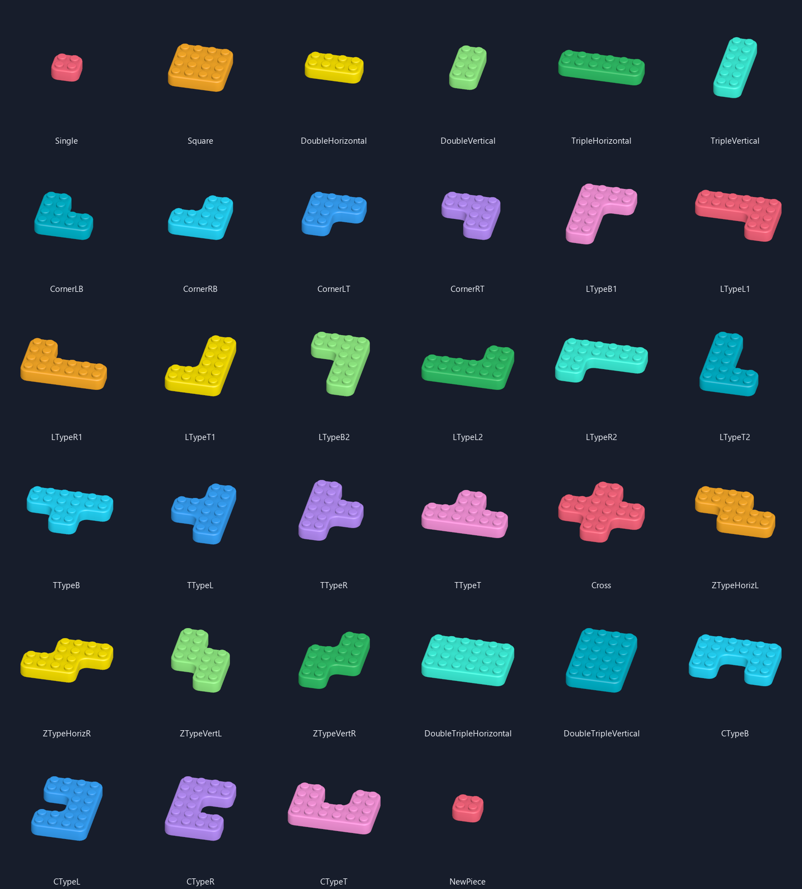

# Modular board kit

Superseded in part by DEC-193 (2026-09-29): library entries no longer have derived prefabs, enum names or
numeric ids. The piece library (`Data/Json/Pieces/BlockShapeLibrary.json`, `{name, cells}` records) is
editor-only, a block type is its footprint key, and every block root is `Prefabs/Board/ModularBlock.prefab`
with `BlockPiece`. The sections below describe the kit as it was built; the mesh calibration still holds.

The 33 reference footprints use only the supplied `BlockParts.fbx` meshes.
Each library entry also has a derived prefab; no new board geometry is generated. Original models, names
and GUIDs are preserved. `ModularBlock_Base` is absent from the imported kit;
the defective `corner_3.002` is excluded.

## Calibration and assets

- One gameplay cell is **1 Unity unit**, with **2×2 LEGO studs**. Each original
  Center/Edge/OuterCorner is a half-cell tile; InnerCorner contains three tiles.
- `BlockPieceComposer` examines four neighboring cells at each grid vertex.
  Full coverage uses four Center children, a straight boundary uses two Edge
  children, a convex corner one OuterCorner, and a concave corner one InnerCorner.
  Opposite occupied quadrants use two opposing convex pieces. There are no
  overlapping top surfaces or extra studs.
- `Prefabs/Board/Pieces/`: four block tile prefabs plus Wall, Corner_1,
  Door_1x1, Door_Arrow, Grid and three arrow lengths. Mesh references
  point directly to the original four supplied FBXs. Wall/gate height is 0.72.
  Wall runs along Z; Door_1x1 runs along X. Apply the appropriate yaw for each
  board edge. Their closed source -Y tops face upward after the X180 calibration.
- `Data/Board/BoardPieceCatalog.asset` maps tiles and environment references.
  `Prefabs/Board/ModularBlock.prefab` stays empty until explicitly prepared.
  Child meshes may be duplicated, disabled or reordered within each tile prefab.
- `Data/Board/PieceDatabases/BlockShapeLibrary.json` owns stable numeric IDs, enum names,
  display names and normalized cells. `BlockShapeLibrary.asset` retains its GUID
  and stores only the JSON TextAsset plus type-to-prefab references.
  These bindings reference `Prefabs/Board/Shapes/Piece_<numeric ID>.prefab` files.
  Each has a `BlockPiece` root and a passive `GeneratedShape` preview assembled
  from the original tile prefabs. The active JSON contains 11 base footprints;
  since 2026-09-25 the enum and prefab bindings hold only these 11 (the unused
  older IDs were removed on the user's order). Runtime copies the data; it
  never edits these assets.

Paths above are relative to `Assets/ColorBlockJam/`.

### Arrow visuals

`Pieces/Arrow_1.prefab`, `Arrow_2.prefab` and `Arrow_3.prefab` use the original
double-headed meshes with their existing GUIDs. They share `MAT_Gameplay`; their
property-block tint comes from `GamePalette.ArrowColor` (white). Each root is
centered in X/Z, has identity scale/rotation, and points along local Z. Rotate
the root Y90 for horizontal display. Parent at the block's local ground origin
and position over the desired footprint center; the child already includes
stud clearance, so it needs no extra vertical offset for the standard block kit.

**Color Block Jam > Art > Prepare Arrow Prefabs** updates only these three
visual prefabs and persists the palette field. It preserves original meshes,
custom prefab content and GUIDs, centers the marker, positions its underside
0.025 units above the highest stud and disables cast shadows. The full board-kit
builder also applies this calibration. Each supplied arrow is 394 triangles.

This is visual preparation only, as requested. Block Effect Data assignment,
axis restrictions and effect pooling belong to their later owning feature;
no automatic layout/presenter component is added. See [ArrowPrefabs.png](ArrowPrefabs.png)
for the three sizes on the existing LEGO blocks and [arrows.md](arrows.md) for verification.

## Palette and editor

`Data/Art/GamePalette.asset` maps 11 block/gate colors and Wall/Ground to the
authored atlas through one `Colours` list, plus a separate Arrow Cell. The
redundant Booster Swatches list was removed on 2026-09-30. Booster UV roles reuse
LightTurquoise, Blue, Purple, Yellow, Orange, LightGreen, DarkGreen and the light
LightTurquoise cell. All board renderers share `MAT_Gameplay` and one cached
property-block owner for atlas selection and clipping; no runtime material clones.
Blender reads the derived `ArtSource/BoardKit/palette-export.json`; export it from
**Color Block Jam > Art > Export Shared Palette for Blender** before a rebake.
After editing Colours or its atlas pixels, run **Color Block Jam > Art > Update
Shared Art Material**. It copies those colors into the lower two atlas rows for
the existing booster UVs and exports the same colors for Blender. Keep authored
Cell, Light Cell and Arrow Cell coordinates in the upper two rows. Model UVs
stay unchanged; baked sprites need a separate rebake to change their appearance.

Open **Color Block Jam > Level Editor** and use its **Piece Editor** tab:

- The 11 base-shape JSON is selected in **Piece Database** on first open.
  The small **+** beside the selector opens a name popup; enter a unique name
  and choose **Create** (or press Enter) to copy the active records. The popup
  explains an invalid or taken name and keeps Create disabled until it is fixed.
  The read-only JSON Source field sits above the database selector and shows the
  selected file. These files live in
  `Data/Board/PieceDatabases/`. Creating or selecting a database immediately
  assigns its JSON to the existing `BlockShapeLibrary.asset` and prepares its
  enum identities and prefab bindings. The small X beside the selector deletes
  the selected JSON after confirmation and switches back to BlockShapeLibrary.
  The default BlockShapeLibrary JSON is protected from deletion. No second
  ScriptableObject is created.
- The drawing area is a fixed 7×7 grid around cell (0, 0); a saved piece wider
  or taller than five cells opens in a larger grid that fits it. Left-drag paints;
  right-drag erases. The drawing viewport and 3D preview are both 320×320;
  rectangular grids keep square cells and center within the viewport. The
  non-interactive cross stays at the grid's visual center. Filled cells match
  the selected preview palette.
- **Ctrl+Z** undoes and **Ctrl+Shift+Z** redoes grid edits. A complete paint/erase
  drag is one step; Clear and Rotate also support Undo.
  These editor shortcuts run only while the Piece Editor window is focused;
  their help text and the live cell/status message share the info box at the top.
  Grid history preserves the current piece name and preview color. Text fields
  retain their editing shortcuts. Saving or switching pieces resets draft
  history. Saved JSON uses the library's Undo history.
- **New piece** opens an unsaved draft without writing assets/source or compiling.
  Fill **Name** and paint the draft; **Save piece** derives a PascalCase type label,
  appends a numeric ID within the selected JSON and saves its occupied cells. Empty
  margins are trimmed. Saving also updates its enum and derived prefab. The type
  label stays internal: **Piece library** lists numbered names such as `6. L Shape`.
  Switching away from unsaved edits asks before discarding them.
- **Delete selected piece** removes its record from the selected JSON after
  confirmation. The enum identity and generated prefab remain reserved.
  Editing a saved piece keeps its ID and type label.
- New/Delete are wide buttons above the editor; Save/Clear/Rotate are below.
  Empty, disconnected, duplicate or oversized shapes are rejected. The 3D preview
  uses an isolated scene.
  Its angle stays fixed; the framing center and orthographic size update for
  each piece's bounds.
- **Level Editor link.** The Level Editor opens the Piece Editor on a library
  piece (`ShowLibraryPiece`) or on a piece that belongs only to one level
  (`ShowLevelPiece` with a `LevelPieceRequest`: level id, piece id, cells and
  the piece's name). `ShowLevelPiece(request, false)` updates an open Piece
  Editor without taking the focus, so drawing in the Level Editor continues.
  - In level-piece mode the info box names the level and the piece, the Name
    field shows the piece's name, and there is no Save piece button: each
    change reaches the level as it is made. `LevelPieceChanged` carries the
    normalized cells and the name after a stroke that changed cells, Rotate
    90°, a grid undo or redo, and a committed name edit (Enter, or leaving the
    field). An empty grid or a blank name is not sent. The event is raised
    before the stroke's undo group closes, so one Undo reverts the grid and the
    level's edit together. It writes no library data.
  - A request equal to the piece already shown changes nothing, so the draft
    keeps its undo history. A level-piece draft never asks the discard question.
  - **Save Level** in the Level Editor adds the level's new pieces through
    `ShapeLibraryAuthoring.TryAddPieces`: one transaction, one library undo step
    and one enum import for the whole batch, under the TypeNames the level's
    blocks already use. An entry equal to an existing record is skipped, so a
    retry adds nothing twice. An invalid entry, Play Mode, a running compilation
    or a failed write changes nothing.
  - **Save as template** adds the piece to the selected Piece Database at once
    through the normal Save (new enum identity and prefab) and returns to
    library mode.
  - Only the designer's Save Level or Save as template click writes the library.
  - **Delete selected piece** is disabled in this mode. **New piece** or a
    library piece leaves the mode. The mode, the request and its draft survive
    a domain reload.
  - Every successful library commit, undo and redo included, raises
    `ShapeLibraryAuthoring.LibraryCommitted`. The Piece Editor re-reads its
    cached JSON on it, so a Save after another window changed the database is
    accepted.
  - Tasks: `production/tasks/TASK-20260925-145158848-5858b722-piece-editor-level-link`
    and `production/tasks/TASK-20260925-185129336-2df1d5a7-piece-editor-live-level-sync`.
- Reusable agent workflow: `.agents/skills/board-piece-authoring/SKILL.md`.
- **Art > Save Shape Prefabs** remains available for validating and refreshing
  all active derived prefabs.

## JSON source and code ownership

- The selected Piece Database JSON is the current game source. Creating a
  database (**+**, then **Create**) copies its records and selects the new file.
  External JSON files can be placed in `Data/Board/PieceDatabases/` and
  selected after Unity imports them. Save
  rejects a file changed since its loaded snapshot; reopen Piece Editor to read
  the external changes before saving.
- Format 1 stores `{formatVersion, shapes:[{id,type,name,cells:[{x,y}]}]}`.
  Coordinates are integer, connected and normalized within 12×12. Duplicate/unknown fields,
  type metadata, conflicting identities, invalid topology and oversized input are rejected.
  JSON has no Unity paths, prefab GUIDs or imported asset references.
- Rotation-equivalent and mirrored pieces share one base record. **Level Editor**
  lets you select a block's base Piece Type, rotate its cells 90° at a time, and
  flip them horizontally. Level JSON keeps the base `shapeId` and the resolved
  cells, so its format does not change.
  Retired enum IDs and prefab bindings remain reserved for existing references.
- `BlockShapeLibraryJson` handles portable records. `PieceDatabaseFiles` owns
  file selection and the active TextAsset binding. `ShapeLibraryAuthoring`
  validates active saves and maintains the enum and derived prefabs. Inactive
  databases stay as portable JSON until selected for game use.

## Board art ownership (DEC-123)

- Shape, piece, `ModularBlock` and `FloorBase` prefabs hold no ScriptableObject
  reference. A shape prefab names only its `SourceType`; the shape library's own
  prefab binding is the identity check. `BoardArt` is bound once in the Game
  scene by `GameSceneInstaller`; editor previews build it from asset loads.
- Views receive resolved colours. `BoardPieceView` is not `[ExecuteAlways]`;
  its owner's `SetColor` is its only colour write, `SetClipPlane` (exit and
  effect clipping) its only other property-block write, and a pool release
  clears clipping without a GPU write. `ModularBlockView.Prepare` caches each
  warmed tile's property block and renderers, so a tile first shown by a Rocket
  remainder allocates nothing in Playing. Prefab Mode shows untinted (white)
  pieces.
- **Color Block Jam > Art > Reserialize Board Kit Prefabs** rewrites every
  shape prefab in `Prefabs/Board/Shapes` (top folder only), the 14 piece prefabs,
  `ModularBlock` and `FloorBase` in place, removing the old palette, catalog and
  library fields. GUIDs, fileIDs and generated signatures stay. It marks each
  prefab's objects dirty and saves them, because `ForceReserializeAssets` wrote
  nothing for these prefabs in Unity 2022.3.
- Before/after Game captures of level 1 at 1080 x 1920 and 1080 x 2400 are in
  `board-art-di/` (at most 6 pixels differ, by at most 6 of 255).

## Runtime and verification

`BlockPieceFactory` implements Onity `IFactory<BlockPieceSpawnData, BlockPiece>`.
One attempt owner creates it with the `BoardArt` (palette, piece catalog and
shape library, DEC-123) and a scene parent, calls
`Prepare(sourceType, count, maximumCellCount)` for each needed type before Playing,
then uses `Create` and `Return`. Actual checkout runs through Onity `PooledFactory`
and `PrefabComponentPool`. Capacity exhaustion rejects the request before Onity
can instantiate another root. The owner disposes the factory at teardown,
including outstanding roots and their nested pools; no installer creates it implicitly.

Each root retains prepared `BlockPieceState` and `ModularBlockView` buffers.
`SetShape` resolves a typed library entry; `SetCells` copies a validated footprint.
Resolved level cells passed to the factory keep their offsets and cannot alias the
authored asset or input array. `TryRemoveCell` removes one unit only if a connected,
nonempty survivor remains. Custom survivor shapes expose a nullable current type;
the immutable source type still identifies their owning pool. Gameplay owns board
occupancy, booster consumption and the decision to apply the visual change.

Historical: `TryRemoveCell` was removed on 2026-09-28 (DEC-178); a Rocket split now
reaches `BlockPiece.SetCells`/`TrySetCells`.

`IPoolHooks` clear cells/type, color/clipping and root transforms on return/reuse.
Disable clears active tiles; re-enable does not start or rebuild anything.
Ordinary return retains warm pools; final disposal releases them. The passive
authored preview remains inactive after preparation and shares original meshes/
materials; it adds no draws, but retains a small hierarchy alongside the warm pools.
No autoplay, polling, material cloning or runtime mesh construction is added.

Current focused EditMode checks cover all 11 base shapes in four rotations, exact occupancy,
invalid-input atomicity, 0 B composition after preparation, pool/material reuse,
prefab-child preservation, typed authoring, centered resize, matching editor
colors and enum/delete behavior. PlayMode covers disable/replay/teardown.
Retained results live in `test-results/`. Environment previews cover all ten
environment prefabs and eleven gate colors.

Historical active-database verification built the BoardKit Editor assembly with zero errors.
Focused `BoardKitTests` and `ShapeLibraryJsonTests` passed **36/36 EditMode tests**,
including a temporary database assignment that restored the original source
and retained all prefab bindings. Unity readback confirms 34 records, 34 prefab
bindings and the original JSON GUID after moving it into `PieceDatabases`.
The later rotation-family reduction leaves 13 active records while retaining all
34 prefab bindings, enum values and the same JSON GUID. Its focused BoardKit,
LevelDatabase and ShapeLibraryJson EditMode checks passed 43/43.
The mirror-family reduction then leaves 11 active records; Level Editor can
create the removed L and Z mirror footprints with a horizontal flip.
The five authored levels were updated to reference base types in six blocks;
their occupied cells and all other level fields stayed unchanged.
Focused BoardKit, LevelDatabase, LevelDatabaseJson and ShapeLibraryJson checks
passed 50/50 after this reduction.
On 2026-09-25 the user ordered the unused identities removed: `BlockShapeType`
keeps only the 11 active IDs (original numbers), the library holds 11 prefab
bindings, and the 23 orphaned `Piece_0xx` prefabs were moved to
`Library/ColorBlockJam/PieceBackups/removed-enums-20260925`. The 34-entry
figures above and in `test-results/` are historical.
Live UI readback at the current Piece Editor width measured the database-name
field at 694×18.7, matching the piece-name field after the row layout fix.
Focused board factory PlayMode lifecycle tests passed **2/2** after the move.
Entering Play Mode still logs the previously known Level Database Addressables
startup errors; they are outside this board-kit change.

Historical prefab/factory verification: **27/27 EditMode + 2/2 focused PlayMode passed**.
The JSON/readability extension passes **50/50 focused EditMode checks** in
`test-results/json-editmode.json` and **2/2 PlayMode lifecycle checks** in
`test-results/json-playmode.json`, including saved JSON Undo/Redo, merge conflict
refusal, strict case-sensitive parsing, external edits, failed preparation and all previous board checks.
Prepared footprint mutation and 50 factory checkout/return cycles measured **0 B
managed allocation** in the focused test. `shape-prefabs.json` verifies all 34
owned prefab references, root scripts and signatures; every mesh references the
original `BlockParts.fbx`. Results are retained in `test-results/`.
Coverage includes stable GUID/custom-child preservation, collision/read-only refusal,
Undo across selections, whole-batch validation, copied state and connected Rocket
survivors, factory exhaustion/foreign/double return, reuse and teardown. Earlier
17-test editor and 13-test booster/board runs remain historical evidence. All four
original FBX hashes match cs:3. Independent source review findings were fixed
and covered by focused tests; recovery attempts every output independently if a
write fails after preflight, reporting any filesystem recovery failure explicitly.

The CBJ Template audit informed the type-to-prefab/root-component boundary and
deep copying of footprints. Its Hammer/Magnet remove whole blocks; its unused split
helper is not copied as a working mutation system. Our library uses JSON authority,
prefabs are derived output, and each attempt owns its mutable state.

Level-session placement, border layout rules, domain booster removal and
device Frame Debugger/CPU/GPU measurements remain integration work. Asset
budgets and allocation tests do not establish mobile frame-time compliance.
