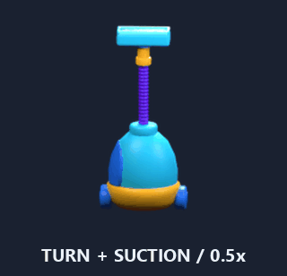

# Booster motion

Hammer and Rocket use the Blender models with PrimeTween transforms. Vacuum uses
an offline Blender animation: **turn in → upright suction → turn out**, plus
PrimeTween scale-in/scale-out. All three prefabs live in
`Assets/ColorBlockJam/Prefabs/Boosters/Effects/`.

| Effect | Presentation | Duration | Contact |
| --- | --- | ---: | --- |
| Hammer | Anticipation, strike and recoil | 0.75 s | Striking face at committed target at normalized 0.74 |
| Rocket | Curved accelerating flight with nose alignment | 0.75 s | Nose at the one removed cell at normalized 0.90 |
| Vacuum | 32 baked turn/hose frames on one SpriteRenderer | 0.75 s | Fixed upper intake throughout full-size suction |

## Vacuum implementation

`VacuumMotion.blend` contains the upright lower canister, corrugated hose,
rigid grip and upper nozzle from the user's references. The body turns 180°
during entry/exit; a localized shape-key bulge travels down the hose during
suction. Timings are authored interpretations of still references, not measured
source-video timings. The original icon-shaped model remains a static art source.

The sheet is **768 × 1536**, 32 cells of 192 × 192 pixels, 75 PPU and a
4 × 8 layout. Android/iOS ASTC 6×6 occupies **512 KiB block payload**. Mipmaps and
Read/Write are off. Compared with the prior 1024² sheet, this costs about 12%
more compressed payload while adding both turns. Runtime remains one quad/two
triangles, with no rig, Animator, skinning, shape-key evaluation or render camera.

The intake is approximately **(-0.000364, 0.981594, 0)** sprite-local units.
`IsIntakeReady` is true only during normalized 0.13–0.86, when the visual is
front-facing and full-size. Matching block visuals should converge on
`IntakePosition` in this interval. Frame GUIDs and local IDs are persisted
through Unity's metadata reserialization before import; every prefab frame
reference is checked after repeat imports.

## Integration and reference boundaries

The CBJ Template supplies the behavior reference: Hammer anticipation/strike,
Magnet appearance/disappearance and same-color Bezier suction. It contains no
Rocket, as clarified by the user. No template scripts, clips or models were
copied. Rocket removes one unit cell according to the domain rules; the
presentation never selects targets or mutates occupancy, inventory or timers.

1. Warm the owning session's pools before Playing.
2. Place Hammer at the committed hit point and call `Play()`.
3. Call Rocket `Play(cellCenter)` from its launch point.
4. Place Vacuum below the board, align its root once to the camera and call
   `Play()`; pull matching block visuals while `IsIntakeReady`.
5. `Suspend()` pauses on pause/background; `Resume()` is explicit.
6. `Stop()` or disabling restores the authored pose/frame and hides the visual.
   Replay replaces the prior tween. No effect autoplays on enable.

Each effect has one bounded tween and finishes within the existing 0.8 s foreground
Finish cap. No Update loop, coroutine, polling, material clone or runtime asset
load was added. Full session integration, selected-block outlines and phone
CPU/GPU/Frame Debugger measurements remain separate implementation work.

## Evidence and rebuild

The latest focused suite covers 12 booster lifecycle/contact/frame tests plus one
board pool lifecycle test. Current job evidence is retained under
`test-results/`; the board report links its separate EditMode checks.
`BoosterMotion.gif`/`BoosterMotion.mp4` show isolated Unity prefab samples.

The previous accepted upright correction used 16 frames and passed 11/11 tests.
Its `vacuum-visual-checks.json`, `vacuum-import.json` and prior XML are historical
evidence for that revision; they do not describe this 32-frame extension.

Colors originate in `Data/Art/GamePalette.asset`. Export via **Color Block Jam >
Art > Export Shared Palette for Blender**, then run
`ArtSource/Boosters/render_vacuum_motion.py` in background Blender.
Use **Art > Import Vacuum Motion Bake** to update sprites and intake while
preserving prefab motion settings. Use **Art > Render Booster Motion Previews**
and run `ArtSource/Boosters/package_motion_previews.py` for evidence media.
Static models can be rebuilt with `build_boosters.py`. All scripts read the
derived shared palette export. Preview scenes are isolated and cleaned up.
