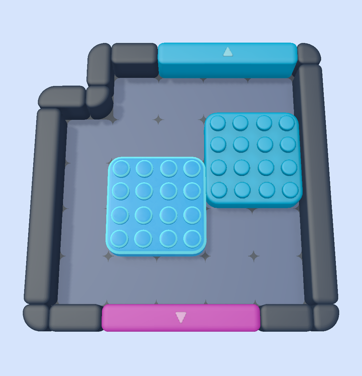

# Wall brick art

The play-area walls and gates use Rollic's supplied models, plus one small project-authored model that finishes
their ends and corners (DEC-139). This page lists what came from Rollic, what the project added and why.

## Supplied by Rollic (unchanged)

| File | Pieces used | Where they appear |
|---|---|---|
| `Art/Models/Supplied/WallAndDoor.fbx` | `Wall`, `Corner_1`, `Door_1x1`, `Door_Arrow` | The middle of every wall run, interior-hole frames, barriers, the middle slots of multi-slot gates, gate arrows, and every wall and gate on the Level Editor canvas |
| `Art/Models/Supplied/GroundGrid.fbx` | `Grid` | One floor tile per cell |
| `Art/Models/Supplied/BlockParts.fbx` | `Center`, `Edge`, `InnerCorner`, `OuterCorner` | Every block |
| `Art/Models/Supplied/Arrows.fbx` | `Arrow_1`, `Arrow_2`, `Arrow_3` | Arrow block markers |

Their prefabs stay in `Prefabs/Board/Pieces/` with their original names and GUIDs. None of these meshes, files or
prefabs were edited.

## Added by the project

One model, `Art/Models/BoardKit/WallBrick.fbx`, with its source `ArtSource/BoardKit/WallBrick.blend`. Its four
pieces are built in Blender from Rollic's own Wall, Corner_1 and Door_1x1 cross-sections, inside the same mesh
bounds, so their size, bevel and calibration match the supplied pieces exactly. Each prefab in
`Prefabs/Board/Pieces/WallBrick/` is the matching supplied prefab with only its mesh replaced.

| Piece | Built from | Why it was added |
|---|---|---|
| `Brick_End` | Wall | In the reference game each straight wall stretch reads as its own rounded brick. The supplied Wall has flat ends, so continuous walls read as one merged frame. `Brick_End` closes both ends of each run. |
| `Corner_End` | Corner_1 | The board's corners are separate rounded units with one large quarter-round outer side, as in the reference. The supplied Corner_1 has flat arm ends, and a lowered gate beside it showed a cut face. |
| `Door_End` | Door_1x1 | Gates are one rounded unit in the reference. The supplied Door_1x1 has square ends. `Door_End` closes both ends of each gate, and the whole gate still sinks and rises together. |
| `Corner_Join` | Corner_1 | Around a one-cell void (a notch or stub), no wall unit should be shorter than one cell. A board corner there merges into its shorter wall. `Corner_Join` is the arc corner with one arm open to join that wall and the other rounded. |

The Level Editor's 2D canvas still draws only the supplied rule pieces. The added pieces appear in the game and in
the Level Editor's 3D scene preview, which use the same `ComposePlayArea` composition.

## Rebuilding

1. Edit the pieces in `ArtSource/BoardKit/WallBrick.blend`. The generator scripts are recorded with the DEC-139
   task.
2. Export: `blender --background --factory-startup ArtSource/BoardKit/WallBrick.blend --python ArtSource/BoardKit/export_wall_brick.py`.
   The script writes only the four pieces with the supplied kit's FBX unit scale and checks their bounds.
3. In Unity, run `Color Block Jam > Art > Build Wall Brick`. It checks that each mesh matches its supplied piece's
   bounds, rebuilds the four prefabs from the supplied prefabs and binds them in `EnvironmentDatabase`.

See [Environment Layout](../../Environment-Layout.md) for the composition rules.
